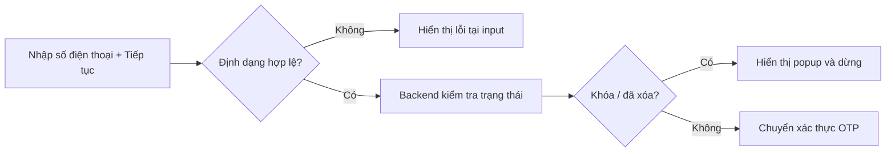
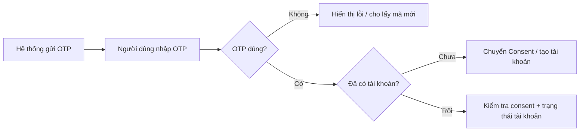
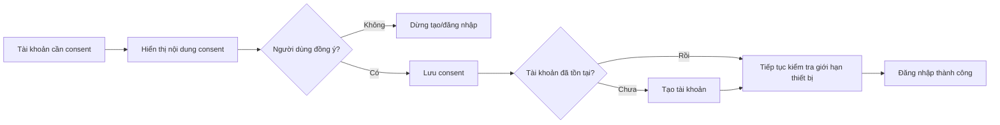
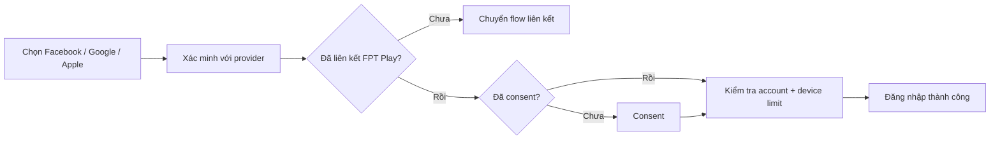
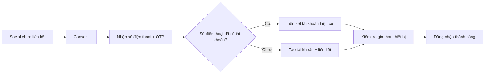
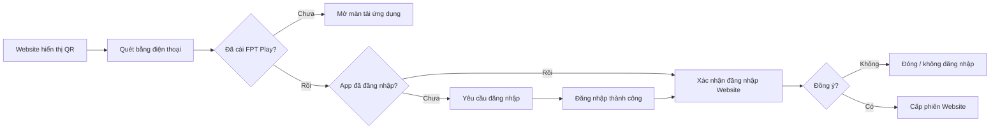
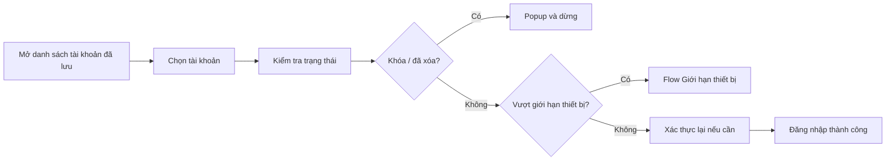
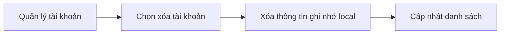

# Login — Functional Requirements

> Project: FPTPlay
> Epic: Account
> Feature: Login
> Audience: Product, BA, Designer, FE, BE, QA
> Status: Review draft — còn nội dung cần xác nhận trước implementation handoff
> Source: `login.pdf` V1.0 ngày 09/10/2026
> Writing style: Caveman Vietnam — ít chữ, dễ đọc, đúng ý, không low-level
> Last updated: 2026-10-16

---

## 1. Description

Tính năng Login cho phép người dùng đăng nhập hoặc tạo tài khoản FPT Play bằng số điện thoại, tài khoản mạng xã hội, QR Code trên Website hoặc tài khoản đã lưu trên thiết bị.

- Người dùng chính: Người dùng chưa đăng nhập.
- Nền tảng: iOS, Android và Website.
- Bề mặt chính: Chọn phương thức đăng nhập, nhập số điện thoại, OTP, consent, QR Code và tài khoản đã lưu.
- Mục tiêu: Đưa người dùng vào đúng tài khoản và kiểm tra trạng thái tài khoản/giới hạn thiết bị trước khi tạo phiên đăng nhập.

---

## 2. Document History

| Phiên bản | Ngày | Người cập nhật | Nội dung | Người phê duyệt |
|---|---|---|---|---|
| V1.0 | 2026-10-09 | Lê Thị Thu Thảo (BA) | Phiên bản nguồn đầu tiên trong `login.pdf`. | Đặng Anh Vũ |
| V1.1-draft | 2026-10-16 | Dylan | Chuẩn hóa source thành functional requirements; gom phần trùng và đánh dấu phần chưa đủ dữ liệu. | Cần review |

---

## 3. Overview

### 3.1 Goal

- Đăng nhập/đăng ký bằng số điện thoại và OTP.
- Đăng nhập bằng Facebook, Google hoặc Apple.
- Đăng nhập Website bằng QR Code và xác nhận trên điện thoại.
- Đăng nhập lại bằng tài khoản đã lưu trên thiết bị.
- Tách thông tin tài khoản ghi nhớ khỏi phiên xác thực.

### 3.2 Platform scope

| Nền tảng | Phạm vi | Ghi chú |
|---|---|---|
| iOS | Trong phạm vi | Số điện thoại/OTP, Facebook, Google, Apple, QR mobile confirm và tài khoản đã lưu. |
| Android | Trong phạm vi | Số điện thoại/OTP, Facebook, Google, QR mobile confirm và tài khoản đã lưu. |
| Website | Trong phạm vi | Số điện thoại/OTP, social theo cấu hình và QR Login. |
| SmartTV / Box | Ngoài phạm vi | Source không mô tả. |

### 3.3 Platform behavior

- Apple chỉ hiển thị trên iOS theo source.
- QR Login chỉ bắt đầu trên Website; điện thoại dùng để quét và xác nhận.
- Social provider nào không khả dụng thì ẩn provider đó.
- Nếu không lấy được toàn bộ danh sách social, ẩn nhóm social và chữ `hoặc`.
- Giao diện cuối theo Figma; PDF chỉ là nguồn flow và interaction. Source chưa có link Figma.

### 3.4 User scope

| Nhóm người dùng | Phạm vi | Ghi chú |
|---|---|---|
| Người dùng chưa có tài khoản | Trong phạm vi | Đăng ký bằng số điện thoại/OTP hoặc social chưa liên kết. |
| Người dùng đã có tài khoản | Trong phạm vi | Đăng nhập bằng số điện thoại, social, QR hoặc tài khoản đã lưu. |
| Người dùng đã đăng nhập trên điện thoại | Trong phạm vi QR | Có thể xác nhận đăng nhập Website. |
| Tài khoản bị khóa/xóa/nợ cước | Trong phạm vi xử lý trạng thái | Không tạo phiên khi chưa thỏa rule tương ứng. |

### 3.5 In scope

- Số điện thoại + OTP.
- Consent cho tài khoản mới/tài khoản chưa consent.
- Facebook, Google, Apple.
- Liên kết social với tài khoản FPT Play.
- QR Login trên Website.
- Tài khoản đã lưu trên thiết bị.
- Kiểm tra khóa/xóa/nợ cước/giới hạn thiết bị.
- Quy tắc bảo mật cho phiên và thông tin ghi nhớ.

### 3.6 Out of scope

- UI/logic chi tiết của flow **Giới hạn thiết bị**.
- Thu cước và xử lý công nợ.
- Quản trị khóa/xóa tài khoản.
- API endpoint, payload, envelope, error code và token contract chi tiết.
- OTP timeout, resend cooldown, rate limit và số lần nhập sai.
- QR expiry, refresh/replay protection và polling contract.
- Login cho SmartTV/Box.

### 3.7 Definitions

| Thuật ngữ | Ý nghĩa |
|---|---|
| Consent | Người dùng đồng ý nội dung cần thiết để tạo/tiếp tục dùng tài khoản. Nội dung, version và cách lưu cần xác nhận. |
| Social account | Facebook, Google hoặc Apple dùng để xác minh và liên kết với tài khoản FPT Play. |
| Tài khoản đã lưu | Thông tin nhận diện được ghi nhớ trên thiết bị; không phải phiên đăng nhập còn hiệu lực. |
| Phiên xác thực | Token/cookie/session chứng minh người dùng đang đăng nhập. |
| Giới hạn thiết bị | Rule giới hạn số thiết bị của tài khoản; flow chi tiết nằm ngoài tài liệu. |
| Whitelist thiết bị | Khái niệm trong nhánh nợ cước; định nghĩa và ma trận xử lý cần xác nhận. |

---

## 4. Entry Points

| # | Điểm vào | Thao tác | Bề mặt | Kết quả |
|---:|---|---|---|---|
| 1 | Popup yêu cầu đăng nhập | Chọn `Đăng nhập` | Login | Mở màn hình phương thức hoặc tài khoản đã lưu. |
| 2 | Màn hình Cá nhân | Chọn `Đăng nhập` | Login | Bắt đầu flow Login. |
| 3 | Màn hình Đăng ký | Chọn `Đăng nhập` | Login | Chuyển sang Login. |
| 4 | Màn hình Login | Chọn `Đăng ký` | Nhập số điện thoại | Bắt đầu tạo tài khoản. |
| 5 | Danh sách tài khoản đã lưu | Chọn `Đăng nhập tài khoản khác` | Chọn phương thức | Bắt đầu flow mới. |
| 6 | Website Login | Chọn QR Login | QR Code | Hiển thị QR để quét. |
| 7 | Danh sách tài khoản đã lưu | Chọn một tài khoản | Kiểm tra tài khoản | Đăng nhập lại nếu hợp lệ. |

---

## 5. Use Case Summary

| ID | Use Case | Người thực hiện | Kích hoạt | Kết quả |
|---|---|---|---|---|
| LG-UC-001 | Nhập số điện thoại và kiểm tra tài khoản | Người dùng | Nhập số điện thoại + `Tiếp tục` | Số điện thoại hợp lệ được chuyển tới OTP. |
| LG-UC-002 | Xác thực OTP | Người dùng | Nhập OTP + `Xác thực` | Hệ thống xác minh số điện thoại. |
| LG-UC-003 | Consent và tạo/hoàn thiện tài khoản | Người dùng | Tài khoản cần consent | Consent được lưu; tài khoản được tạo hoặc tiếp tục Login. |
| LG-UC-004 | Đăng nhập bằng social đã liên kết | Người dùng | Chọn provider | Đăng nhập tài khoản đã liên kết. |
| LG-UC-005 | Liên kết social chưa liên kết | Người dùng | Social chưa có liên kết | Liên kết với tài khoản hiện có hoặc tài khoản mới. |
| LG-UC-006 | Đăng nhập Website bằng QR Code | Người dùng | Quét QR Website | Website được đăng nhập sau xác nhận trên điện thoại. |
| LG-UC-007 | Đăng nhập bằng tài khoản đã lưu | Người dùng | Chọn tài khoản đã lưu | Đăng nhập lại sau khi kiểm tra trạng thái. |
| LG-UC-008 | Xóa tài khoản đã lưu | Người dùng | Chọn quản lý/xóa | Xóa thông tin ghi nhớ trên thiết bị. |

---

## 6. Business Rules

### 6.1 Quy tắc chung

1. Chỉ tạo phiên sau khi xác thực thành công, tài khoản được phép sử dụng và không vướng giới hạn thiết bị.
2. Tài khoản bị khóa hoặc đã xóa phải dừng flow và hiển thị thông báo tương ứng.
3. Tài khoản cần consent phải hoàn tất consent trước khi tạo tài khoản/đăng nhập.
4. Vượt giới hạn thiết bị thì chuyển flow **Giới hạn thiết bị**.
5. Đăng nhập thành công phải quay lại màn hình/tính năng đã tạo yêu cầu Login nếu còn hợp lệ. Source mới ghi chung là `màn hình tính năng`.
6. Đóng Login quay lại màn hình trước và không tạo phiên.

### 6.2 Số điện thoại

1. Chỉ nhập ký tự số, tối đa 10 ký tự.
2. Source yêu cầu đủ 10 số; rule đầu số/quốc gia chưa có.
3. Quay lại màn hình trong cùng flow không xóa số đã nhập.
4. Bỏ trống: `Nhập số điện thoại để tiếp tục`.
5. Không hợp lệ/chưa đủ 10 số: `Số điện thoại không hợp lệ`.
6. Client kiểm tra định dạng trước; Backend kiểm tra trạng thái tài khoản sau.

### 6.3 Điều khoản và consent

1. Checkbox `Điều kiện và Điều khoản sử dụng FPT Play` mặc định được chọn.
2. Bỏ chọn checkbox làm disable `Tiếp tục`.
3. Link điều khoản: `https://fptplay.vn/dieu-khoan-su-dung`.
4. Checkbox điều khoản và consent tạo tài khoản có thể là hai trạng thái khác nhau; **Cần xác nhận**.
5. Tài khoản mới hoặc tài khoản hiện có chưa consent phải hoàn tất consent.

### 6.4 OTP

1. OTP được gửi sau khi số điện thoại hợp lệ và trạng thái tài khoản cho phép tiếp tục.
2. OTP đúng: tiếp tục kiểm tra/tạo tài khoản.
3. OTP sai: hiển thị lỗi; cho nhập lại hoặc lấy OTP mới.
4. Không lưu OTP dạng văn bản thuần.
5. Độ dài, hiệu lực, resend cooldown, giới hạn nhập/gửi lại: **Cần xác nhận**.

### 6.5 Trạng thái tài khoản

1. Bị khóa: dừng flow; copy/CTA **Cần xác nhận**.
2. Đã xóa: dừng flow; copy/CTA **Cần xác nhận**.
3. Nợ cước:
   - Source nhắc trạng thái Lite và số thiết bị whitelist `< 2`, nhưng câu nguồn chưa đủ rõ để triển khai.
   - Khi `full whitelist`, source yêu cầu thông báo nợ cước; chọn `Đã hiểu` quay lại màn hình nhập số điện thoại.
   - Ma trận nợ cước/whitelist/đá thiết bị: **Cần xác nhận**.
4. Tài khoản hợp lệ tiếp tục consent và giới hạn thiết bị.

### 6.6 Social login

1. Facebook, Google, Apple; Apple chỉ iOS.
2. Người dùng xác nhận với social provider.
3. Social đã liên kết: kiểm tra consent, trạng thái tài khoản và giới hạn thiết bị rồi đăng nhập.
4. Social chưa liên kết: consent → số điện thoại → OTP → liên kết tài khoản.
5. Số điện thoại đã có tài khoản: liên kết social với tài khoản hiện có.
6. Số điện thoại chưa có tài khoản: tạo tài khoản và liên kết social.
7. Provider không khả dụng thì ẩn provider đó.
8. Không lấy được danh sách social thì ẩn toàn bộ nhóm và chữ `hoặc`.
9. Hủy social, token lỗi, liên kết trùng, Apple Hide My Email: **Cần xác nhận**.

### 6.7 QR Login

1. QR Login chỉ bắt đầu trên Website.
2. Chưa cài FPT Play: chuyển màn tải ứng dụng và kết thúc flow hiện tại.
3. App chưa đăng nhập: hiện yêu cầu Login; `Đăng nhập` mở flow Login, `Đóng` kết thúc.
4. App đã đăng nhập/vừa đăng nhập xong: hiện xác nhận Login Website.
5. Đồng ý: cấp quyền phiên Website. Từ chối/đóng: không đăng nhập Website.
6. QR expiry, refresh, one-time use, replay protection, polling: **Cần xác nhận**.

### 6.8 Tài khoản đã lưu

1. Có tài khoản đã lưu thì màn Login hiển thị danh sách tài khoản.
2. Người dùng có thể chọn tài khoản, quản lý/xóa hoặc đăng nhập tài khoản khác.
3. Chọn tài khoản vẫn phải kiểm tra khóa/xóa/giới hạn thiết bị và xác thực lại khi cần.
4. Tài khoản ghi nhớ được giữ tới khi người dùng xóa, gỡ app/xóa data hoặc hệ thống xóa theo chính sách bảo mật.
5. Đăng xuất thu hồi phiên nhưng không tự xóa tài khoản ghi nhớ.
6. Lưu tài khoản không đồng nghĩa với duy trì đăng nhập.
7. Xóa tài khoản đã lưu chỉ xóa local; không xóa Backend và không ảnh hưởng thiết bị khác.
8. Vị trí opt-in lưu tài khoản và dữ liệu được phép lưu: **Cần xác nhận**.

### 6.9 Bảo mật

1. Không lưu OTP, mã quản lý hoặc credential nhạy cảm dạng văn bản thuần.
2. Dữ liệu tài khoản ghi nhớ phải tách khỏi phiên xác thực.
3. Đăng xuất phải thu hồi/xóa phiên theo chính sách bảo mật.
4. Client phải kiểm tra lại trạng thái tài khoản; không tin trạng thái local cũ.
5. Token/session lifetime, refresh/revocation, secure storage và audit log: Security/BE xác nhận.

---

## 7. Functional Requirements

### LG-US-001 — Đăng nhập/đăng ký bằng số điện thoại

#### LG-UC-001 — Nhập số điện thoại và kiểm tra tài khoản



| Trường | Nội dung |
|---|---|
| Người thực hiện | Người dùng, hệ thống |
| Kích hoạt | Nhập số điện thoại và chọn `Tiếp tục`. |
| Điều kiện trước | Chưa đăng nhập; checkbox điều khoản đang chọn. |
| Luồng chính | 1. Kiểm tra input.<br>2. Gửi số điện thoại để kiểm tra trạng thái.<br>3. Nếu hợp lệ, chuyển OTP. |
| Kết quả | Số điện thoại đủ điều kiện bước OTP. |
| Trường hợp khác | Trống/sai định dạng → lỗi tại input. |
| Xử lý lỗi | Khóa/xóa/nợ cước hoặc lỗi hệ thống → không gửi OTP, không tạo phiên. |

#### LG-UC-002 — Xác thực OTP



| Trường | Nội dung |
|---|---|
| Người thực hiện | Người dùng, hệ thống |
| Kích hoạt | Số điện thoại đã được chấp nhận và OTP được gửi. |
| Điều kiện trước | Có yêu cầu OTP hợp lệ. |
| Luồng chính | 1. Nhập OTP.<br>2. Chọn `Xác thực`.<br>3. OTP đúng → kiểm tra tài khoản. |
| Kết quả | Số điện thoại được xác minh. |
| Trường hợp khác | OTP sai → nhập lại hoặc lấy mã mới. |
| Xử lý lỗi | Gửi/xác minh lỗi → giữ màn hình an toàn; copy và retry rule cần xác nhận. |

#### LG-UC-003 — Consent và tạo/hoàn thiện tài khoản



| Trường | Nội dung |
|---|---|
| Người thực hiện | Người dùng, hệ thống |
| Kích hoạt | Số điện thoại chưa có tài khoản hoặc tài khoản chưa consent. |
| Điều kiện trước | Đã xác minh OTP/social theo flow tương ứng. |
| Luồng chính | 1. Hiển thị consent.<br>2. Người dùng đồng ý.<br>3. Lưu consent.<br>4. Tạo tài khoản nếu cần.<br>5. Kiểm tra giới hạn thiết bị và đăng nhập. |
| Kết quả | Consent được lưu; tài khoản được tạo/hoàn thiện. |
| Trường hợp khác | Từ chối/đóng → dừng flow, không tạo tài khoản. |
| Xử lý lỗi | Lưu consent/tạo tài khoản lỗi → không tạo trạng thái một phần; cho thử lại. |

### LG-US-002 — Đăng nhập bằng social

#### LG-UC-004 — Đăng nhập bằng social đã liên kết



| Trường | Nội dung |
|---|---|
| Người thực hiện | Người dùng, hệ thống, social provider |
| Kích hoạt | Chọn một social provider. |
| Điều kiện trước | Provider khả dụng; người dùng chưa đăng nhập. |
| Luồng chính | Xác minh provider → tìm liên kết → consent nếu cần → kiểm tra tài khoản/giới hạn thiết bị → đăng nhập. |
| Kết quả | Đăng nhập đúng tài khoản đã liên kết. |
| Trường hợp khác | Chưa liên kết → LG-UC-005. |
| Xử lý lỗi | Hủy/xác minh lỗi → không tạo phiên; cho thử lại. |

#### LG-UC-005 — Liên kết social chưa liên kết



| Trường | Nội dung |
|---|---|
| Người thực hiện | Người dùng, hệ thống, social provider |
| Kích hoạt | Social xác minh thành công nhưng chưa liên kết. |
| Điều kiện trước | Social identity hợp lệ. |
| Luồng chính | Consent → số điện thoại → OTP → liên kết tài khoản hiện có hoặc tạo mới → device limit → đăng nhập. |
| Kết quả | Social được liên kết với đúng tài khoản FPT Play. |
| Trường hợp khác | Tài khoản số điện thoại chưa consent → LG-UC-003. |
| Xử lý lỗi | OTP/account/link lỗi → không để liên kết một phần; error contract cần BE chốt. |

### LG-US-003 — Đăng nhập Website bằng QR

#### LG-UC-006 — Đăng nhập Website bằng QR Code



| Trường | Nội dung |
|---|---|
| Người thực hiện | Người dùng, Website, ứng dụng FPT Play |
| Kích hoạt | Chọn QR Login và quét mã. |
| Điều kiện trước | Website có QR hợp lệ; chi tiết hiệu lực cần xác nhận. |
| Luồng chính | Quét QR → kiểm tra app/login → xác nhận → cấp phiên Website. |
| Kết quả | Website đăng nhập đúng tài khoản đã xác nhận. |
| Trường hợp khác | Chưa cài app → tải app. Chưa Login → Login rồi quay lại xác nhận. Từ chối → không đăng nhập. |
| Xử lý lỗi | QR hết hạn/đã dùng/lỗi kết nối → tạo/quét mã mới; copy cần xác nhận. |

### LG-US-004 — Đăng nhập lại bằng tài khoản đã lưu

#### LG-UC-007 — Đăng nhập bằng tài khoản đã lưu



| Trường | Nội dung |
|---|---|
| Người thực hiện | Người dùng, hệ thống |
| Kích hoạt | Chọn tài khoản đã lưu. |
| Điều kiện trước | Thiết bị có ít nhất một tài khoản ghi nhớ. |
| Luồng chính | Chọn tài khoản → kiểm tra trạng thái/device limit → xác thực lại nếu cần → đăng nhập. |
| Kết quả | Đăng nhập tài khoản đã chọn. |
| Trường hợp khác | Chọn `Đăng nhập tài khoản khác` → màn phương thức. |
| Xử lý lỗi | Khóa/xóa/xác thực lại lỗi → không tạo phiên. |

#### LG-UC-008 — Xóa tài khoản đã lưu



| Trường | Nội dung |
|---|---|
| Người thực hiện | Người dùng, hệ thống |
| Kích hoạt | Chọn xóa tài khoản đã lưu. |
| Điều kiện trước | Tài khoản có trong danh sách trên thiết bị. |
| Luồng chính | Quản lý → chọn tài khoản → xóa local record → cập nhật danh sách. |
| Kết quả | Tài khoản không còn hiển thị trên thiết bị hiện tại. |
| Trường hợp khác | Danh sách rỗng → lần sau hiển thị màn phương thức Login. |
| Xử lý lỗi | Xóa local lỗi → giữ item và cho thử lại; không xóa Backend. |

---

## 8. Screen Element Specification

### 8.1 Figma / Design Reference

| Hạng mục | Link/Ghi chú |
|---|---|
| Final Figma | Chưa có link trong source. |
| Jira | Chưa có link trong source. |
| Source PDF | `login.pdf` V1.0; hình ảnh chỉ minh họa flow/interaction. |
| Mockup | Không tạo trong task này. |

### 8.2 Information Architecture

```text
Login
├── Chọn phương thức
│   ├── Số điện thoại + Điều khoản + Tiếp tục
│   ├── Facebook / Google / Apple
│   └── Đăng ký / Đóng
├── OTP
├── Consent
├── Trạng thái tài khoản
├── Tài khoản đã lưu
│   ├── Chọn / Xóa
│   └── Đăng nhập tài khoản khác
└── QR Login
    ├── QR Website
    ├── Yêu cầu Login trên Mobile
    └── Xác nhận Website
```

### 8.4 Surface Details by Surface

#### SURF-001 — Chọn phương thức đăng nhập

| Trường | Nội dung |
|---|---|
| Vị trí | Login trên iOS/Android/Web khi không có tài khoản đã lưu. |
| UC | LG-UC-001, LG-UC-004, LG-UC-005. |
| Khi hiển thị | Người dùng chưa đăng nhập và bắt đầu Login. |

```text
Đăng nhập tài khoản                         [X]
┌──────────────────────────────────────────────┐
│ [Nhập số điện thoại____________________]     │
│ ☑ Điều kiện và Điều khoản sử dụng FPT Play  │
│ [                Tiếp tục                 ]  │
│ ------------------ hoặc -------------------  │
│ [Facebook] [Google] [Apple — iOS]            │
│ Chưa có tài khoản? [Đăng ký]                 │
└──────────────────────────────────────────────┘
```

| # | Thành phần | Trạng thái/Nội dung | Quy tắc |
|---:|---|---|---|
| 1 | Đóng | enabled | Về màn hình trước. |
| 2 | Title | `Đăng nhập tài khoản` | Hard-code client theo source. |
| 3 | Số điện thoại | `Nhập số điện thoại`, error | Chỉ số; tối đa 10; không clear khi Back. |
| 4 | Điều khoản | checked/unchecked | Mặc định checked; unchecked disable `Tiếp tục`. |
| 5 | Tiếp tục | enabled/disabled/loading | Validate local rồi kiểm tra hệ thống. |
| 6 | Social | visible/hidden | Provider lỗi thì ẩn theo rule. |
| 7 | Đăng ký | enabled | Chuyển flow đăng ký. |

#### SURF-002 — Xác thực OTP

| Trường | Nội dung |
|---|---|
| Vị trí | Sau khi số điện thoại được chấp nhận. |
| UC | LG-UC-002, LG-UC-005. |

```text
Xác thực OTP                                [X]
┌──────────────────────────────────────────────┐
│ Nhập mã gửi đến [Số điện thoại]             │
│ [ _ ] [ _ ] [ _ ] [ _ ] [...]               │
│ [               Xác thực                  ]  │
│ Chưa nhận được mã? [Gửi lại]                 │
│ [Thông báo lỗi]                              │
└──────────────────────────────────────────────┘
```

| # | Thành phần | Trạng thái/Nội dung | Quy tắc |
|---:|---|---|---|
| 1 | OTP input | empty/filling/error | Độ dài cần xác nhận; không lưu plain text. |
| 2 | Xác thực | enabled/disabled/loading | Chặn submit lặp. |
| 3 | Gửi lại | available/waiting | Timer/limit cần xác nhận. |
| 4 | Error | visible/hidden | Copy cần xác nhận. |

#### SURF-003 — Consent

| Trường | Nội dung |
|---|---|
| Vị trí | Tạo tài khoản hoặc tài khoản chưa consent. |
| UC | LG-UC-003, LG-UC-004, LG-UC-005. |

```text
Consent / Xác nhận
┌──────────────────────────────────────────────┐
│ [Nội dung pháp lý — Cần xác nhận]            │
│ [              Đồng ý / Tiếp tục          ]  │
│ [                   Đóng                   ]  │
└──────────────────────────────────────────────┘
```

| # | Thành phần | Trạng thái/Nội dung | Quy tắc |
|---:|---|---|---|
| 1 | Nội dung consent | version hiện hành | Legal/Product cung cấp. |
| 2 | Đồng ý | loading/enabled | Chỉ tiếp tục sau khi lưu thành công. |
| 3 | Đóng/từ chối | enabled | Không tạo/không Login. |

#### SURF-004 — Tài khoản đã lưu

| Trường | Nội dung |
|---|---|
| Vị trí | Login khi thiết bị có tài khoản ghi nhớ. |
| UC | LG-UC-007, LG-UC-008. |
| Lưu ý | Design 1.2 trong source bị lặp; layout danh sách cần Figma xác nhận. |

```text
Đăng nhập tài khoản                         [X]
┌──────────────────────────────────────────────┐
│ Tài khoản đã lưu                            │
│ [Avatar]  09******12                 [>]     │
│ [Avatar]  08******34                 [>]     │
│ [Quản lý tài khoản]                          │
│ [Đăng nhập tài khoản khác]                   │
└──────────────────────────────────────────────┘
```

| # | Thành phần | Trạng thái/Nội dung | Quy tắc |
|---:|---|---|---|
| 1 | Danh sách | loading/populated/empty/error | Không hiển thị credential nhạy cảm. |
| 2 | Item tài khoản | enabled/loading/unavailable | Chọn để kiểm tra và Login. |
| 3 | Quản lý | `Quản lý tài khoản` | Cho xóa local record. |
| 4 | Tài khoản khác | `Đăng nhập tài khoản khác` | Mở SURF-001. |

#### SURF-005 — QR Login

| Trường | Nội dung |
|---|---|
| Vị trí | Website Login + Mobile confirm. |
| UC | LG-UC-006. |

```text
Website                              Mobile App
┌──────────────────────┐            ┌──────────────────────┐
│ Đăng nhập bằng QR    │  scan →    │ Đăng nhập Website?   │
│      [ QR CODE ]     │            │ [Đồng ý] [Đóng]      │
│ Quét bằng FPT Play   │            └──────────────────────┘
└──────────────────────┘
```

| # | Thành phần | Trạng thái/Nội dung | Quy tắc |
|---:|---|---|---|
| 1 | QR | loading/active/expired/used/error | One-time/expiry cần xác nhận. |
| 2 | Hướng dẫn | Copy cần xác nhận | Nêu dùng điện thoại/FPT Play. |
| 3 | Tải app | Link store | Hiện nếu chưa cài app. |
| 4 | Yêu cầu Login | `Đăng nhập`, `Đóng` | Login xong quay lại confirm. |
| 5 | Confirm Website | CTA cần xác nhận | Không tự cấp quyền. |

#### SURF-006 — Trạng thái tài khoản

| Trạng thái | Nội dung | Hành vi |
|---|---|---|
| Bị khóa | Cần xác nhận | Dừng Login. |
| Đã xóa | Cần xác nhận | Dừng Login. |
| Nợ cước | Cần xác nhận; có `Đã hiểu` theo source | Quay lại nhập số điện thoại ở nhánh source mô tả. |
| Giới hạn thiết bị | Theo flow hiện có | Chuyển flow. |

---

## 9. Error Handling & User-Facing Messages

| Tình huống | Copy | Hành vi |
|---|---|---|
| Số điện thoại trống | `Nhập số điện thoại để tiếp tục` | Giữ màn hình, focus input. |
| Số điện thoại không hợp lệ | `Số điện thoại không hợp lệ` | Không sang OTP. |
| Bỏ chọn điều khoản | Không cần lỗi | Disable `Tiếp tục`. |
| OTP sai/không gửi được | Cần xác nhận | Nhập lại/gửi lại; không tạo phiên. |
| Tài khoản khóa/xóa | Cần xác nhận | Dừng Login. |
| Nợ cước | Cần xác nhận | Theo ma trận sau khi chốt. |
| Vượt device limit | Theo flow Giới hạn thiết bị | Chưa tạo phiên. |
| Social hủy/lỗi | Cần xác nhận | Không tạo phiên/liên kết. |
| Không lấy được social list | Không hiển thị social | Vẫn Login bằng số điện thoại. |
| QR hết hạn/đã dùng/lỗi | Cần xác nhận | Tạo/quét QR mới. |
| Từ chối QR | Không cần lỗi | Website chưa Login. |
| Xóa local account lỗi | Cần xác nhận | Giữ item; không ảnh hưởng Backend. |
| Mất mạng/lỗi hệ thống | Cần xác nhận | Không tạo trạng thái một phần; cho thử lại. |

---

## 10. Open Decisions & Handoff Checklist

### 10.1 Cần xác nhận

1. **OTP và QR**
   - OTP length/expiry/resend/rate limit/failed-attempt rule.
   - QR expiry, refresh, polling, one-time use và replay protection.
2. **Trạng thái tài khoản**
   - Ma trận nợ cước, Lite/full whitelist, `< 2` thiết bị và `đá thiết bị`.
   - Source of truth/return contract của flow Giới hạn thiết bị.
3. **Consent và tài khoản đã lưu**
   - Checkbox điều khoản có cùng consent hay không.
   - Nội dung/version consent.
   - Vị trí opt-in lưu tài khoản, dữ liệu được lưu và phạm vi Website.
4. **Design/copy/API**
   - Jira, Figma, exact copy popup/error.
   - API/session/error-code contract.

### 10.2 Handoff checklist

- [x] Scope iOS, Android, Website.
- [x] Có 8 UC cho phone, OTP, consent, social, QR và tài khoản đã lưu.
- [x] Tách tài khoản ghi nhớ khỏi phiên xác thực.
- [x] Không lưu OTP/credential nhạy cảm plain text.
- [x] Apple chỉ iOS; QR bắt đầu trên Website.
- [x] Provider failure có fallback số điện thoại.
- [x] Khóa/xóa/device limit không tạo phiên.
- [ ] Product/BE chốt OTP và QR contract.
- [ ] Product/BE chốt nợ cước/whitelist/device limit.
- [ ] Product/Legal/BE chốt consent.
- [ ] Product/Design chốt saved-account opt-in/layout.
- [ ] Designer cung cấp Figma và copy còn thiếu.
- [ ] BE cung cấp API/error/session contract.
- [ ] QA lập matrix platform × method × account state × consent × device limit.
- [ ] Approved By được cập nhật trước final handoff.

---

## 11. References

| Nguồn | Ghi chú |
|---|---|
| `login.pdf` | V1.0, 09/10/2026; BA Lê Thị Thu Thảo; người phê duyệt Đặng Anh Vũ. |
| Source SHA-256 | `d30e3dbadd05e2fa719072ae17acd66517eb5d01e123a4edf396c7631b52d5dd` |
| Điều khoản | <https://fptplay.vn/dieu-khoan-su-dung> |
| Jira / Figma | Chưa có link trong source. |

### Source interpretation notes

- PDF có đoạn lặp và lỗi chính tả; tài liệu này chuẩn hóa câu chữ nhưng không đổi ý nghiệp vụ.
- Design `1.2 DS tài khoản đã đăng nhập` lặp thành phần màn phương thức và chưa mô tả rõ account item; SURF-004 chờ Figma xác nhận.
- Không suy diễn endpoint, token, OTP timing, QR expiry hoặc error code khi source chưa cung cấp.
