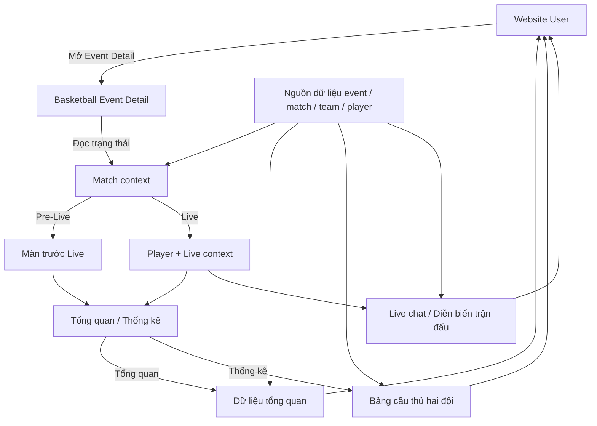

# Basketball Event Detail Web — Template handoff

- **Dự án / Nền tảng:** FPT Play / Website
- **Mục tiêu / Phạm vi:** Đặc tả UI và hành vi màn Detail Event Bóng rổ có match: trước Live, đã Live — tab Tổng quan, đã Live — tab Thống kê.
- **Phiên bản / Ngày cập nhật / Người phụ trách:** v1.0 / 2026-10-12 / Dylan

> Khung dùng để soạn tài liệu handoff cho Dev và Stakeholder. Nhân bản dòng bảng hoặc khối nội dung khi cần; mục không áp dụng ghi N/A.

**Quy ước sử dụng**

- Mục 1 là nội dung cố định; người dùng tự điền link. Skill phải giữ nguyên toàn bộ mục này, bao gồm các link đã điền.
- Skill chỉ tạo/cập nhật nội dung trong phạm vi được giao ở mục 2–5. Mỗi mục có thể gắn nhiều skill; tên skill đã được chốt bên dưới, link sẽ bổ sung khi xây dựng skill.
- Flow / Structure / Behavior / State / Interaction rules là khung kiểm tra nội dung. Chỉ mô tả các ý áp dụng; ý không áp dụng có thể bỏ hoặc ghi N/A.
- Trạng thái chung mô tả một lần ở mục 4. Mục 5 dẫn chiếu tình huống tương ứng và chỉ bổ sung ngoại lệ của thành phần.
- Thông tin chưa chốt ghi **Cần xác nhận: [Nội dung]** ngay trong Mô tả hoặc ghi chú của mục liên quan; không tự suy diễn thành yêu cầu đã thống nhất.

**Skills áp dụng toàn tài liệu**

| Skill | Vai trò | Link |
| --- | --- | --- |
| `ba-source-analysis` | Đọc nguồn, xác định phạm vi, phần kế thừa và thông tin cần xác nhận. | |
| `ba-spec-review` | Rà soát thiếu sót, mâu thuẫn, trùng lặp và tính nhất quán giữa các mục. | |
| `ba-template-assembly` | Đưa nội dung vào đúng bố cục template, bảo toàn mục 1 và chỉ cập nhật phần được giao. | |

> Các tên skill là danh mục đã thống nhất để xây dựng; chưa phải skill đã triển khai.

## 1. Disclaimer & Tài liệu tham chiếu

<!-- Nội dung cố định: giữ nguyên khi tái sử dụng hoặc chạy skill. Người dùng tự điền các link bên dưới. -->

Để đảm bảo tính đồng nhất và tránh trùng lặp, tài liệu này kế thừa các mô tả tính năng từ các nguồn liên quan sau:

- **Thiết kế:**
- **Jira task:**
- **Tài liệu liên quan:**
- **Data Licensing:**

**Lưu ý:** Hình ảnh minh họa trong tài liệu này tập trung thể hiện luồng nghiệp vụ (user flow) và tương tác (interaction). Để cập nhật giao diện (UI) mới nhất, vui lòng tham khảo trực tiếp tại link thiết kế. Quyền sử dụng dữ liệu và nội dung được tham chiếu tại Data Licensing.

## 2. Model overview

**Skills:** `ba-model-overview` — Link: [Bổ sung sau]

- **Vai trò các thành phần:**
  - `Basketball Event Detail`: bố cục chính, nhận context event và match.
  - `Match context`: xác định trạng thái trước Live hoặc đang Live.
  - `Player + Live context`: hiển thị video, score, trạng thái trận; giữ nguyên khi user đổi tab.
  - `Tổng quan`: hiển thị lịch sử, phong độ, so sánh đội, cầu thủ nổi bật và thống kê trận.
  - `Thống kê`: hiển thị bảng thống kê cầu thủ riêng cho từng đội.
  - `Live chat / Diễn biến trận đấu`: vùng phụ khi match Live và nguồn dữ liệu khả dụng.
  - `Nguồn dữ liệu`: cung cấp dữ liệu thật theo event, match, team và player; không dùng cứng dữ liệu minh họa trong PDF.
- **Luồng chính:** User mở Event Detail → hệ thống xác định trạng thái match → hiển thị layout trước Live hoặc Live → mặc định mở tab Tổng quan → user có thể chuyển Tổng quan/Thống kê mà không reset player/live context.
- **Phạm vi thiết kế:**
  - Hình 2: event có match — trước Live.
  - Hình 3: event có match — đã Live, tab Tổng quan.
  - Hình 4: event có match — đã Live, tab Thống kê.
  - Hình 1 chỉ dùng tham khảo; không thuộc phạm vi đặc tả.

## 3. Layout Overview

**Skills:** `ba-layout-overview` — Link: [Bổ sung sau]

| Screen | Section | Feature / Thành phần | Vị trí / Thứ tự | Mô tả tổng quan |
| --- | --- | --- | --- | --- |
| Basketball Event Detail — Pre-Live | Global Header | Navigation / Mua gói / Tài khoản | Đầu trang | Kế thừa global header Website; không thay đổi trong feature này. |
| Basketball Event Detail — Pre-Live | Main Event Area | Player hoặc event visual | Khối đầu nội dung, cột chính | Vùng xem nội dung chính trước giờ Live; trạng thái playback theo player hiện hành. |
| Basketball Event Detail — Pre-Live | Match Context | Lịch thi đấu, hai đội, giải, địa điểm | Cạnh hoặc phía trên vùng nội dung theo thiết kế | Giúp user nhận biết trận, ngày giờ và giải đấu. |
| Basketball Event Detail — Pre-Live | Event Information | Tiêu đề, chia sẻ, giải/category, mô tả | Dưới Main Event Area | Hiển thị metadata event và mô tả từ CMS/dữ liệu nguồn. |
| Basketball Event Detail — Pre-Live | Match Data Tabs | Tổng quan / Thống kê | Dưới Event Information | Tổng quan active mặc định; Thống kê chỉ có nội dung khi có dữ liệu. |
| Basketball Event Detail — Pre-Live | Tổng quan | Lịch sử đối đầu | Section đầu tab | So sánh lịch sử hai đội của match hiện tại. |
| Basketball Event Detail — Pre-Live | Tổng quan | Phong độ 5 trận gần nhất | Sau Lịch sử đối đầu | Hiển thị tối đa 5 trận gần nhất cho mỗi đội. |
| Basketball Event Detail — Pre-Live | Tổng quan | Dữ liệu đội bóng so với trung bình liên đoàn | Sau Phong độ | Biểu đồ cột nhóm so sánh hai đội và benchmark liên đoàn. |
| Basketball Event Detail — Live | Main Event Area | Live player, score, status | Khối đầu nội dung, cột chính | Player là surface chính; hiển thị score/trạng thái Live mới nhất. |
| Basketball Event Detail — Live | Right Panel | Trò chuyện | Cột phải, phần trên | Hiển thị message list và input khi chat khả dụng. |
| Basketball Event Detail — Live | Right Panel | Diễn biến trận đấu | Cột phải, dưới chat hoặc theo thiết kế | Timeline sự kiện trận; có filter theo hiệp/Tất cả nếu dữ liệu hỗ trợ. |
| Basketball Event Detail — Live / Tổng quan | Match Data Tabs | Tổng quan active | Dưới Event Information | Giữ player/chat/timeline khi render nội dung Tổng quan. |
| Basketball Event Detail — Live / Tổng quan | Tổng quan | Lịch sử đối đầu | Section đầu tab | Hiển thị dữ liệu đối đầu của hai đội. |
| Basketball Event Detail — Live / Tổng quan | Tổng quan | Phong độ 5 trận gần nhất | Sau Lịch sử đối đầu | So sánh phong độ gần đây của hai đội. |
| Basketball Event Detail — Live / Tổng quan | Tổng quan | Dữ liệu đội bóng so với trung bình liên đoàn | Sau Phong độ | Chiều cao cột tính theo max trong chính nhóm chỉ số. |
| Basketball Event Detail — Live / Tổng quan | Tổng quan | Cầu thủ xuất sắc nhất | Sau biểu đồ so sánh | Hiển thị cầu thủ nổi bật theo từng đội và chỉ số khả dụng. |
| Basketball Event Detail — Live / Tổng quan | Tổng quan | Thống kê trong trận | Sau Cầu thủ xuất sắc nhất | Mỗi dòng so sánh giá trị đội 1 — tên chỉ số — giá trị đội 2. |
| Basketball Event Detail — Live / Thống kê | Match Data Tabs | Thống kê active | Dưới Event Information | Giữ player/chat/timeline; thay vùng dữ liệu tab bằng hai bảng đội. |
| Basketball Event Detail — Live / Thống kê | Thống kê | Bảng đội 1 | Bảng đầu | Header cột, player rows và dòng TỔNG CỘNG. |
| Basketball Event Detail — Live / Thống kê | Thống kê | Bảng đội 2 | Sau bảng đội 1 | Dùng cùng cấu trúc và thứ tự cột với đội 1. |
| Tất cả trạng thái | Suggested Content | Nội dung gợi ý | Sau vùng dữ liệu trận, trước footer | Card nội dung liên quan; click mở nội dung đích. |
| Tất cả trạng thái | Global Footer | Footer Website | Cuối trang | Kế thừa global footer; không thay đổi trong feature này. |

## 4. Layout Overview — Các trạng thái chung

**Skills:** `ba-common-states` — Link: [Bổ sung sau]; `ba-user-flow` — Link: [Bổ sung sau]

| Tình huống | Link tham chiếu | Mô tả |
| --- | --- | --- |
| Mất mạng | | **Flow:** User đang mở trang hoặc thao tác đổi tab khi thiết bị mất mạng. **Structure:** Giữ layout, player/event information và dữ liệu tốt gần nhất đã tải; module chưa có dữ liệu hiển thị fallback tại vị trí module. **Behavior:** Không làm trắng toàn trang. Hệ thống giữ dữ liệu cũ nếu có và retry theo cơ chế Website hiện hành. **State:** Offline / stale data / module unavailable. **Interaction rules:** Không bịa score hoặc thống kê mới; thao tác cần mạng có thể disabled hoặc báo thử lại. |
| Loading | | **Flow:** Hệ thống tải event context, match data hoặc dữ liệu riêng từng module. **Structure:** Giữ khung trang ổn định; dùng skeleton tại player, card, timeline hoặc bảng tương ứng. **Behavior:** Module tải độc lập; module đã có dữ liệu được hiển thị ngay, không chờ toàn trang. **State:** Page loading / module loading / tab loading. **Interaction rules:** Chặn thao tác lặp khi đang tải cùng request; đổi tab không reset player. |
| Lỗi | | **Flow:** Một hoặc nhiều request trả lỗi. **Structure:** Hiển thị fallback trong module lỗi; giữ header, player/event information và module còn dùng được. **Behavior:** Có retry khi component hiện hành hỗ trợ; lỗi một module không chặn toàn trang. **State:** Module error / event unavailable / match unavailable. **Interaction rules:** Event không tồn tại dùng trang 404/content unavailable hiện hành; không hiển thị dữ liệu của event khác. |
| Yêu cầu đăng nhập | | **Flow:** User dùng chức năng cần tài khoản theo rule hiện hành, ví dụ chat hoặc nội dung có entitlement. **Structure:** Giữ Event Detail; mở login surface theo Website hiện hành. **Behavior:** Sau login thành công, quay lại đúng Event Detail và context trước đó khi hệ thống hỗ trợ. **State:** Guest / login required. **Interaction rules:** Việc xem metadata và thống kê không tự động bị coi là cần login nếu product/entitlement chưa quy định. |
| Phiên hết hạn | | **Flow:** Session hết hạn khi user đang xem hoặc thao tác chức năng tài khoản. **Structure:** Giữ nội dung public đã tải; chức năng cần session chuyển sang trạng thái yêu cầu đăng nhập. **Behavior:** Dùng flow refresh session/login hiện hành. **State:** Session expired / re-authentication required. **Interaction rules:** Không reset player hoặc tab chỉ vì session của chức năng phụ hết hạn, trừ khi nội dung chính bắt buộc entitlement. |
| Không có dữ liệu | | **Flow:** Module trả về empty hợp lệ. **Structure:** Hiển thị empty state gọn hoặc ẩn toàn section nếu product không yêu cầu empty state. **Behavior:** Không hiển thị heading/canvas/bảng rỗng; không đổi missing thành `0`. **State:** Empty / partial data. **Interaction rules:** Module khác vẫn hiển thị bình thường. |
| Dữ liệu một phần | | **Flow:** Chỉ một phần chỉ số, một đội hoặc một module có dữ liệu. **Structure:** Render phần hợp lệ; phần thiếu dùng `—`, empty state hoặc ẩn theo component được duyệt. **Behavior:** Không suy diễn dữ liệu còn thiếu. **State:** Partial data. **Interaction rules:** Phải phân biệt `0` hợp lệ với missing/null. |
| Trước Live | PDF hình 2 | **Flow:** User mở event có match chưa Live. **Structure:** Hiển thị player/event visual, lịch trận, Event Information, tab và dữ liệu lịch sử có sẵn. **Behavior:** Tổng quan active mặc định; không giả lập dữ liệu chưa phát sinh của trận hiện tại. **State:** Pre-Live. **Interaction rules:** Live chat/timeline realtime chỉ hiển thị khi capability và dữ liệu cho phép. |
| Đang Live | PDF hình 3–4 | **Flow:** User mở event Live hoặc trang chuyển trạng thái sang Live. **Structure:** Hiển thị live player, score/status, chat/timeline và tab dữ liệu trận. **Behavior:** Cập nhật score/status/timeline theo dữ liệu mới; giữ trạng thái tốt gần nhất nếu update tạm lỗi. **State:** Live / live data updating / stale. **Interaction rules:** Chuyển tab không reset player, chat hoặc timeline. |
| Chuyển tab | PDF hình 3–4 | **Flow:** User chọn Tổng quan hoặc Thống kê. **Structure:** Chỉ thay nội dung vùng tab; phần phía trên giữ nguyên. **Behavior:** Cập nhật active state và tải data tab khi cần. **State:** Tab active / inactive / loading / error. **Interaction rules:** Chọn lại tab active không fetch thừa nếu cache còn hợp lệ. |

## 5. Chi tiết từng section

**Skills:** `ba-component-spec` — Link: [Bổ sung sau]; `ba-user-flow` — Link: [Bổ sung sau]

### Basketball Event Detail / Main Event Area — Pre-Live

Mục đích: cho user nhận biết event, match và thời điểm thi đấu trước khi trận Live.

| Screen | Section | Feature / Thành phần | Mô tả chi tiết |
| --- | --- | --- | --- |
| Basketball Event Detail — Pre-Live | Main Event Area | Player / Event visual | **Flow:** User mở event có match chưa Live → hệ thống tải player hoặc event visual. **Structure:** Vùng nội dung chính; kết hợp khu vực match context theo thiết kế. **Behavior:** Render player/visual theo capability hiện hành; lỗi player không chặn metadata và dữ liệu phía dưới. **State:** Loading, available, unavailable, error. **Interaction rules:** Logic DRM, entitlement và mua gói kế thừa player hiện hành; không định nghĩa mới trong tài liệu này. |
| Basketball Event Detail — Pre-Live | Match Context | Lịch thi đấu và hai đội | **Flow:** Hệ thống nhận match context → hiển thị team 1, team 2, ngày giờ, giải và địa điểm nếu có. **Structure:** Logo/tên hai đội, thời gian, ngày, giải, địa điểm. **Behavior:** Dùng dữ liệu thật theo match ID. **State:** Available, partial, postponed/cancelled nếu nguồn hỗ trợ. **Interaction rules:** Không hard-code dữ liệu mẫu; field thiếu được ẩn hoặc fallback theo component. |

**Tham chiếu:** PDF hình 2; Mục 4 — Loading, Lỗi, Trước Live.

**Ngoại lệ so với trạng thái chung:** Không hiển thị dữ liệu realtime của trận hiện tại nếu trận chưa bắt đầu.

**Cần xác nhận:** Quy tắc hiển thị tab Thống kê trước Live khi chưa có dữ liệu: giữ tab với empty state hay ẩn/disable tab.

### Basketball Event Detail / Main Event Area — Live

Mục đích: giúp user xem trận, score và diễn biến realtime trong cùng màn.

| Screen | Section | Feature / Thành phần | Mô tả chi tiết |
| --- | --- | --- | --- |
| Basketball Event Detail — Live | Main Event Area | Live player | **Flow:** User mở event Live → hệ thống tải stream và live context. **Structure:** Player ở cột chính; score/status gắn với vùng xem trận theo thiết kế. **Behavior:** Player tiếp tục hoạt động khi user đổi tab dữ liệu. **State:** Loading, playing, paused, error, unavailable. **Interaction rules:** Không reset player khi chuyển Tổng quan/Thống kê. |
| Basketball Event Detail — Live | Match Context | Live badge / score / period / clock | **Flow:** Hệ thống nhận dữ liệu match mới → cập nhật status/score. **Structure:** Hai đội, score, `LIVE`, period và game clock nếu có. **Behavior:** Cập nhật mà không reload toàn trang; giữ giá trị tốt gần nhất khi update tạm lỗi. **State:** Live, updating, stale, unavailable. **Interaction rules:** Không tự tăng/đoán score; mọi giá trị theo nguồn dữ liệu. |

**Tham chiếu:** PDF hình 3–4; Mục 4 — Loading, Lỗi, Đang Live, Chuyển tab.

**Ngoại lệ so với trạng thái chung:** Lỗi dữ liệu live không tự dừng player nếu stream vẫn hoạt động.

**Cần xác nhận:** N/A.

### Basketball Event Detail / Right Panel — Trò chuyện

Mục đích: cho user theo dõi và tham gia trò chuyện trong lúc xem Live khi feature chat khả dụng.

| Screen | Section | Feature / Thành phần | Mô tả chi tiết |
| --- | --- | --- | --- |
| Basketball Event Detail — Live | Right Panel | Trò chuyện | **Flow:** Hệ thống tải chat → hiển thị messages; user nhập và gửi tin theo quyền hiện hành. **Structure:** Header, message list, system/event messages nếu có, input gửi tin. **Behavior:** Chat cập nhật độc lập với player và tab dữ liệu; lỗi chat không chặn player. **State:** Loading, available, login required, disabled, empty, error. **Interaction rules:** Auth, moderation, rate limit và copy lỗi kế thừa feature chat hiện hành. |

**Tham chiếu:** PDF hình 3–4; Mục 4 — Yêu cầu đăng nhập, Phiên hết hạn, Lỗi.

**Ngoại lệ so với trạng thái chung:** Khi chat yêu cầu login, chỉ vùng chat chuyển login-required; dữ liệu trận vẫn xem được nếu không có restriction khác.

**Cần xác nhận:** Chat có hiển thị ở trạng thái Pre-Live hay chỉ khi Live.

### Basketball Event Detail / Right Panel — Diễn biến trận đấu

Mục đích: giúp user theo dõi các sự kiện chính theo thời gian trận.

| Screen | Section | Feature / Thành phần | Mô tả chi tiết |
| --- | --- | --- | --- |
| Basketball Event Detail — Live | Right Panel | Diễn biến trận đấu | **Flow:** Hệ thống tải event timeline → user xem tất cả hoặc lọc theo hiệp. **Structure:** Header, filter `Hiệp 1/Hiệp 2/Hiệp 3/Hiệp 4/Tất cả` khi dữ liệu hỗ trợ, danh sách event gồm clock và mô tả. **Behavior:** Event mới cập nhật theo nguồn realtime; empty hiển thị `Chưa có diễn biến trận đấu.` **State:** Loading, available, empty, partial, error, stale. **Interaction rules:** Sắp xếp event theo convention được duyệt; không bịa event khi nguồn không trả dữ liệu. |

**Tham chiếu:** PDF hình 3–4; Mục 4 — Loading, Lỗi, Không có dữ liệu, Đang Live.

**Ngoại lệ so với trạng thái chung:** Timeline có thể giữ event cũ và đánh dấu stale khi realtime tạm gián đoạn.

**Cần xác nhận:** Thứ tự hiển thị timeline chính thức: mới nhất ở trên hay theo thời gian tăng dần.

### Basketball Event Detail / Event Information

Mục đích: cung cấp thông tin nhận diện và mô tả event.

| Screen | Section | Feature / Thành phần | Mô tả chi tiết |
| --- | --- | --- | --- |
| Basketball Event Detail | Event Information | Tiêu đề event | **Flow:** Hệ thống nhận metadata → hiển thị title. **Structure:** Title nằm đầu khối thông tin. **Behavior:** Ưu tiên title CMS; fallback theo tên hai đội nếu contract cho phép. **State:** Available, fallback, missing. **Interaction rules:** Không hard-code title trong thiết kế. |
| Basketball Event Detail | Event Information | Chia sẻ | **Flow:** User chọn Chia sẻ → hệ thống dùng share behavior hiện hành. **Structure:** Icon/label cạnh title theo thiết kế. **Behavior:** Mở native/browser share hoặc copy link theo Website hiện hành. **State:** Default, success, unavailable. **Interaction rules:** URL chia sẻ phải trỏ đúng event. |
| Basketball Event Detail | Event Information | Giải / Category | **Flow:** Hệ thống hiển thị metadata giải nếu có. **Structure:** Text metadata dưới title. **Behavior:** Ẩn field khi không có dữ liệu. **State:** Available, hidden. **Interaction rules:** Không hiển thị placeholder giả. |
| Basketball Event Detail | Event Information | Mô tả | **Flow:** Hệ thống tải nội dung mô tả → render bên dưới metadata. **Structure:** Khối text; có thể collapse/expand nếu component hiện hành yêu cầu. **Behavior:** Render theo định dạng CMS an toàn. **State:** Available, empty, loading. **Interaction rules:** Không tự sinh mô tả từ dữ liệu trận. |

**Tham chiếu:** PDF hình 2–4; Mục 4 — Loading, Lỗi, Không có dữ liệu.

**Ngoại lệ so với trạng thái chung:** N/A.

**Cần xác nhận:** Có giới hạn số dòng và nút `Xem thêm/Thu gọn` cho mô tả dài hay không.

### Basketball Event Detail / Match Data Tabs

Mục đích: cho user chuyển giữa dữ liệu tổng quan và thống kê cầu thủ.

| Screen | Section | Feature / Thành phần | Mô tả chi tiết |
| --- | --- | --- | --- |
| Basketball Event Detail | Match Data Tabs | Tổng quan | **Flow:** Trang mở → Tổng quan active mặc định; user có thể chọn lại từ Thống kê. **Structure:** Tab label và active indicator. **Behavior:** Render các section tổng quan; giữ player/chat/timeline. **State:** Active, inactive, loading, error. **Interaction rules:** Chọn lại tab active không fetch thừa nếu data còn hợp lệ. |
| Basketball Event Detail | Match Data Tabs | Thống kê | **Flow:** User chọn Thống kê → hệ thống active tab và tải bảng hai đội. **Structure:** Tab label và active indicator. **Behavior:** Chỉ thay vùng nội dung tab; giữ live context phía trên. **State:** Active, inactive, loading, empty, error. **Interaction rules:** Không reset player/chat/timeline; xử lý bảng rộng bằng horizontal scroll trong vùng bảng. |

**Tham chiếu:** PDF hình 2–4; Mục 4 — Loading, Lỗi, Chuyển tab.

**Ngoại lệ so với trạng thái chung:** Nếu data tab lỗi, chỉ vùng tab hiển thị fallback; phần Event Detail phía trên giữ nguyên.

**Cần xác nhận:** Có lưu tab user đã chọn khi refresh/back navigation hay luôn về Tổng quan.

### Basketball Event Detail / Tổng quan — Lịch sử đối đầu

Mục đích: cho user xem dữ liệu đối đầu của hai đội trong match hiện tại.

| Screen | Section | Feature / Thành phần | Mô tả chi tiết |
| --- | --- | --- | --- |
| Basketball Event Detail — Tổng quan | Lịch sử đối đầu | Head-to-head | **Flow:** Hệ thống lấy hai team ID → tải dữ liệu đối đầu → hiển thị kết quả. **Structure:** Heading, hai đội và các giá trị/kết quả theo thiết kế. **Behavior:** Chỉ dùng dữ liệu của đúng hai đội. **State:** Loading, available, partial, empty, error. **Interaction rules:** Empty thì hiển thị empty state gọn hoặc ẩn toàn section; không dùng dữ liệu đội khác. |

**Tham chiếu:** PDF hình 2–3; Mục 4 — Loading, Lỗi, Không có dữ liệu.

**Ngoại lệ so với trạng thái chung:** N/A.

**Cần xác nhận:** Khoảng thời gian/số trận dùng để tính lịch sử đối đầu.

### Basketball Event Detail / Tổng quan — Phong độ 5 trận gần nhất

Mục đích: so sánh phong độ gần đây của hai đội.

| Screen | Section | Feature / Thành phần | Mô tả chi tiết |
| --- | --- | --- | --- |
| Basketball Event Detail — Tổng quan | Phong độ 5 trận gần nhất | Recent form — Team 1 | **Flow:** Hệ thống tải tối đa 5 trận gần nhất của đội 1. **Structure:** Team label và chuỗi item đối thủ/kết quả. **Behavior:** Dùng cùng quy tắc sắp xếp với đội 2. **State:** Loading, available, partial, empty, error. **Interaction rules:** Tối đa 5 trận; không bổ sung trận giả khi thiếu data. |
| Basketball Event Detail — Tổng quan | Phong độ 5 trận gần nhất | Recent form — Team 2 | **Flow:** Hệ thống tải tối đa 5 trận gần nhất của đội 2. **Structure:** Team label và chuỗi item đối thủ/kết quả. **Behavior:** Dùng cùng quy tắc sắp xếp với đội 1. **State:** Loading, available, partial, empty, error. **Interaction rules:** Hai đội phải dùng cùng chiều sắp xếp mới → cũ hoặc cũ → mới. |

**Tham chiếu:** PDF hình 2–3; Mục 4 — Loading, Dữ liệu một phần.

**Ngoại lệ so với trạng thái chung:** Có thể hiển thị ít hơn 5 trận khi nguồn chỉ có một phần dữ liệu.

**Cần xác nhận:** Quy ước icon/màu cho thắng, thua và các trạng thái đặc biệt.

### Basketball Event Detail / Tổng quan — Dữ liệu đội bóng so với trung bình liên đoàn

Mục đích: trực quan hóa tương quan của hai đội với benchmark liên đoàn theo từng nhóm chỉ số.

| Screen | Section | Feature / Thành phần | Mô tả chi tiết |
| --- | --- | --- | --- |
| Basketball Event Detail — Tổng quan | Dữ liệu đội bóng so với trung bình liên đoàn | Grouped comparison chart | **Flow:** Hệ thống nhận các series của từng nhóm chỉ số → tìm giá trị lớn nhất trong chính nhóm → tính chiều cao tương đối → render cột và value label. **Structure:** Các nhóm chỉ số; mỗi nhóm có các cột Team 1, Team 2, Trung bình liên đoàn, Cao nhất liên đoàn theo data/design; legend nằm dưới hoặc theo thiết kế. **Behavior:** Giá trị text hiển thị số thật; chiều cao cột chỉ biểu diễn tương quan. **State:** Loading, available, partial, empty, zero-group, error. **Interaction rules:** `column_height_percent = value / max_value_in_same_group × 100%`. Tính độc lập cho từng nhóm; không dùng max của nhóm khác hoặc max toàn card. Nếu `max_value_in_same_group = 0`, không chia cho 0; tất cả cột dùng zero/minimum visual state theo design system. Màu series và legend phải nhất quán giữa các nhóm. |

**Tham chiếu:** PDF hình 2–3; UI note đã chốt; Mục 4 — Loading, Dữ liệu một phần, Không có dữ liệu.

**Ngoại lệ so với trạng thái chung:** Một nhóm thiếu series vẫn có thể render phần còn lại nếu chart component hỗ trợ partial data và legend không gây hiểu sai.

**Cần xác nhận:** Chiều cao pixel tối thiểu cho giá trị dương rất nhỏ và cách làm tròn value label.

### Basketball Event Detail / Tổng quan — Cầu thủ xuất sắc nhất

Mục đích: nêu bật cầu thủ dẫn đầu của từng đội theo các chỉ số được chọn.

| Screen | Section | Feature / Thành phần | Mô tả chi tiết |
| --- | --- | --- | --- |
| Basketball Event Detail — Live / Tổng quan | Cầu thủ xuất sắc nhất | Best players — Team 1 / Team 2 | **Flow:** Hệ thống tải top player theo từng metric → hiển thị player và giá trị. **Structure:** Hai vùng đội; player name và metric/value như Điểm, Kiến tạo, Bắt rổ theo dữ liệu thiết kế. **Behavior:** Chỉ hiển thị metric có dữ liệu hợp lệ. **State:** Loading, available, partial, empty, error. **Interaction rules:** Không tự tính/chọn top player nếu nguồn contract đã trả kết quả; tie handling theo dữ liệu/backend rule. |

**Tham chiếu:** PDF hình 3; Mục 4 — Loading, Dữ liệu một phần.

**Ngoại lệ so với trạng thái chung:** Section có thể chỉ hiển thị một đội nếu đội còn lại chưa có dữ liệu, nhưng phải tránh tạo cảm giác đội thiếu có giá trị bằng 0.

**Cần xác nhận:** Danh sách metric chính thức và rule xử lý đồng hạng.

### Basketball Event Detail / Tổng quan — Thống kê trong trận

Mục đích: so sánh nhanh dữ liệu tổng của hai đội trong trận hiện tại.

| Screen | Section | Feature / Thành phần | Mô tả chi tiết |
| --- | --- | --- | --- |
| Basketball Event Detail — Live / Tổng quan | Thống kê trong trận | Team comparison rows | **Flow:** Hệ thống tải team totals → map từng metric → hiển thị giá trị hai phía. **Structure:** Giá trị Team 1 bên trái, label metric ở giữa, giá trị Team 2 bên phải. **Behavior:** Cập nhật theo dữ liệu trận mới; metric thiếu xử lý riêng theo partial-data rule. **State:** Loading, available, partial, empty, error, stale. **Interaction rules:** Giữ format nhất quán theo metric: integer, percentage hoặc made/attempted; phân biệt `0` và missing. |

**Tham chiếu:** PDF hình 3; Mục 4 — Đang Live, Dữ liệu một phần.

**Ngoại lệ so với trạng thái chung:** Khi realtime gián đoạn, giữ totals tốt gần nhất thay vì reset về 0.

**Cần xác nhận:** Danh sách và thứ tự metric chính thức trên Website.

### Basketball Event Detail / Thống kê — Bảng cầu thủ đội 1

Mục đích: cung cấp thống kê chi tiết từng cầu thủ của đội 1.

| Screen | Section | Feature / Thành phần | Mô tả chi tiết |
| --- | --- | --- | --- |
| Basketball Event Detail — Live / Thống kê | Bảng đội 1 | Player statistics table | **Flow:** User chọn Thống kê → hệ thống tải roster/statistics đội 1 → render player rows và dòng tổng. **Structure:** Tên đội; header cột; rows cầu thủ; dòng `TỔNG CỘNG`. Các cột theo thiết kế: Số/Tên, Thời gian, Điểm, Bắt rổ, Kiến tạo, Ném rổ, 3 điểm, Ném phạt, Cướp bóng, Chặn bóng, Mất bóng, Phạm lỗi, `+/-`. **Behavior:** Shooting metric dùng format `thành công/tổng lần`; `+/-` giữ dấu; total row có visual emphasis. **State:** Loading, available, partial, empty, error, horizontal overflow. **Interaction rules:** Không trộn player giữa hai đội. Phân biệt `0` với missing. Bảng rộng dùng horizontal scroll trong vùng bảng; không làm vỡ page width. |

**Tham chiếu:** PDF hình 4; Mục 4 — Loading, Lỗi, Dữ liệu một phần, Chuyển tab.

**Ngoại lệ so với trạng thái chung:** Có thể dùng sticky header/first column nếu component Website hiện hành hỗ trợ; đây không phải yêu cầu bắt buộc khi chưa được Designer chốt.

**Cần xác nhận:** Mapping field chính thức cho từng cột và behavior sort bảng nếu có.

### Basketball Event Detail / Thống kê — Bảng cầu thủ đội 2

Mục đích: cung cấp thống kê chi tiết từng cầu thủ của đội 2 theo cùng cấu trúc đội 1.

| Screen | Section | Feature / Thành phần | Mô tả chi tiết |
| --- | --- | --- | --- |
| Basketball Event Detail — Live / Thống kê | Bảng đội 2 | Player statistics table | **Flow:** Hệ thống tải roster/statistics đội 2 → render player rows và dòng tổng. **Structure:** Giống bảng đội 1; đặt sau bảng đội 1. **Behavior:** Dùng cùng column order, format và state handling với đội 1. **State:** Loading, available, partial, empty, error, horizontal overflow. **Interaction rules:** Một bảng lỗi không chặn bảng còn lại; team order phải khớp match context phía trên. |

**Tham chiếu:** PDF hình 4; Mục 4 — Loading, Lỗi, Dữ liệu một phần.

**Ngoại lệ so với trạng thái chung:** Empty/error xử lý độc lập với bảng đội 1.

**Cần xác nhận:** N/A ngoài các xác nhận chung của bảng đội 1.

### Basketball Event Detail / Nội dung gợi ý

Mục đích: giúp user tiếp tục khám phá nội dung thể thao liên quan sau vùng dữ liệu trận.

| Screen | Section | Feature / Thành phần | Mô tả chi tiết |
| --- | --- | --- | --- |
| Basketball Event Detail | Nội dung gợi ý | Suggested content cards | **Flow:** Hệ thống tải danh sách gợi ý → hiển thị cards → user chọn card → mở nội dung tương ứng. **Structure:** Heading `Nội dung gợi ý`; row/grid cards gồm thumbnail, badge/metadata và title theo component hiện hành. **Behavior:** Dùng component content card Website; lỗi gợi ý không chặn trang. **State:** Loading, available, empty, error. **Interaction rules:** Card phải mở đúng content URL. Nếu không có item và không có empty state được duyệt, ẩn cả heading và section. |

**Tham chiếu:** PDF hình 2–4; Mục 4 — Loading, Lỗi, Không có dữ liệu.

**Ngoại lệ so với trạng thái chung:** Suggested content có thể bị ẩn hoàn toàn khi lỗi/empty mà không cần message gây gián đoạn.

**Cần xác nhận:** Số lượng card và behavior carousel/grid theo breakpoint Website.
