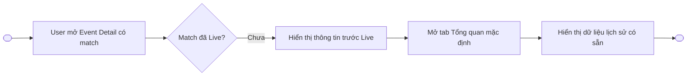
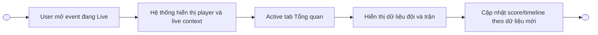
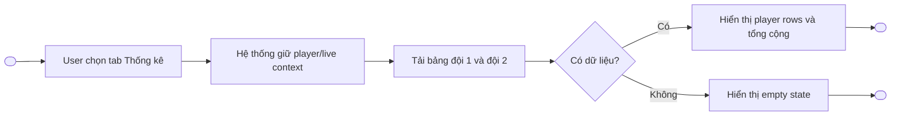
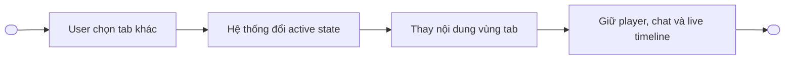
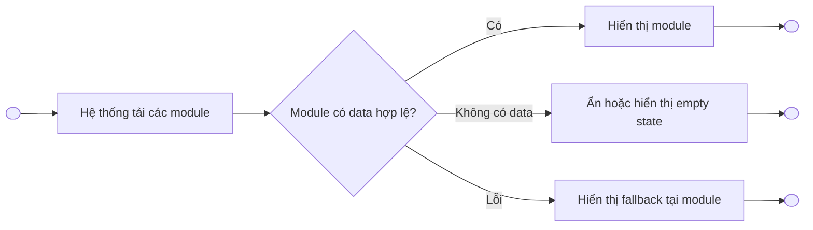

# Basketball Event Detail Web — Functional Requirements

> Project: FPTPlay
> Epic: Sport Zone
> Feature: Basketball Event Detail — Web
> Audience: Product, BA, Designer, FE, BE, QA
> Status: Final implementation handoff draft
> Source: `product/FPT_Play_man_hinh.pdf` — hình 2, 3, 4
> Writing style: Caveman Vietnam — ít chữ, dễ đọc, đúng ý, không low-level
> Last updated: 2026-10-12

---

## 1. Description

Màn **Basketball Event Detail** giúp user xem thông tin event/trận bóng rổ trên Website theo thời điểm trước Live và đang Live.

Khi event có match, trang hiển thị:

- Khu vực video/player và thông tin event.
- Thông tin giải đấu, đội bóng và trận đấu.
- Tab `Tổng quan` và `Thống kê`.
- Dữ liệu trận theo trạng thái và tab.
- Nội dung gợi ý phía cuối trang.

Khi trận đã Live, trang bổ sung score/live context, trò chuyện và diễn biến trận đấu theo thiết kế.

- Epic: Sport Zone
- Feature: Basketball Event Detail
- Main user: Website User
- Main platform: Web
- Main surfaces: Event player, event information, Overview tab, Statistics tab, Live chat, Match timeline, Suggested content
- Main intent: Xem trận và dữ liệu bóng rổ trong cùng một Event Detail

---

## 2. Document History

| Version | Date | Updated By | Notes | Approved By |
|---|---|---|---|---|
| v1.0 | 2026-10-12 | Dylan | Tạo đặc tả từ PDF hình 2–4. Thêm rule chiều cao cột của card so sánh dữ liệu đội bóng. | Pending |

---

## 3. Overview

### 3.1 Goal

- User mở Event Detail và nhận biết trận chưa Live hay đang Live.
- User xem thông tin tổng quan của hai đội.
- User chuyển sang tab Thống kê để xem dữ liệu chi tiết khi trận đã có dữ liệu.
- User tiếp tục xem nội dung liên quan ở cuối trang.

### 3.2 Platform scope

| Platform | Scope | Notes |
|---|---|---|
| Website | In scope | Desktop web theo PDF. |
| Mobile application | Out of scope | Không đặc tả trong tài liệu này. |
| SmartTV / Box | Out of scope | Không đặc tả trong tài liệu này. |

### 3.3 User scope

| User type | Scope | Notes |
|---|---|---|
| Guest | In scope | Xem UI/data nếu nội dung cho phép truy cập. |
| Logged-in User | In scope | Xem nội dung và dùng các chức năng tài khoản hiện hành. |
| Admin/CMS user | Out of scope | Không thuộc màn user-facing này. |

### 3.4 In scope

- Event có match trước Live.
- Event có match đang Live.
- Tab Tổng quan.
- Tab Thống kê.
- Trạng thái active/inactive của tab.
- Head-to-head, phong độ, team comparison, best player, match statistics.
- Player statistics theo từng đội.
- Live chat và match timeline khi Live, theo layout trong nguồn thiết kế.
- Loading, empty, partial-data và error fallback ở mức UI.
- Nội dung gợi ý.

### 3.5 Out of scope

- Event Detail không có match — hình 1.
- Logic video entitlement, mua gói và DRM.
- Chi tiết moderation của chat.
- Thuật toán tạo dữ liệu thống kê thể thao.
- API endpoint/schema low-level.
- Mobile/TV responsive specification.
- Thay đổi header, footer và global navigation hiện hành.

### 3.6 Accepted assumptions

1. Text, logo, tên giải, tên đội, cầu thủ, điểm số và số liệu trong PDF là dữ liệu minh họa.
2. Header/footer/global navigation dùng component hiện hành của Website.
3. Player, live chat và timeline dùng capability hiện hành; tài liệu này chỉ mô tả placement/state trên Event Detail.
4. Nếu một module không có dữ liệu, hệ thống xử lý theo rule empty/partial data tại Section 6 và Section 9; không bịa số `0` để lấp dữ liệu thiếu.

---

## 4. Entry Points

| # | Entry Point | User action / System trigger | Surface | Expected result |
|---:|---|---|---|---|
| 1 | Sport Zone / Basketball listing | User chọn một event có match | Website | Mở đúng Basketball Event Detail. |
| 2 | Match card | User chọn card trận | Website | Mở Event Detail gắn với match tương ứng. |
| 3 | Suggested content | User chọn nội dung bóng rổ liên quan | Website | Mở Event Detail/content tương ứng. |
| 4 | Direct link / deeplink web | User mở URL hợp lệ | Browser | Tải Event Detail và trạng thái trận mới nhất. |

---

## 5. Use Case Summary

| Use Case ID | Use Case | Primary Actor | Trigger | Outcome |
|---|---|---|---|---|
| BED-UC-001 | Xem Event Detail trước Live | Website User | Mở event có match chưa Live | User thấy lịch/phần giới thiệu và dữ liệu tổng quan có sẵn. |
| BED-UC-002 | Xem Event Detail đang Live — Tổng quan | Website User | Mở event đang Live hoặc chọn tab Tổng quan | User xem player, live context và dữ liệu tổng quan cập nhật. |
| BED-UC-003 | Xem Event Detail đang Live — Thống kê | Website User | Chọn tab Thống kê | User xem bảng thống kê cầu thủ theo từng đội. |
| BED-UC-004 | Chuyển tab dữ liệu trận | Website User | Chọn Tổng quan/Thống kê | Nội dung tab đổi, context player/live vẫn được giữ. |
| BED-UC-005 | Xử lý dữ liệu thiếu/lỗi | Website User, hệ thống | Module tải lỗi hoặc không có data | Trang giữ phần dùng được và hiển thị fallback tại module lỗi. |

---

## 6. Business Rules

### Global display rules

1. Trang phải render theo trạng thái mới nhất của match: `Pre-Live` hoặc `Live`.
2. Hình 1 — event không có match — không thuộc scope tài liệu này.
3. `Tổng quan` là tab mặc định khi user mở Event Detail có match.
4. Tab active phải có visual state khác tab inactive theo design system.
5. Chuyển tab chỉ thay nội dung vùng dữ liệu bên dưới phần mô tả; không reload hoặc reset player nếu không có lỗi bắt buộc.
6. Các module dùng dữ liệu thật theo match/team/player ID. Không hard-code dữ liệu mẫu trong PDF.
7. Module nào lỗi thì fallback riêng module đó. Không làm hỏng toàn trang nếu player hoặc các module khác vẫn dùng được.
8. Các section không có dữ liệu và không có empty-state được duyệt có thể ẩn toàn section, không để heading/canvas rỗng.

### Pre-Live rules

1. Hệ thống hiển thị thời gian/ngày thi đấu, hai đội và metadata địa điểm/giải nếu có.
2. Live chat và diễn biến realtime chỉ hiển thị khi nguồn dữ liệu/trạng thái hiện hành cho phép.
3. Tab Tổng quan có thể hiển thị dữ liệu lịch sử trước trận: lịch sử đối đầu, phong độ gần đây và so sánh đội.
4. Dữ liệu chưa phát sinh của trận hiện tại không được giả lập bằng `0`.

### Live rules

1. Khi match chuyển sang Live, hệ thống hiển thị live badge, score/status và dữ liệu mới nhất.
2. Player/video là vùng chính. Chat và `Diễn biến trận đấu` là vùng phụ bên phải theo thiết kế desktop.
3. Score, period, clock và timeline dùng dữ liệu realtime hoặc trạng thái tốt gần nhất nếu update tạm lỗi.
4. Timeline sắp xếp sự kiện theo thời gian trận; event mới nhất nằm theo convention của component hiện hành.
5. User chuyển tab Tổng quan/Thống kê không làm mất nội dung đang phát hoặc trạng thái chat hiện hành.

### Overview data rules

1. `Lịch sử đối đầu` so sánh hai đội của match hiện tại.
2. `Phong độ 5 trận gần nhất` hiển thị tối đa 5 trận gần nhất mỗi đội theo thứ tự mới → cũ hoặc convention hiện hành; cả hai đội phải dùng cùng quy tắc.
3. `Dữ liệu đội bóng so với trung bình liên đoàn` hiển thị các nhóm chỉ số của hai đội và benchmark liên đoàn.
4. Với từng **nhóm chỉ số**, lấy giá trị lớn nhất trong chính nhóm đó làm mốc cao nhất.
5. Chiều cao mỗi cột được tính theo công thức:

```text
column_height_percent = value / max_value_in_same_group × 100%
```

6. Rule tính cột áp dụng độc lập cho từng nhóm; không dùng max của nhóm khác hoặc max toàn card.
7. Nếu `max_value_in_same_group = 0`, tất cả cột của nhóm dùng chiều cao tối thiểu/zero state theo design system; không chia cho 0.
8. Giá trị text hiển thị số thật. Chiều cao cột chỉ là biểu diễn tương quan, không thay đổi số liệu.
9. Các series phải có legend/màu nhất quán: đội 1, đội 2, trung bình liên đoàn, cao nhất liên đoàn.
10. `Cầu thủ xuất sắc nhất` hiển thị theo từng đội và theo các chỉ số được thiết kế, khi có dữ liệu.
11. `Thống kê trong trận` so sánh hai đội theo từng chỉ số; label nằm ở giữa, giá trị hai đội nằm hai phía.

### Statistics tab rules

1. Tab Thống kê hiển thị tối thiểu hai bảng: một bảng cho mỗi đội.
2. Mỗi bảng có tên đội, header cột, danh sách cầu thủ và dòng `TỔNG CỘNG`.
3. Các cột theo thiết kế gồm: Số/Tên, Thời gian, Điểm, Bắt rổ, Kiến tạo, Ném rổ, 3 điểm, Ném phạt, Cướp bóng, Chặn bóng, Mất bóng, Phạm lỗi, +/-.
4. Tỷ lệ cú ném dùng format `thành công/tổng lần`, ví dụ `9/14`.
5. Giá trị `+/-` giữ dấu `+` hoặc `-`.
6. Player chưa thi đấu hoặc chưa có thống kê hiển thị theo dữ liệu nguồn; không tự đổi missing thành `0` nếu backend phân biệt hai trạng thái.
7. Dòng `TỔNG CỘNG` dùng style phân biệt với player rows và phản ánh tổng team do nguồn dữ liệu trả về.
8. Nếu bảng rộng hơn content area, dùng horizontal scroll trong vùng bảng hoặc responsive table pattern hiện hành; không ép chữ/cột chồng lên nhau.

### Suggested content rules

1. `Nội dung gợi ý` nằm sau vùng dữ liệu trận.
2. Card dùng component nội dung hiện hành và hiển thị đúng metadata khả dụng.
3. Click card mở nội dung tương ứng.

---

## 7. Functional Requirements

### BED-US-001 — Xem Event Detail theo trạng thái trận

#### BED-UC-001 — Xem Event Detail trước Live

**Activity Flows:**



| Field | Details |
|---|---|
| Actor | Website User, hệ thống |
| Triggers | User mở event có match chưa Live. |
| Pre-condition | Event và match tồn tại; trạng thái chưa Live. |
| Basic Path | 1. Hệ thống tải Event Detail.<br>2. Hiển thị player/cover, lịch thi đấu, đội và metadata.<br>3. Hiển thị thông tin event.<br>4. Active tab Tổng quan.<br>5. Hiển thị lịch sử đối đầu, phong độ và team comparison khi có data.<br>6. Hiển thị nội dung gợi ý. |
| Post-condition | User xem được context trước trận. |
| Alternative Path | User chọn tab Thống kê; nếu chưa có dữ liệu, hệ thống hiển thị empty state hoặc ẩn tab theo cấu hình sản phẩm hiện hành. |
| Exception Handling | Module lỗi hiển thị fallback riêng; phần khác của trang vẫn hoạt động. |

#### BED-UC-002 — Xem Event Detail đang Live — Tổng quan

**Activity Flows:**



| Field | Details |
|---|---|
| Actor | Website User, hệ thống |
| Triggers | User mở event đang Live hoặc chọn tab Tổng quan. |
| Pre-condition | Event có match; match ở trạng thái Live. |
| Basic Path | 1. Hiển thị player/video.<br>2. Hiển thị score/status Live.<br>3. Hiển thị chat và diễn biến trận đấu nếu khả dụng.<br>4. Hiển thị thông tin event và active tab Tổng quan.<br>5. Hiển thị lịch sử đối đầu, phong độ, team comparison, cầu thủ nổi bật và thống kê trong trận khi có data.<br>6. Cập nhật live data mà không reload toàn trang. |
| Post-condition | User theo dõi trận và dữ liệu tổng quan trong cùng màn. |
| Alternative Path | Một module chưa có data thì ẩn hoặc hiển thị empty state tại module đó. |
| Exception Handling | Realtime lỗi: giữ trạng thái tốt gần nhất và retry theo cơ chế hiện hành. |

### BED-US-002 — Xem thống kê cầu thủ

#### BED-UC-003 — Xem Event Detail đang Live — Thống kê

**Activity Flows:**



| Field | Details |
|---|---|
| Actor | Website User, hệ thống |
| Triggers | User chọn tab Thống kê. |
| Pre-condition | Event có match; tab Thống kê khả dụng. |
| Basic Path | 1. Hệ thống active tab Thống kê.<br>2. Giữ player/chat/timeline hiện tại.<br>3. Hiển thị bảng đội 1.<br>4. Hiển thị bảng đội 2.<br>5. Hiển thị dòng tổng cộng mỗi đội.<br>6. Cập nhật data khi nguồn thống kê thay đổi. |
| Post-condition | User xem được thống kê cầu thủ của hai đội. |
| Alternative Path | Bảng rộng dùng horizontal scroll; một đội thiếu data thì đội còn lại vẫn hiển thị. |
| Exception Handling | Lỗi tải bảng hiển thị lỗi tại bảng và action thử lại nếu component hỗ trợ. |

#### BED-UC-004 — Chuyển tab dữ liệu trận

**Activity Flows:**



| Field | Details |
|---|---|
| Actor | Website User, hệ thống |
| Triggers | Click `Tổng quan` hoặc `Thống kê`. |
| Pre-condition | User đang ở Basketball Event Detail có match. |
| Basic Path | 1. User chọn tab.<br>2. Hệ thống active tab được chọn.<br>3. Render nội dung tab.<br>4. Giữ các surface live bên ngoài vùng tab. |
| Post-condition | Nội dung đúng tab được hiển thị. |
| Alternative Path | User chọn lại tab đang active: giữ nguyên trạng thái, không fetch thừa nếu data còn hợp lệ. |
| Exception Handling | Tab load lỗi: giữ header/player và hiển thị fallback trong vùng tab. |

### BED-US-003 — Khả năng phục hồi dữ liệu

#### BED-UC-005 — Xử lý dữ liệu thiếu/lỗi

**Activity Flows:**



| Field | Details |
|---|---|
| Actor | Website User, hệ thống |
| Triggers | Page/module fetch. |
| Pre-condition | Event Detail được mở. |
| Basic Path | Hệ thống xử lý trạng thái từng module độc lập. |
| Post-condition | Trang vẫn dùng được khi một phần dữ liệu thiếu/lỗi. |
| Alternative Path | Data đến muộn: module chuyển từ loading sang content mà không reload trang. |
| Exception Handling | Event/match không tồn tại: dùng trang lỗi/fallback routing hiện hành. |

---

## 8. Screen Element Specification

### 8.1 Design Reference

| Item | Link / Note |
|---|---|
| Figma source | `https://www.figma.com/design/qOMt95TNUdslqExgg23Vy2/-Web-V5--Th%25E1%25BB%2583-thao---V1?node-id=48864-272333&p=f` |
| PDF source | `product/FPT_Play_man_hinh.pdf` |
| Scope | Hình 2, 3, 4. Hình 1 chỉ tham khảo, không mô tả. |

### 8.2 Information Architecture

```text
Basketball Event Detail — Web
├── Global Header
├── Main Event Area
│   ├── Player / Event visual
│   ├── Match identity / score / status
│   ├── Live Chat (Live, when available)
│   └── Match Timeline (Live, when available)
├── Event Information
│   ├── Event title
│   ├── Share action
│   ├── League/category
│   └── Description
├── Match Data Tabs
│   ├── Tổng quan
│   │   ├── Lịch sử đối đầu
│   │   ├── Phong độ 5 trận gần nhất
│   │   ├── Dữ liệu đội bóng so với trung bình liên đoàn
│   │   ├── Cầu thủ xuất sắc nhất
│   │   └── Thống kê trong trận
│   └── Thống kê
│       ├── Bảng thống kê đội 1
│       └── Bảng thống kê đội 2
├── Nội dung gợi ý
└── Global Footer
```

### 8.4 Surface Details by Surface

#### SURF-001 — Event có match, trước Live — Tổng quan

**Surface details:**

| Field | Details |
|---|---|
| Surface / Location | Basketball Event Detail — main page |
| Platform | Website |
| When shown | Event có match; match chưa Live. |
| Related UC / Flow | BED-UC-001, BED-UC-004 |
| Placement notes | Main content phía trái/giữa; dữ liệu tổng quan nằm dưới event information. |

**Sketching wireframe / Text-Based Wireframing:**

```text
┌──────────────────────────────────────────────────────────────────┐
│ Global Header                                                    │
├──────────────────────────────────────────────┬───────────────────┤
│ Player / Event visual                       │ Match schedule /  │
│                                              │ related context   │
├──────────────────────────────────────────────┴───────────────────┤
│ Event title                                      [Chia sẻ]       │
│ League / category                                                  │
│ Description                                                        │
├──────────────────────────────────────────────────────────────────┤
│                 [Tổng quan] [Thống kê]                            │
├──────────────────────────────────────────────────────────────────┤
│ Lịch sử đối đầu                                                   │
│ Phong độ 5 trận gần nhất                                          │
│ Dữ liệu đội bóng so với trung bình liên đoàn                     │
├──────────────────────────────────────────────────────────────────┤
│ Nội dung gợi ý                                                    │
├──────────────────────────────────────────────────────────────────┤
│ Global Footer                                                     │
└──────────────────────────────────────────────────────────────────┘
```

**Surface elements:**

| # | Element | States | Format / Copy | Rules / Notes |
|---:|---|---|---|---|
| 1 | Player/Event visual | loading, available, unavailable | Theo player hiện hành | Không thuộc scope entitlement/DRM. |
| 2 | Match schedule | scheduled, postponed/cancelled nếu nguồn có | Hai đội, ngày, giờ, địa điểm | Dùng timezone/format của Website. |
| 3 | Event title | available | `{team_1} - {team_2}` hoặc title CMS | Không hard-code. |
| 4 | Chia sẻ | default, success, unavailable | Label/icon hiện hành | Dùng share behavior hiện hành. |
| 5 | League/category | available, hidden | Tên giải | Ẩn khi không có data. |
| 6 | Description | available, collapsed/expanded nếu dài | Rich/plain text theo CMS | Không tự sinh mô tả. |
| 7 | Tabs | active, inactive, loading | `Tổng quan`, `Thống kê` | Tổng quan active mặc định. |
| 8 | Lịch sử đối đầu | loading, available, empty | Hai đội + dữ liệu đối đầu | Empty thì ẩn/empty state. |
| 9 | Phong độ 5 trận gần nhất | loading, available, partial | Tối đa 5 trận mỗi đội | Dùng cùng thứ tự cho hai đội. |
| 10 | Team comparison card | loading, available, partial, empty | Chart + values + legend | Áp dụng rule scale theo max trong từng nhóm. |
| 11 | Nội dung gợi ý | loading, available, empty | Content cards | Click mở content đích. |

**Surface behavior notes:**

- Default tab: Tổng quan.
- Thống kê trước Live chỉ hiển thị khi có data/được product cho phép; nếu không thì empty state hoặc hidden theo cấu hình.
- Không hiển thị số liệu trận hiện tại giả định.

#### SURF-002 — Event đang Live — Khung xem trận

**Surface details:**

| Field | Details |
|---|---|
| Surface / Location | Phần đầu Basketball Event Detail |
| Platform | Website desktop |
| When shown | Match đang Live. |
| Related UC / Flow | BED-UC-002, BED-UC-003, BED-UC-004 |
| Placement notes | Player là vùng chính; chat/timeline ở panel phải theo nguồn thiết kế. |

**Sketching wireframe / Text-Based Wireframing:**

```text
┌──────────────────────────────────────────────┬─────────────────────┐
│ LIVE Player                                  │ Trò chuyện          │
│                                              │ - Messages          │
│ Team 1                Score          Team 2  │ - Input             │
│ Live status / period / clock                 ├─────────────────────┤
│                                              │ Diễn biến trận đấu │
│                                              │ - Filter theo hiệp  │
│                                              │ - Timeline events   │
└──────────────────────────────────────────────┴─────────────────────┘
```

**Surface elements:**

| # | Element | States | Format / Copy | Rules / Notes |
|---:|---|---|---|---|
| 1 | Live badge | live, hidden | `LIVE` | Chỉ hiện khi trạng thái Live. |
| 2 | Player | loading, playing, paused, error | Component player hiện hành | Tab change không reset player. |
| 3 | Team identity | available, fallback | Logo + tên đội | Dùng fallback logo hiện hành. |
| 4 | Score/status | loading, live, stale | Score, period, clock | Giữ trạng thái tốt gần nhất khi update lỗi. |
| 5 | Chat panel | loading, available, disabled, error | Message list + input | Moderation/auth theo feature chat hiện hành. |
| 6 | Match timeline | loading, available, empty, error | Event + game clock | Sắp xếp nhất quán; có filter hiệp/Tất cả nếu data hỗ trợ. |

**Surface behavior notes:**

- Player/chat/timeline nằm ngoài vùng tab dữ liệu.
- Chuyển Tổng quan ↔ Thống kê không làm mất playback/chat state.
- Nếu panel phải không khả dụng, player vẫn render theo layout fallback hiện hành.

#### SURF-003 — Live — Tab Tổng quan

**Surface details:**

| Field | Details |
|---|---|
| Surface / Location | Dưới Event Information |
| Platform | Website |
| When shown | Match Live và tab Tổng quan active. |
| Related UC / Flow | BED-UC-002, BED-UC-004 |
| Placement notes | Các card xếp dọc theo PDF. |

**Sketching wireframe / Text-Based Wireframing:**

```text
┌──────────────────────────────────────────────────────────────────┐
│ [Tổng quan — active] [Thống kê]                                 │
├──────────────────────────────────────────────────────────────────┤
│ Lịch sử đối đầu                                                  │
├──────────────────────────────────────────────────────────────────┤
│ Phong độ 5 trận gần nhất: Team 1 | Team 2                       │
├──────────────────────────────────────────────────────────────────┤
│ Dữ liệu đội bóng so với trung bình liên đoàn                    │
│ [Grouped comparison columns + legend]                            │
├──────────────────────────────────────────────────────────────────┤
│ Cầu thủ xuất sắc nhất: Team 1 | Team 2                           │
├──────────────────────────────────────────────────────────────────┤
│ Thống kê trong trận: value | metric | value                      │
└──────────────────────────────────────────────────────────────────┘
```

**Surface elements:**

| # | Element | States | Format / Copy | Rules / Notes |
|---:|---|---|---|---|
| 1 | Lịch sử đối đầu | loading, available, empty | Team 1 vs Team 2 | Dùng đúng match teams. |
| 2 | Phong độ gần nhất | loading, available, partial | Logo/mã đối thủ + W/L/result | Tối đa 5 trận mỗi đội. |
| 3 | Comparison chart | loading, available, partial, empty | Grouped columns | Mỗi group scale theo max của chính group. |
| 4 | Chart value labels | available | Number/decimal theo data | Hiển thị số thật. |
| 5 | Chart legend | available | Team 1, Team 2, TB league, Max league | Màu nhất quán. |
| 6 | Cầu thủ xuất sắc nhất | loading, available, partial, empty | Player name + metric/value | Theo data nguồn. |
| 7 | Thống kê trong trận | loading, available, partial, empty | Team 1 value — metric — Team 2 value | Mỗi metric một row. |

**Surface-specific notes:**

- Các metric quan sát trong nguồn gồm điểm, bắt rổ, kiến tạo, cướp bóng, chặn bóng, mất bóng, ném phạt, ném 3 điểm, phạm lỗi và tỷ lệ ném. Danh sách thực tế theo contract dữ liệu được duyệt.
- Không dùng cùng một max cho tất cả metric của comparison chart.

#### SURF-004 — Live — Tab Thống kê

**Surface details:**

| Field | Details |
|---|---|
| Surface / Location | Dưới Event Information |
| Platform | Website |
| When shown | User chọn tab Thống kê. |
| Related UC / Flow | BED-UC-003, BED-UC-004 |
| Placement notes | Hai bảng đội xếp dọc; mỗi bảng có horizontal overflow độc lập nếu cần. |

**Sketching wireframe / Text-Based Wireframing:**

```text
┌─────────────────────────────────────────────────────────────────────┐
│ [Tổng quan] [Thống kê — active]                                    │
├─────────────────────────────────────────────────────────────────────┤
│ Team 1                                                              │
│ ┌─────────────────────────────────────────────────────────────────┐ │
│ │ Số/Tên | TG | Điểm | BR | KT | Ném | 3Đ | NP | CB | ... | +/-│ │
│ │ Player rows                                                     │ │
│ │ TỔNG CỘNG                                                       │ │
│ └─────────────────────────────────────────────────────────────────┘ │
├─────────────────────────────────────────────────────────────────────┤
│ Team 2                                                              │
│ ┌─────────────────────────────────────────────────────────────────┐ │
│ │ Số/Tên | TG | Điểm | BR | KT | Ném | 3Đ | NP | CB | ... | +/-│ │
│ │ Player rows                                                     │ │
│ │ TỔNG CỘNG                                                       │ │
│ └─────────────────────────────────────────────────────────────────┘ │
└─────────────────────────────────────────────────────────────────────┘
```

**Surface elements:**

| # | Element | States | Format / Copy | Rules / Notes |
|---:|---|---|---|---|
| 1 | Team section title | available | Team name/logo | Đúng team order của match. |
| 2 | Table header | default, sticky nếu component hỗ trợ | Các cột thống kê đã duyệt | Cùng column order cho hai đội. |
| 3 | Player identity | available, fallback | Số áo + tên | Không trộn player giữa hai đội. |
| 4 | Playing time | available, missing | Time format từ nguồn | Không tự suy diễn. |
| 5 | Counting metrics | available, zero, missing | Integer | Phân biệt `0` và missing. |
| 6 | Shooting metrics | available, zero, missing | `{made}/{attempted}` | Không đổi thành phần trăm nếu design không yêu cầu. |
| 7 | Plus/minus | available, zero, missing | `+N`, `-N`, `0` | Giữ dấu. |
| 8 | Total row | available, partial | `TỔNG CỘNG` | Visual emphasis; dùng team totals từ nguồn. |
| 9 | Table loading | loading | Skeleton theo rows/columns | Không shift player/live area. |
| 10 | Table empty/error | empty, error | Empty copy / retry | Xử lý riêng từng team table. |

**Surface behavior notes:**

- Bảng không được làm vỡ page width.
- Có thể dùng sticky first column/header nếu component Website hiện hành hỗ trợ.
- Chuyển về Tổng quan giữ player và live context.

#### SURF-005 — Nội dung gợi ý

**Surface details:**

| Field | Details |
|---|---|
| Surface / Location | Cuối nội dung Event Detail, trước footer |
| Platform | Website |
| When shown | Có suggested content. |
| Related UC / Flow | BED-UC-001, BED-UC-002, BED-UC-003 |
| Placement notes | Dùng row/grid card hiện hành. |

**Sketching wireframe / Text-Based Wireframing:**

```text
Nội dung gợi ý
┌──────────────┐ ┌──────────────┐ ┌──────────────┐ ┌──────────────┐
│ Thumbnail    │ │ Thumbnail    │ │ Thumbnail    │ │ Thumbnail    │
│ Metadata     │ │ Metadata     │ │ Metadata     │ │ Metadata     │
│ Title        │ │ Title        │ │ Title        │ │ Title        │
└──────────────┘ └──────────────┘ └──────────────┘ └──────────────┘
```

**Surface elements:**

| # | Element | States | Format / Copy | Rules / Notes |
|---:|---|---|---|---|
| 1 | Section title | available | `Nội dung gợi ý` | Ẩn cùng section nếu không có items và không có empty state. |
| 2 | Content card | loading, available, unavailable | Thumbnail, badge, metadata, title | Dùng card component hiện hành. |
| 3 | Card action | enabled, unavailable | Click/tap card | Mở đúng content URL. |

---

## 9. Error Handling & User-Facing Messages

| Case | User-facing message | Behavior |
|---|---|---|
| Event không tồn tại | Theo trang 404/content unavailable hiện hành | Không render data của event khác. |
| Match data tải lỗi | `Không thể tải dữ liệu trận đấu.` | Giữ player/event info; cho retry nếu component hỗ trợ. |
| Live data tạm gián đoạn | Không bắt buộc toast | Giữ trạng thái tốt gần nhất; retry nền. |
| Tổng quan không có dữ liệu | `Chưa có dữ liệu tổng quan.` | Hiển thị empty state gọn hoặc ẩn module. |
| Thống kê chưa có dữ liệu | `Chưa có dữ liệu thống kê.` | Giữ tab/page; không hiển thị bảng giả. |
| Một team table lỗi | `Không thể tải thống kê đội bóng.` | Team table còn lại vẫn hiển thị. |
| Chat không khả dụng | Theo copy của chat feature hiện hành | Player và timeline vẫn hoạt động. |
| Timeline không có sự kiện | `Chưa có diễn biến trận đấu.` | Giữ panel, không bịa event. |
| Suggested content lỗi | Không cần block page | Ẩn section hoặc hiển thị fallback component hiện hành. |

---

## 10. References

| Item | Path / Link |
|---|---|
| Source PDF | `features/final-docs/Sport-Zone/Basketball-Event-Detail/product/FPT_Play_man_hinh.pdf` |
| Figma design | `https://www.figma.com/design/qOMt95TNUdslqExgg23Vy2/-Web-V5--Th%25E1%25BB%2583-thao---V1?node-id=48864-272333&p=f` |
| Related Live Activity | `features/final-docs/Sport-Zone/Live-Activity/product/Live-Activity.md` |
| Related Notifications | `features/final-docs/Sport-Zone/Notifications-Alert/product/Notifications-&-Alert.md` |

---

## 11. Handoff Checklist

- [x] Scope chỉ gồm hình 2, 3, 4.
- [x] Hình 1 không được mô tả như requirement.
- [x] Pre-Live, Live/Tổng quan và Live/Thống kê có surface riêng.
- [x] Mỗi UC có Mermaid flow và Field/Details table.
- [x] Mỗi surface có text wireframe và elements table.
- [x] Rule chiều cao cột theo max trong chính nhóm được ghi rõ, có công thức và zero guard.
- [x] Tab switch giữ player/chat/live context.
- [x] Main, loading, empty, partial-data và error cases được cover.
- [x] Không tạo API endpoint/schema chưa có source-of-truth.
- [x] Dùng `hệ thống` trong tài liệu tiếng Việt.
- [ ] Product/Designer xác nhận copy empty/error cuối cùng.
- [ ] FE/BE xác nhận field mapping và realtime update contract hiện hành.
- [ ] QA đối chiếu final Figma trước test UI pixel/layout.
