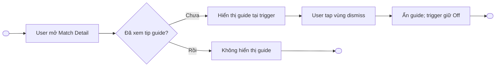
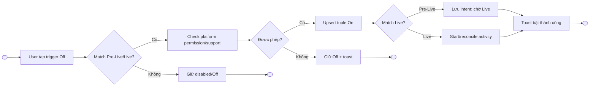
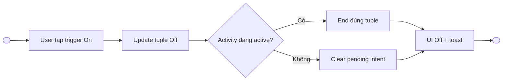
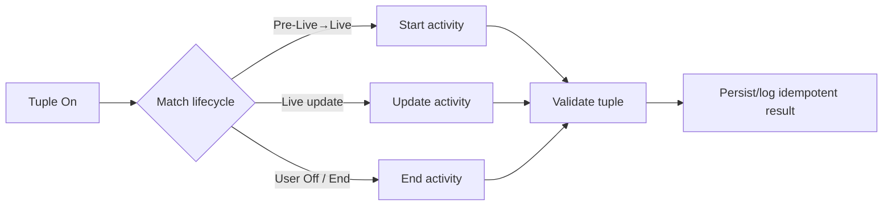
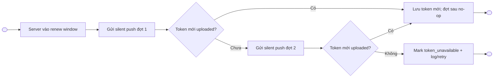
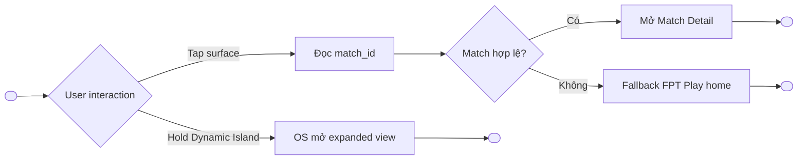

# Live Activity — Match Detail Trigger

> Project: FPTPlay
> Epic: Sport Zone
> Feature: Live Activity
> Audience: Product, BA, FE, BE, QA, iOS, Android
> Status: Final implementation handoff — canonical source of truth
> Canonical document: `product/Live-Activity-Change-Draft.md` — filename retained by Product decision on 2026-10-13
> Supersedes: `product/Live-Activity.md` and the companion BA template document for implementation decisions
> Base document: exact copy of `Live-Activity.md`, then semantically rewritten for the Match Detail trigger requirements dated 2026-10-13
> Writing style: Caveman Vietnam — ít chữ, dễ đọc, đúng ý, không low-level
> Last updated: 2026-10-13
> Consolidation note (2026-08-18): single source-of-truth spec per sub-feature. Merged from legacy split contracts: `product/functional-specification.md` (system functional requirements, state model, analytics, QA), `api/technical-contract.md` (Section 11 — API & Technical Contract), `design/design-contract.md` (Section 10 — UX & Design Contract), and `product/live-activity-user-flows.md` (Section 12 — Wireframes). Source PDF: `product/LiveAct.pdf` (read-only reference).

---

## 1. Description

Live Activity giúp user theo dõi score/status trận bóng đá ngay trên **iOS Lock Screen**, **iOS Dynamic Island** và **Android ongoing notification**.

Live Activity được bật/tắt bằng control riêng tại **Match Detail**:

- Control nằm bên trái icon **Đặt lịch**.
- Trạng thái mặc định là **Off**.
- User chủ động bật/tắt cho từng trận.
- Control độc lập với **Đặt lịch**, theo dõi đội, theo dõi mùa giải và task Notifications Sport cũ.
- Mỗi trạng thái được quản lý theo bộ khóa `device_id + match_id`.

Trận **Pre-Live** hoặc **Live** cho phép thao tác control. Trận **End** disable control. Nếu user bật từ Pre-Live, hệ thống lưu intent và bắt đầu Live Activity khi trận đủ điều kiện phát. Nếu user bật khi trận đang Live, hệ thống bắt đầu ngay khi permission/token/device hợp lệ.

- Epic: Sport Zone
- Feature: Live Activity
- Main user: User đã đăng nhập để vào Player/Match Detail trên Mobile App
- Main platform: Mobile iOS, Mobile Android
- Main entry point: Match Detail
- Main surfaces: Match Detail trigger, tip guide, toast, iOS Dynamic Island, iOS Lock Screen Live Activity, Android ongoing notification
- Main intent: Bật/tắt Live Activity cho đúng trận trên đúng device

### Success signals

| Signal | Target behavior |
|---|---|
| Trigger clarity | User hiểu control trên Match Detail và trạng thái On/Off hiện tại. |
| Permission correctness | iOS chỉ chuyển On sau khi Live Activities permission được grant; deny giữ Off. |
| Lifecycle reliability | Start/update/end đúng theo `device_id + match_id`. |
| Token reliability | Token hết hạn được renew trước giờ phát bằng khoảng 2 đợt silent push. |
| User feedback | Mỗi thao tác On/Off có toast; lỗi có toast rõ ràng. |
| Quality | Không duplicate activity, không update nhầm device/match, không stale sau End/Off. |

---

## 2. Document History

| Version | Date | Updated By | Notes | Approved By |
|---|---|---|---|---|
| v1.0 | 2026-06-04 | Dylan | Created from `live-activity-user-flows.md` using Functional Requirements / Use Case format. | Pending |
| v1.1 | 2026-06-05 | Dylan | Reworded to Caveman Vietnam. Simplified wording. Removed `Priority` and `Status` fields. Actor changed to Logged-in User. | Pending |
| v1.2 | 2026-06-05 | Dylan | Added template sections: Description, Document History, Overview, Non-functional Requirements, Design Specifications, References. | Pending |
| v1.3 | 2026-06-05 | Dylan | Clarified mobile iOS + mobile Android scope and minimum OS versions. | Pending |
| v1.4 | 2026-06-05 | Dylan | Mapped Global Business Rules into each Use Case using Caveman Vietnam wording. | Pending |
| v1.5 | 2026-06-05 | Dylan | Earlier draft considered Android Live Updates for Samsung-like surfaces. Superseded by v3.9 scope. | Pending |
| v1.6 | 2026-06-05 | Dylan | Shortened Platform scope and removed Website/TV rows. | Pending |
| v1.7 | 2026-06-05 | Dylan | Shortened In scope list. | Pending |
| v1.8 | 2026-06-05 | Dylan | Shortened Out of scope list. | Pending |
| v1.9 | 2026-06-05 | Dylan | Added permission cases: allow, deny, re-enable. | Pending |
| v2.0 | 2026-06-05 | Dylan | Added UI organization rules for text, score, logo, state, and event priority. | Pending |
| v2.1 | 2026-06-05 | Dylan | Changed Flow 1 diagram to Mermaid stateDiagram-v2. | Pending |
| v2.2 | 2026-06-07 | Dylan | Shortened Business Rules Applied in each Use Case to flow-specific rules only. Kept shared rules in Global Business Rules. | Pending |
| v2.3 | 2026-06-08 | Dylan | Restructured document into 9-section functional requirements outline. Moved UI Organization Rules into Screen Element Specification. Added error/message table. | Pending |
| v2.4 | 2026-06-08 | Dylan | Changed Business Rules back from table format to list format. | Pending |
| v2.5 | 2026-06-08 | Dylan | Restored Business Rules to table format. | Pending |
| v2.6 | 2026-06-08 | Dylan | Rewrote Business Rules into numbered list style with subheadings. | Pending |
| v2.7 | 2026-06-08 | Dylan | Restructured Screen Element Specification into Figma link, Information Architecture, and separate surface tables with rules/format columns. | Pending |
| v2.8 | 2026-06-08 | Dylan | Tightened Screen Element Specification wording in Caveman Vietnam style and clarified subtle brand/icon usage on Lock Screen. | Pending |
| v2.9 | 2026-06-08 | Dylan | Simplified Information Architecture into tree format. | Pending |
| v3.0 | 2026-06-08 | Dylan | Added Dynamic Island minimal surface. | Pending |
| v3.1 | 2026-06-08 | Dylan | Merged UI organization and surface format rules into Surface elements. | Pending |
| v3.2 | 2026-06-08 | Dylan | Simplified flow diagrams to use only User and App for non-technical readability. | Pending |
| v3.3 | 2026-06-08 | Dylan | Clarified Platform scope with OS/device/app version applicability. | Pending |
| v3.4 | 2026-06-08 | Dylan | Changed Platform scope from table to short bullet format. | Pending |
| v3.5 | 2026-06-08 | Dylan | Added logo field to Dynamic Island surfaces and hide icon when logo is missing. | Pending |
| v3.6 | 2026-06-08 | Dylan | Removed Dynamic Island status field and set score styling to tabular/monospace. | Pending |
| v3.7 | 2026-06-08 | Dylan | Clarified Dynamic Island Minimal as left-side score only; right side may belong to another app. | Pending |
| v3.8 | 2026-06-08 | Dylan | Aligned Dynamic Island Expanded fields with expanded match UI layout. | Pending |
| v3.9 | 2026-06-09 | Dylan | Clarified Android uses ongoing notification; Lock Screen visibility depends on OS/user settings. Removed Android Dynamic Island / Live Updates / Samsung Now Bar-like scope. | Pending |
| v4.0 | 2026-06-09 | Dylan | Reworded Android surface to ongoing notification and clarified Lock Screen visibility depends on OS/user settings. | Pending |
| v4.1 | 2026-06-09 | Dylan | Clarified match eligibility: Upcoming and Live can Đặt Lịch; only Live shows outside app; End disables button but keeps user history. | Pending |
| v4.2 | 2026-06-09 | Dylan | Moved permission behavior from Overview into Business Rules as Permission rules. | Pending |
| v4.3 | 2026-06-09 | Dylan | Clarified simultaneous event behavior: when multiple new events arrive together, display the latest event. | Pending |
| v4.4 | 2026-06-09 | Dylan | Clarified deeplink route fallback and added global Routing rules. | Pending |
| v4.5 | 2026-06-09 | Dylan | Tightened routing wording: visible cards route by match_id; fallback only when match_id is missing/corrupted or match cannot be opened. | Pending |
| v4.6 | 2026-06-09 | Dylan | Drift audit cleanup: aligned Đặt Lịch wording and clarified Upcoming only saves follow, Live starts outside-app surface. | Pending |
| v4.7 | 2026-06-09 | Dylan | Replaced route/match context wording with direct match_id routing to reduce ambiguity. | Pending |
| v4.8 | 2026-06-09 | Dylan | Changed route fallback destination from Followed Matches / Live Matches to Sport Zone match card. | Pending |
| v4.9 | 2026-07-17 | Dylan | Updated Dynamic Island Expanded: added latest_event row (full event type priority list, rescinded handling), expanded match clock/period states to include extra_time/penalties (ET, PSO), added shootout score display rule. Updated Lock Screen Expanded: expanded match clock/period states, replaced generic latest_event with full event type label mapping (goal/own_goal/penalty/missed_penalty/yellow_card/red_card/yellow_red_card/var/pen_shootout_goal/pen_shootout_miss/rescinded), added shootout score display rule. substitution excluded from both surfaces. | Pending |
| v5.0 | 2026-07-17 | Dylan | Added substitution event to both DI Expanded and Lock Screen Expanded latest_event display. Label: `🔄 Thay người · {relatedPlayerName} ▶ {playerName}`. Priority: lowest (after all other event types). | Pending |
| v5.1 | 2026-07-17 | Dylan | Expanded follow trigger sources: added Theo dõi Đội bóng (`sport_team`) and Theo dõi Mùa giải (`sport_league`) as valid Live Activity triggers alongside Đặt Lịch (`content_event_match`). Updated Description, Overview, User scope, In scope, Entry Points, UC-001, Business Rules (follow sources, eligibility, unfollow isolation rules). | Pending |
| v6.0 | 2026-08-18 | Dylan | Consolidated into single source-of-truth spec `product/Live-Activity.md`: merged functional-specification (system requirements, state model, analytics, QA), technical-contract (API section), design-contract (design section), user-flows wireframes. Legacy split files removed. | Pending |
| v6.1 | 2026-08-18 | PD update | Thêm display states (Section 8.4): default = progress bar realtime + event icons; event mới = text ~6s rồi về default; match end = 3 stat chính so sánh 2 đội (Phạt góc, Kiểm soát bóng, Thẻ vàng). Resolve conflict còn sót: key event không trigger auto-switch selected match (F-002, 10.5, 10.7). | Pending |
| v6.2 | 2026-08-18 | PD confirm | Chốt liên kết với Notifications & Alert: event trên Live Activity không config per-event; toggle Live feed = off → dừng update, giữ trạng thái cuối, không tự remove; không đồng bộ 2 chiều với OS Settings. | Pending |
| v7.0-draft | 2026-10-13 | Dylan | Drift rewrite: bỏ Notifications Sport/follow-source model; trigger On/Off tại Match Detail; default Off; tip guide lần đầu; toast; eligibility Pre-Live/Live/End; permission flow iOS/Android; lifecycle theo `profile_id + device_id + match_id`; silent-push token renewal. | Pending |
| v7.1 | 2026-10-13 | Product decision | Chốt `Live-Activity-Change-Draft.md` làm canonical source of truth và final implementation handoff. Tên file được giữ nguyên. | Dang Duong |
| v7.2 | 2026-10-13 | Product decision | Chuyển trigger/lifecycle sang device-scoped identity `device_id + match_id`; không gửi `profile_id`/`user_id`; switch profile và logout không end Live Activity. | Dang Duong |
| v7.3 | 2026-10-13 | Product decision | Xóa Section 7bis và hệ ID `F-001`–`F-009` bị trùng; traceability dùng trực tiếp Use Case, Business Rules và section canonical. | Dang Duong |

---

## 3. Overview

### 3.1 Goal

User đã đăng nhập để vào Player/Match Detail, sau đó chủ động bật/tắt Live Activity cho đúng trận. Hệ thống lưu trạng thái theo device và match; bắt đầu/cập nhật/kết thúc activity đúng lifecycle.

### 3.2 Platform scope

- **iOS:** apply từ **iOS 16.1+**.
  - Dynamic Island: chỉ thiết bị có Dynamic Island.
  - Lock Screen Live Activity: chỉ thiết bị hỗ trợ ActivityKit/Live Activities.
  - Khi user bật trigger, app check Live Activities permission/authorization trước khi lưu On.
- **Android:** apply từ **Android 8.0+ / API 26+** cho ongoing notification.
  - Android 13+ / API 33+: notification permission được check trong flow lần đầu vào app, không prompt lại từ trigger Match Detail.
  - Android Dynamic Island / OEM custom surfaces: out of scope.
- **Website / TV:** out of scope.
- **FPT Play app version:** Cần xác nhận theo release plan.

### 3.3 Platform behavior

- iOS gọi surface là **Live Activity**.
- Android dùng **ongoing notification** trong scope hiện tại.
- Cùng một product intent nhưng permission và OS surface khác nhau.
- Trigger state trong app là product state theo `device_id + match_id`; OS surface có thể không hiện nếu device/permission/token không hợp lệ.
- Task Notifications Sport cũ không còn là dependency hoặc trigger source.

### 3.4 User scope

| User type | Scope | Notes |
|---|---|---|
| User đã đăng nhập | In scope | Login là điều kiện để vào Player/Match Detail; trigger không gửi hoặc dùng `profile_id`/`user_id`. |
| Guest/chưa đăng nhập | Ngoài trigger flow | App yêu cầu login trước khi cho vào Player/Match Detail; không xử lý login tại trigger. |
| Đổi profile trên cùng device | In scope | Dùng chung trigger/activity theo `device_id + match_id`; không tạo activity mới và không reset state. |
| Logout sau khi đã bật | In scope | Live Activity tiếp tục hiển thị và nhận update; logout không tự Off/end activity. |
| Cùng user/profile trên nhiều device | In scope | Mỗi device có trạng thái/token/activity riêng. |
| Admin/CMS user | Out of scope | Không thuộc feature user-facing. |

### 3.5 In scope

- Trigger On/Off tại Match Detail, nằm bên trái icon Đặt lịch.
- Default Off cho tuple chưa có state.
- Tip guide một lần sau khi cài app, tại lần đầu vào Match Detail có trigger.
- Toast sau mỗi On/Off thành công và khi thao tác lỗi.
- Enable control ở Pre-Live và Live; disable khi End.
- Permission behavior riêng cho iOS/Android.
- Start/update/end theo `device_id + match_id`.
- Token registration, expiry detection và renew bằng khoảng 2 silent pushes trước giờ phát.
- Dynamic Island, Lock Screen Live Activity và Android ongoing notification.
- Deeplink về đúng Match Detail.
- Analytics/observability cho trigger, permission, lifecycle và token renew.

### 3.6 Out of scope

- Notifications Sport task và per-event notification configuration.
- Dùng Đặt lịch, theo dõi đội hoặc theo dõi mùa giải làm trigger Live Activity.
- Priority selection/switch giữa nhiều followed matches trong một activity.
- App-controlled multi-match list hoặc `+N` trên Dynamic Island.
- Android Dynamic Island / Samsung Now Bar / OEM-specific custom surfaces.
- Payment/entitlement changes.
- Full Match Detail redesign ngoài việc thêm trigger/tip/toast.
- Admin/CMS tooling.

### 3.7 Future scope / later

- OEM-specific Android live surfaces nếu feasibility được xác nhận.
- Interactive Live Activity actions nếu OS/product hỗ trợ.
- Sport-specific expanded layouts.

### 3.8 Non-functional requirements

| ID | Requirement | Notes |
|---|---|---|
| LA-NFR-001 | Update speed | Score/status mới phải được gửi tới activity active trong thời gian hợp lý; lỗi giữ trạng thái tốt gần nhất. |
| LA-NFR-002 | Idempotency | Start/update/end và toggle phải idempotent theo `device_id + match_id` và `event_id` khi có. |
| LA-NFR-003 | Isolation | Không update/end activity của device hoặc match khác. |
| LA-NFR-004 | Security & privacy | Không hiển thị device/token trên Lock Screen; token lưu an toàn. |
| LA-NFR-005 | Observability | Log trigger, permission, register token, renew, start, update, end, deeplink và lỗi. |
| LA-NFR-006 | Resilience | Silent push/token renew fail không làm đổi trigger On thành Off; hệ thống retry/đánh dấu suppressed có reason. |

### 3.9 Definitions

| Term | Meaning |
|---|---|
| Live Activity trigger | Control On/Off tại Match Detail cho một match cụ thể. |
| Trigger tuple | Bộ khóa duy nhất `device_id + match_id`. |
| Trigger Off | Không start/update Live Activity cho tuple; activity active phải được end. |
| Trigger On | User đã bật intent cho tuple và permission/platform checks đạt rule tương ứng. |
| Pre-Live | Trận chưa bắt đầu nhưng cho phép user bật trigger trước. |
| Live | Trận đang diễn ra; trigger On có thể start/update activity ngay. |
| End | Trận đã kết thúc; control disabled và lifecycle phải end. |
| Tip guide | Hướng dẫn một lần tại lần đầu vào Match Detail sau cài app. |
| Activity token | Token device-scoped dùng cho start/update Live Activity trên iOS. |
| Token renew | App lấy token mới và gửi server khi token cũ expire/invalid. |
| Ongoing notification | Android persistent notification dùng để hiển thị score/status. |

---

## 4. Entry Points

| # | Entry Point | User action / System trigger | Surface | Expected result |
|---:|---|---|---|---|
| 1 | Match Detail lần đầu sau cài app | User mở Match Detail có trigger | In-app | Hiển thị tip guide một lần; trigger vẫn Default Off. |
| 2 | Match Detail — trigger Off | User tap trigger | In-app | Check eligibility/permission; thành công chuyển On và hiển thị toast. |
| 3 | Match Detail — trigger On | User tap trigger | In-app | Lưu Off, end activity của tuple nếu đang active và hiển thị toast. |
| 4 | Match status change | Pre-Live → Live | Server/App | Nếu tuple đang On và token/permission hợp lệ, start Live Activity. |
| 5 | Live score/status feed | Có update mới | Server/App/OS | Update đúng activity theo tuple. |
| 6 | Match End | Match chuyển End | Server/App/OS | End activity; disable trigger. |
| 7 | iOS permission result | User grant/deny | OS/App | Grant mới cho phép On; deny giữ Off và báo toast/hướng dẫn. |
| 8 | Android first app entry | App check notification permission | App/OS | Chạy permission flow Android một lần theo app-level rule; Match Detail trigger không prompt lại. |
| 9 | Token renew window | Server gửi silent push trước giờ phát | Server/App | App renew token và upload token mới; tối đa khoảng 2 đợt theo lịch cấu hình. |
| 10 | Dynamic Island / Lock Screen / Android notification | User tap | OS surface | Mở Match Detail của `match_id` tương ứng. |

---

## 5. Use Case Summary

| Use Case ID | Use Case | Primary Actor | Trigger | Outcome |
|---|---|---|---|---|
| LA-UC-001 | Xem tip guide lần đầu | User | Lần đầu vào Match Detail sau cài app | User thấy vị trí/chức năng trigger và dismiss guide. |
| LA-UC-002 | Bật Live Activity trigger | User | Tap trigger đang Off | Permission/eligibility hợp lệ → trạng thái On; thất bại/deny → giữ Off. |
| LA-UC-003 | Tắt Live Activity trigger | User | Tap trigger đang On | Trạng thái Off; activity của tuple được end nếu đang active. |
| LA-UC-004 | Start/update/end theo tuple | Server, App | Match lifecycle/data change | Chỉ tuple đúng được start/update/end. |
| LA-UC-005 | Renew Activity token | Server, App | Token expire/invalid hoặc pre-broadcast renew window | Token mới được upload trước khi start/update cần dùng. |
| LA-UC-006 | Tương tác với OS surface | User | Tap/hold Live Activity | Expand hoặc deeplink đúng Match Detail. |

---

## 6. Business Rules

### Global Business Rules

#### Match Detail trigger rules

1. Live Activity chỉ được bật/tắt từ trigger tại Match Detail trong scope này.
2. Trigger nằm bên trái icon **Đặt lịch**.
3. Trigger độc lập với Đặt lịch, theo dõi đội, theo dõi mùa giải và Notifications Sport.
4. Tuple chưa có trạng thái luôn hiển thị **Off**.
5. Pre-Live và Live: trigger enabled.
6. End: trigger disabled; hệ thống không nhận On request mới.
7. Cancelled: trigger disabled, chuyển Off và end activity với terminal reason `cancelled`.
8. Postponed: trigger vẫn enabled. Nếu đang On thì giữ intent On nhưng không duy trì OS surface; hủy renew schedule cũ và lập lại theo giờ phát mới.
9. Unavailable: trigger disabled, chuyển Off và end/suppress activity với reason `unavailable`; chỉ enable lại khi match trở về Pre-Live/Live hợp lệ.
10. Mỗi tap On/Off thành công phải có toast.
11. Toggle request lỗi phải giữ state cuối đã xác nhận từ server và hiển thị error toast.
12. Không optimistic commit On nếu permission/start eligibility chưa đạt; UI có thể loading/disabled tạm trong request.

#### Tip guide rules

1. Sau lần cài app mới, lần đầu user vào Match Detail có trigger thì hiển thị tip guide.
2. Guide neo vào/vạch rõ trigger Live Activity.
3. User nhấn bất kỳ đâu trong vùng dismiss/overlay để tắt guide.
4. Dismiss guide không tự thay đổi trigger; trigger vẫn Off cho tới khi user chủ động tap control.
5. Guide chỉ hiển thị một lần theo app installation/device flag.
6. Guide dùng local installation flag có version, ví dụ `live_activity_tip_seen_v1`; reinstall hoặc reset app data sẽ hiển thị lại, đổi profile trên cùng installation không hiển thị lại. Khi nội dung guide thay đổi lớn, tăng version để hiển thị lại một lần.

#### iOS permission rules

1. ActivityKit không được mô tả như một runtime permission prompt do app chủ động gọi. App đọc `ActivityAuthorizationInfo().areActivitiesEnabled` để biết có thể start Live Activity hay không.
2. Khi user tap On và `areActivitiesEnabled = true`, app tiếp tục lưu intent/start activity; request thành công mới hiển thị On.
3. Khi `areActivitiesEnabled = false`, trigger giữ Off và hiển thị toast hướng dẫn user bật Live Activities trong Settings.
4. App quan sát `activityEnablementUpdates` hoặc recheck khi app resume/Match Detail load để đồng bộ thay đổi từ Settings.
5. Khi user quay lại từ Settings, app không tự đổi Off → On; user phải tap On lại để xác nhận intent.
6. `frequentPushesEnabled` là capability riêng cho frequent ActivityKit push updates; không dùng nó thay cho `areActivitiesEnabled` khi quyết định user có được bật trigger hay không.

#### Android permission rules

1. Android notification permission được check trong flow lần đầu vào app theo app-level permission strategy.
2. Trigger Match Detail không tự prompt notification permission mỗi lần user tap On.
3. Nếu Android notification permission đã deny, trigger giữ Off và hiển thị toast hướng dẫn Settings; không lưu On-suppressed vì user không thể nhận surface mong muốn.
4. Không spam permission prompt; trigger chỉ đọc permission state hiện tại.
5. Android chỉ dùng ongoing notification trong phase này.

#### Identity and lifecycle rules

1. Identity duy nhất của trigger/activity là `device_id + match_id`.
2. Cùng match trên hai device là state/activity độc lập; các profile trên cùng device dùng chung state/activity.
3. `profile_id` và `user_id` không được gửi trong trigger/token/lifecycle payload và không thuộc dedup key.
4. On request phải upsert đúng tuple; không tạo duplicate active record cho cùng tuple.
5. Off request chỉ end/suppress activity của đúng tuple.
6. Start/update/end phải idempotent theo tuple và `event_id`/idempotency key.
7. Switch profile không đổi trigger, không end và không tạo activity mới.
8. Logout không đổi trigger và không end Live Activity đang hiển thị.
9. Pre-Live + On: lưu intent; chưa hiển thị score surface cho tới khi match Live/eligible.
10. Live + On: start hoặc reconcile activity ngay nếu token/permission/device hợp lệ.
11. Live data update: chỉ gửi tới các tuple On/active của `match_id` đó.
12. Match End: gửi final state theo rule hiện hành rồi end activity; trigger disabled.
13. User Off trước End: end activity ngay; không nhận update tiếp cho tuple.
14. Không có priority selection hoặc auto-switch sang match khác trong model mới.

#### Trigger interaction matrix

| Current trigger | Match status | Permission/platform | User/System action | Next trigger | Lifecycle result | Feedback |
|---|---|---|---|---|---|---|
| Off | Pre-Live | iOS grant/support | User tap On | On | Save intent; chờ match Live | Toast On |
| Off | Pre-Live | iOS deny/unsupported | User tap On | Off | Không start | Permission/error toast |
| Off | Live | iOS grant/token valid | User tap On | On | Start/reconcile ngay | Toast On |
| Off | Live | iOS authorization disabled | User tap On | Off | Không start | Settings guidance toast |
| Off | Live | Authorization granted, token tạm unavailable | User tap On | On-pending | Lưu intent; chạy renew/recovery | Success toast; chỉ báo recovery state nếu hết recovery window |
| On | Pre-Live | Any | User tap Off | Off | Xóa/suppress intent | Toast Off |
| On | Live | Any | User tap Off | Off | End đúng tuple | Toast Off |
| Off/On | End | Any | User tap | Không đổi; disabled | Không start; ensure end | Không toast hoặc disabled hint |
| On | Pre-Live | Match chuyển Live | Token valid | On | Start đúng tuple | Không bắt buộc toast |
| On | Live | Score/status update | Active | On | Update đúng tuple | Không toast |
| On | Live | Match chuyển End | Active | Disabled | Final state rồi end | Không bắt buộc toast |
| Any | Any | Request fail | User/System action | Giữ state confirmed trước đó | Retry/log | Error toast nếu user action |

#### Token registration and renewal rules

1. Activity token được scope theo device/activity và liên kết với tuple.
2. Token expire/invalid không tự đổi trigger On thành Off.
3. Trước giờ phát sóng, server gửi khoảng **2 đợt silent push** xuống mobile để app renew token.
4. Mỗi silent push yêu cầu app lấy token mới (nếu có) và upload server kèm `device_id`, `match_id`, token version/time; không gửi `profile_id` hoặc `user_id`.
5. Khi server nhận token mới hợp lệ, các đợt renew còn lại có thể no-op hoặc dùng làm fallback; request phải idempotent.
6. Nếu cả hai đợt fail, giữ trigger On nhưng mark activity `suppressed/token_unavailable`; log và retry theo policy.
7. Lịch mặc định: đợt 1 tại **T-30 phút**, đợt 2 tại **T-5 phút** so với giờ phát hiện hành. Khi trận Postponed/đổi giờ, hủy schedule cũ và lập lại theo giờ mới.
8. Mỗi đợt dùng một `event_id`; server timeout chờ token mới **120 giây**. Đợt 2 no-op nếu token mới hợp lệ đã được nhận từ đợt 1/foreground.
9. Silent push delivery không được coi là guaranteed; app cũng renew/upload token khi foreground/app resume nếu phát hiện token thay đổi.
10. Nếu T-5 + 120 giây vẫn không có token mới, giữ trigger On với lifecycle `suppressed/token_unavailable`; retry khi app foreground/resume, không chạy vòng retry nền vô hạn.

#### Routing rules

1. Mỗi surface phải có `match_id` đúng.
2. Tap Dynamic Island/Lock Screen/Android ongoing notification mở Match Detail của `match_id` đó.
3. Hold Dynamic Island mở expanded view, không deeplink ngay.
4. App cold start vẫn route đúng Match Detail.
5. `match_id` thiếu/corrupted/unavailable → fallback FPT Play home.
6. Không stack trùng Match Detail khi user tap lặp.

#### Display/update rules

1. OS quyết định presentation thật của system surface.
2. Update fail giữ trạng thái tốt gần nhất; event trùng/cũ bị bỏ qua.
3. Event state hiển thị text khoảng 6 giây rồi về default state theo Section 8.4.
4. Match End gửi final content, end activity và giữ final state tối đa **15 phút**, sau đó dismiss. User Off, Cancelled hoặc Unavailable dùng immediate dismissal.
5. PiP và Live Activity là hai surface độc lập.

#### System / API rules

- Start/update/end idempotent theo `device_id + match_id + event_id`.
- Token và device identifiers là dữ liệu nhạy cảm; lưu an toàn và cleanup token invalid.
- Product owns template/data definition; engineering implement trong OS constraints.
- Analytics/performance instrumentation bắt buộc cho trigger, permission, token renew, lifecycle và deeplink.

---

## 7. Functional Requirements

### LA-US-001 — User hiểu và bật/tắt Live Activity từ Match Detail

#### LA-UC-001 — Xem tip guide lần đầu

**Activity Flows:**



| Field | Details |
|---|---|
| Actor | User, hệ thống |
| Triggers | Lần đầu vào Match Detail sau cài app. |
| Pre-condition | Match Detail có trigger; installation flag chưa dismissed. |
| Basic Path | 1. Mở Match Detail.<br>2. Hệ thống hiển thị tip guide neo tại trigger.<br>3. User tap bất kỳ vùng dismiss/overlay.<br>4. Guide đóng và lưu dismissed flag.<br>5. Trigger vẫn Default Off. |
| Post-condition | Guide không hiện lại trong installation hiện tại. |
| Alternative Path | User rời màn trước khi dismiss: chưa lưu seen flag; guide hiển thị lại ở lần vào Match Detail tiếp theo. |
| Exception Handling | Lưu flag fail: không block Match Detail; log và tránh spam trong cùng session. |

#### LA-UC-002 — Bật Live Activity trigger

**Activity Flows:**



| Field | Details |
|---|---|
| Actor | User, hệ thống |
| Triggers | User tap trigger đang Off tại Match Detail. |
| Pre-condition | User đã đăng nhập và đã vào Player/Match Detail; match Pre-Live hoặc Live; control enabled; có `device_id`, `match_id`. |
| Basic Path | 1. Check status.<br>2. iOS check Live Activities permission/support; Android dùng app-level notification permission state.<br>3. Permission hợp lệ → upsert tuple On.<br>4. Pre-Live: lưu intent.<br>5. Live: start/reconcile activity.<br>6. UI chuyển On và hiện toast. |
| Post-condition | Tuple On; lifecycle tương ứng được thiết lập. |
| Alternative Path | Authorization hợp lệ nhưng token tạm unavailable: intent vẫn On và UI hiển thị On-pending; hệ thống chạy renew/recovery. Chỉ chuyển `suppressed/token_unavailable` khi hết recovery window. |
| Exception Handling | Permission deny hoặc request fail → giữ Off; hiện toast/hướng dẫn; không tạo duplicate. |

#### LA-UC-003 — Tắt Live Activity trigger

**Activity Flows:**



| Field | Details |
|---|---|
| Actor | User, hệ thống |
| Triggers | User tap trigger đang On. |
| Pre-condition | Tuple On; match Pre-Live hoặc Live. |
| Basic Path | 1. Update tuple Off.<br>2. Nếu active thì end activity đúng tuple.<br>3. Nếu Pre-Live thì clear/suppress pending intent.<br>4. UI Off và toast. |
| Post-condition | Tuple Off; không nhận update mới. |
| Alternative Path | End request async: UI chỉ commit Off khi server xác nhận state, hoặc hiển thị loading theo FE contract. |
| Exception Handling | Request fail → giữ state confirmed trước đó và hiện error toast. |

### LA-US-002 — Hệ thống duy trì lifecycle đúng tuple

#### LA-UC-004 — Start/update/end theo `device_id + match_id`

**Activity Flows:**



| Field | Details |
|---|---|
| Actor | Server, hệ thống |
| Triggers | Match start/update/end hoặc user Off. |
| Pre-condition | Tuple và lifecycle event hợp lệ. |
| Basic Path | Resolve đúng tuple → kiểm tra On/active → start/update/end → persist result/idempotency. |
| Post-condition | Không ảnh hưởng tuple khác. |
| Alternative Path | Cùng match trên nhiều device: xử lý độc lập từng tuple. Switch profile hoặc logout trên cùng device không tạo tuple mới và không end activity. |
| Exception Handling | Event trùng/cũ → no-op idempotent; token invalid → suppressed + renew path; end fail → retry. |

#### LA-UC-005 — Renew Activity token trước giờ phát

**Activity Flows:**



| Field | Details |
|---|---|
| Actor | Server, Mobile App |
| Triggers | Token expire/invalid hoặc pre-broadcast renew schedule. |
| Pre-condition | Tuple On/eligible; device có silent push capability. |
| Basic Path | 1. Server gửi đợt 1.<br>2. App renew/upload token.<br>3. Nếu chưa thành công, server gửi đợt 2.<br>4. Server dùng token mới cho start/update. |
| Post-condition | Token mới gắn đúng tuple/device. |
| Alternative Path | App foreground/resume tự phát hiện token mới và upload trước silent push. |
| Exception Handling | Cả 2 đợt fail → trigger vẫn On; activity suppressed/token_unavailable; log/alert; không dùng token cũ invalid. |

### LA-US-003 — User tương tác với Live Activity

#### LA-UC-006 — Expand hoặc deeplink

**Activity Flows:**



| Field | Details |
|---|---|
| Actor | User, hệ thống |
| Triggers | Tap/hold Dynamic Island; tap Lock Screen/Android ongoing notification. |
| Pre-condition | Surface đang hiển thị và có route payload. |
| Basic Path | Hold → expand; tap → mở Match Detail theo `match_id`. |
| Post-condition | User thấy expanded view hoặc đúng Match Detail. |
| Alternative Path | Cold start vẫn route đúng. |
| Exception Handling | Invalid/unavailable match → fallback FPTPlay home. |

## 8. Screen Element Specification

### 8.1 Figma link

| Item | Link / Note |
|---|---|
| Match Detail reference | User-provided screenshot `input-f5f243a4-f288-4d85-8025-d7fd76d56c7f.jpg`; trigger mới nằm bên trái icon Đặt lịch. |
| Wireframe reference | `features/lightweight/Sport-Zone/Live-Activity/design/wireframe-suggestion-live-activity.md` |

### 8.2 Information Architecture

#### Screen IA

```text
Sport Zone
└── Match Detail
    ├── Match header / score / status
    ├── Live Activity trigger (bên trái icon Đặt lịch)
    │   ├── Off — default
    │   ├── On
    │   ├── Loading
    │   └── Disabled — End
    ├── Tip guide — lần đầu sau cài app
    ├── Toast — On / Off / permission / error
    ├── Đặt lịch icon — feature độc lập
    └── OS surfaces
        ├── Dynamic Island minimal / compact / expanded
        ├── Lock Screen Live Activity
        └── Android ongoing notification
```

#### Match Detail trigger

| # | Element | States | Format | Rules / Notes |
|---:|---|---|---|---|
| 1 | Live Activity trigger | Off, On, loading, disabled | Icon/toggle theo final design | Nằm bên trái icon Đặt lịch; default Off; enabled Pre-Live/Live; disabled End. |
| 2 | Tip guide | first-view, dismissed | Tooltip/coach mark | Hiện một lần sau cài app; tap vùng dismiss để đóng; không tự bật trigger. |
| 3 | Toast | On success, Off success, permission denied, error | Bottom/top toast theo design system | Hiện sau mỗi user action; copy tại Section 9. |
| 4 | Đặt lịch | current states | Existing icon/control | Độc lập, không làm thay đổi Live Activity trigger. |

### 8.3 Surface elements

#### Dynamic Island Minimal

| # | Element | States | Format | Rules / Notes |
|---:|---|---|---|---|
| 1 | Score | default, updating, switched | `home_score - away_score` | Hiện ở vùng bên trái của Dynamic Island minimal. Dùng tabular/monospace digits nếu support. |
| 2 | Other app area | occupied, empty | OS-controlled | Vùng bên phải có thể thuộc app khác, ví dụ Music. App không control vùng này. |
| 3 | Tap area | default | Tap target | Tap vùng score mở selected match. Hold mở expanded view nếu OS hỗ trợ. |

#### Dynamic Island Compact

| # | Element | States | Format | Rules / Notes |
|---:|---|---|---|---|
| 1 | Logo | default, missing | Small icon | Logo missing thì ẩn icon. |
| 2 | Score | default, updating, switched | `home_score - away_score` | Nội dung chính. Chỉ của selected match. Dùng tabular/monospace digits nếu support. |
| 3 | Tap area | default | Tap target | Tap mở selected match. Hold mở expanded view. |

#### Dynamic Island Expanded

| # | Element | States | Format | Rules / Notes |
|---:|---|---|---|---|
| 1 | Home team logo | default, missing | Small icon | Logo missing thì ẩn icon. Không dùng placeholder to. |
| 2 | Home team short name | default, truncated | `HOME_SHORT` | 1 dòng. Tên dài thì truncate. |
| 3 | Score | default, updating, switched | `home_score - away_score` | Main visual ở giữa. Dùng tabular/monospace digits nếu support. Khi `periodType=penalties`: hiện `FT: X-Y` ở dòng phụ nhỏ bên dưới, score chính đổi sang shootout score lấy từ `scores[].type="penalties"`. |
| 4 | Away team short name | default, truncated | `AWAY_SHORT` | 1 dòng. Tên dài thì truncate. |
| 5 | Away team logo | default, missing | Small icon | Logo missing thì ẩn icon. Không dùng placeholder to. |
| 6 | Match clock/period | live, half-time, extra-time, penalties, ended | `12'`, `45+2'`, `HT`, `ET 95'`, `PSO`, `FT` | Render theo `periodType`: `1st_half`/`2nd_half` → `{minute}'` hoặc `{minute}+{extraMinute}'`; `extra_time` → `ET {minute}'`; `penalties` → `PSO`; giữa 2 hiệp (inferred) → `HT`; `status=final` → `FT`. Unknown thì ẩn, không tự đoán. |
| 7 | Latest key event | optional, rescinded | 1 dòng ngắn | Chỉ hiện khi có event mới. Ưu tiên: `goal` > `own_goal` > `penalty` > `missed_penalty` > `red_card` > `yellow_red_card` > `yellow_card` > `var` > `pen_shootout_goal` > `pen_shootout_miss` > `substitution`. `substitution` → `🔄 Thay người · {relatedPlayerName} ▶ {playerName}`. Khi `rescinded=true`: đổi sang label VAR (vd `VAR - Goal Disallowed`). Max 1 event. Truncate nếu dài. |
| 8 | Tap area | default | Tap target | Tap expanded UI mở selected match. |

#### Lock Screen Expanded

| # | Element | States | Format | Rules / Notes |
|---:|---|---|---|---|
| 1 | Brand/header | default | `FPT Play · Sport Zone` | Dùng text brand nhỏ. Không dùng icon/logo lớn trong card body. |
| 2 | Match title | default, truncated, switched | `{home_team} vs {away_team}` | Context chính. Tên dài thì truncate. Logo missing thì placeholder nhỏ hoặc ẩn. |
| 3 | Score | default, updating, penalties | `home_score - away_score` | Main visual. To/rõ hơn brand. Khi `periodType=penalties`: hiện score thường ở dòng phụ (`FT: X-Y`), score chính đổi sang shootout score từ `scores[].type="penalties"`. |
| 4 | Match clock/period | live, half-time, extra-time, penalties, ended, unavailable | `12'`, `45+2'`, `HT`, `ET 95'`, `PSO`, `FT`, `—` | Render theo `periodType`: `1st_half`/`2nd_half` → `{minute}'` hoặc `{minute}+{extraMinute}'`; `extra_time` → `ET {minute}'`; `penalties` → `PSO`; giữa 2 hiệp (inferred) → `HT`; `status=final` → `FT`; unavailable → `—`. Unknown thì ẩn, không tự đoán. |
| 5 | Latest key event | optional, rescinded | 1 dòng ngắn | Chỉ show khi có event mới. Event types và label hiển thị: `goal` → `⚽ Bàn thắng · {playerName} {result}`; `own_goal` → `⚽ Phản lưới · {playerName} {result}`; `penalty` → `⚽ Penalty · {playerName} {result}`; `missed_penalty` → `Hỏng penalty · {playerName}`; `yellow_card` → `Thẻ vàng · {playerName}`; `red_card` → `Thẻ đỏ · {playerName}`; `yellow_red_card` → `Thẻ vàng/đỏ · {playerName}`; `var` → `VAR · {addition}`; `pen_shootout_goal` → `⚽ {result}`; `pen_shootout_miss` → `Hỏng luân lưu · {result}`; `goal` với `rescinded=true` → `VAR - Goal Disallowed`; `substitution` → `🔄 Thay người · {relatedPlayerName} ▶ {playerName}`. Ưu tiên khi nhiều event cùng lúc: `goal` > `own_goal` > `penalty` > `missed_penalty` > `red_card` > `yellow_red_card` > `yellow_card` > `var` > `pen_shootout_goal` > `pen_shootout_miss` > `substitution`. Max 1 event. Truncate nếu dài. |
| 6 | Tap target | default | Tap target | Tap mở đúng match của card. |

#### Android ongoing notification

| # | Element | States | Format | Rules / Notes |
|---:|---|---|---|---|
| 1 | Brand/header | default | `FPT Play · Sport Zone` | Nhỏ, gọn. Không dùng logo to. |
| 2 | Match title | default, truncated | `{home_team} vs {away_team}` | Match của notification đó. Text dài thì truncate. |
| 3 | Score | default, updating | `home_score - away_score` | Main visual. |
| 4 | Match status | live, half-time, ended, unavailable | `LIVE`, `HT`, `FT` hoặc local text | Có text/token. Không chỉ dùng notification color. Unknown thì ẩn, không tự đoán. |
| 5 | Tap target | default | Tap target | Tap mở Match Detail của match đó. Không fake Dynamic Island. |

### 8.4 Display states: default / event / match end

Live Activity (Dynamic Island expanded + Lock Screen Expanded) có 3 display state:

| State | Trigger | Hiển thị | Duration |
|---|---|---|---|
| **Default** | Trận đang Live, không có event mới | Progress bar update realtime theo match clock; các event đã xảy ra hiển thị dạng **icon gắn trên progress bar** tại đúng phút xảy ra (VD: icon thẻ đỏ, thẻ vàng, bàn thắng). | Persistent trong khi trận Live. |
| **Event** | Có event mới (bàn thắng, thẻ đỏ, thẻ vàng, penalty, VAR...) | Hiển thị text event (label theo bảng Latest key event ở 8.3). Icon event mới đồng thời được gắn lên progress bar. | ~6 giây, sau đó tự quay về Default state. |
| **Match end** | Trận kết thúc (status = final/FT) | Hiển thị **3 event chính dạng thống kê so sánh giữa 2 đội** — VD: Phạt góc, Kiểm soát bóng, Thẻ vàng (mỗi stat: `{home_value} - {away_value}` kèm label). Data thống kê đã có sẵn từ match feed. | Giữ cho tới khi switch sang match khác hoặc end Live Activity (theo `LIVE_ACTIVITY_FINAL_STATE_TTL_SECONDS`). |

Rules:

- Nhiều event đến cùng lúc hoặc event mới đến khi đang ở Event state → hiển thị event mới nhất (theo priority ở 8.3) và reset timer 6 giây.
- Event icons trên progress bar tích lũy trong suốt trận, không bị xóa khi về Default state.
- Nếu thiếu data thống kê cho Match end state → fallback hiển thị final score + FT theo surface table ở 8.3.
- Event hiển thị trên Live Activity không phụ thuộc Notifications Sport/per-event notification config. Trigger Off tại Match Detail phải dừng update và end activity đúng tuple; trigger On mới cho phép start/update.
- Dynamic Island minimal/compact quá nhỏ → giữ score/clock hiện tại; display state trên áp dụng cho Expanded surfaces (Dynamic Island expanded, Lock Screen Expanded, Android ongoing notification theo khả năng OS).

### 8.5 PiP behavior

- PiP = video.
- Live Activity / Android ongoing notification = score/status.
- Nếu cùng hiện, OS quyết định layout.
- Tap Live Activity / Android ongoing notification vẫn mở đúng match.
- PiP tiếp tục nếu OS cho. PiP đóng không phải lỗi của Live Activity / notification.

---

## 9. Error Handling & User-Facing Messages

> Recommended default copy cho change draft; Designer có thể tinh chỉnh typography/placement nhưng không đổi meaning nếu chưa có Product decision mới.

| Case ID | Scenario | System behavior | User-facing message |
|---|---|---|---|
| LA-ERR-001 | Bật thành công | Tuple chuyển On; Pre-Live lưu intent, Live start/reconcile. | `Đã bật Hoạt động trực tiếp cho trận đấu.` |
| LA-ERR-002 | Tắt thành công | Tuple Off; end/clear intent đúng tuple. | `Đã tắt Hoạt động trực tiếp cho trận đấu.` |
| LA-ERR-003 | Toggle request fail | Giữ state confirmed trước đó; cho retry. | `Không thể cập nhật Hoạt động trực tiếp. Vui lòng thử lại.` |
| LA-ERR-004 | Match End | Disable control; ensure activity ended. | Không bắt buộc toast; có thể dùng disabled hint `Trận đấu đã kết thúc.` |
| LA-ERR-005 | iOS permission deny/Live Activities off | Giữ Off; không start. | `Hãy bật Hoạt động trực tiếp trong Cài đặt để sử dụng tính năng.` |
| LA-ERR-006 | Device/OS unsupported | Giữ Off; suppress. | `Thiết bị này chưa hỗ trợ Hoạt động trực tiếp.` |
| LA-ERR-007 | Android notification permission deny | Không prompt lại từ toggle; hướng dẫn Settings. | `Hãy bật quyền thông báo trong Cài đặt để sử dụng tính năng.` |
| LA-ERR-008 | Token unavailable/expired sau recovery window | Giữ trigger On, lifecycle suppressed và retry khi foreground/resume. | `Đã bật Hoạt động trực tiếp. Tính năng sẽ tự kết nối lại khi ứng dụng hoạt động.` |
| LA-ERR-009 | Silent push renew fail cả 2 đợt | Mark token unavailable; log/retry; không dùng token cũ. | Không cần message nền; khi user thao tác thì dùng LA-ERR-008. |
| LA-ERR-010 | Duplicate toggle/start/update/end | Treat idempotent; không duplicate activity. | Không cần message ngoài toast success của action hiện tại. |
| LA-ERR-011 | Event trùng/cũ | Bỏ qua. | Không cần message. |
| LA-ERR-012 | Update fail | Retry; giữ trạng thái tốt gần nhất. | Không cần message ngoài app. |
| LA-ERR-013 | End fail | Retry end đúng tuple; alert operational nếu vượt ngưỡng. | Không cần message ngoài app. |
| LA-ERR-014 | Deeplink thiếu/corrupted `match_id` | Fallback FPTPlay home. | `Không mở được trận đấu. Đã chuyển đến Sport Zone.` |
| LA-ERR-015 | Match unavailable | Fallback. | `Không tìm thấy trận đấu này.` |
| LA-ERR-016 | Session hết hạn khi đang ở Player/Match Detail | Trigger request không thực hiện; app dùng login/session flow hiện hành. Live Activity đã bật trên device không tự end chỉ vì logout/session hết hạn. | Dùng message/session flow hiện hành của app. |
| LA-ERR-017 | Tip dismissed flag save fail | Đóng guide trong session; retry persist sau. | Không cần message. |

---

## 10. UX & Design Contract

### 10.1 Design goal

Cho user bật/tắt Live Activity ngay tại Match Detail, dễ hiểu nhưng không nhầm với Đặt lịch. Trigger state phải rõ, phản hồi nhanh và nhất quán với permission/lifecycle thật.

### 10.2 Screen Inventory

| Screen / Surface | Route | Purpose | Primary interaction | Related UC |
|---|---|---|---|---|
| Match Detail trigger | Match Detail | Bật/tắt cho match hiện tại | Tap On/Off | LA-UC-002, LA-UC-003 |
| Tip guide | Match Detail overlay | Giải thích trigger lần đầu | Tap vùng dismiss | LA-UC-001 |
| Toast | Match Detail | Feedback success/error | Auto dismiss | LA-UC-002, LA-UC-003 |
| Dynamic Island compact/expanded | iOS system surface | Glanceable score/status | Tap/hold | LA-UC-006 |
| Lock Screen Live Activity | iOS system surface | Persistent match state | Tap | LA-UC-006 |
| Android ongoing notification | Android system surface | Persistent score/status | Tap | LA-UC-006 |

### 10.3 Match Detail placement

- Trigger nằm bên trái icon **Đặt lịch** theo screenshot reference.
- Trigger và Đặt lịch phải có hit area riêng, không overlap.
- Không dùng visual làm user hiểu trigger là trạng thái Đặt lịch.
- Default Off; On/Off/disabled/loading phải phân biệt rõ bằng icon/state/accessibility label, không chỉ bằng màu.
- End state disabled nhưng vẫn nhận biết control từng tồn tại.

### 10.4 Tip guide

- Hiện tại lần đầu vào Match Detail sau cài app.
- Anchor vào trigger.
- Có vùng dismiss; tap bất kỳ trong vùng/overlay đóng guide.
- Dismiss không thay đổi trigger.
- Guide không block player/data lâu hơn cần thiết.
- Copy mặc định: `Bật Hoạt động trực tiếp để theo dõi tỷ số ngay trên Màn hình khóa.`
- Nếu user rời màn chưa dismiss, không lưu seen flag và hiển thị lại ở lần vào Match Detail tiếp theo.

### 10.5 Toast and microcopy

| Action | Recommended copy |
|---|---|
| Tip guide | `Bật Hoạt động trực tiếp để theo dõi tỷ số ngay trên Màn hình khóa.` |
| On success | `Đã bật Hoạt động trực tiếp.` |
| Off success | `Đã tắt Hoạt động trực tiếp.` |
| Generic error | `Không thể cập nhật Hoạt động trực tiếp. Vui lòng thử lại.` |
| iOS authorization disabled | `Hãy bật Hoạt động trực tiếp trong Cài đặt để sử dụng tính năng.` |
| Android permission denied | `Hãy bật quyền thông báo trong Cài đặt để sử dụng tính năng.` |
| Token recovery | `Đã bật Hoạt động trực tiếp. Tính năng sẽ tự kết nối lại khi ứng dụng hoạt động.` |

### 10.6 Interaction & State Contract

| State | Trigger | UI requirement | Action |
|---|---|---|---|
| Off | Default/no tuple or confirmed Off | Off visual; enabled Pre-Live/Live | Tap attempts On |
| Checking permission | Tap On | Temporary loading/disabled | Wait for result |
| On — pending | Pre-Live intent saved | On visual; no OS activity yet | Tap Off clears intent |
| On — active | Live and activity active | On visual | Tap Off ends tuple |
| Off — permission denied | iOS/Android rule fails | Off visual + toast | Settings/retry |
| Disabled | End | Disabled visual | No action |
| Error | Request failed | Revert/keep last confirmed state | Toast + retry |

### 10.7 System surface requirements

- Keep compact state glanceable: score/status only.
- Expanded state follows existing score/event/final-state tables in Section 8.
- Tap routes by `match_id`; hold Dynamic Island expands.
- No app-controlled multi-match priority/switch UI.
- Lock-screen content must not expose private device/token data.

### 10.8 Accessibility

- Dùng icon riêng dạng **scoreboard/pulse**: Off = outline màu trung tính; On/On-pending = filled màu brand kèm state indicator; Disabled = giảm opacity. Không dùng bell hoặc calendar để tránh nhầm với notification/Đặt lịch.
- Trigger accessibility label reflects current state: `Hoạt động trực tiếp, đang tắt/đang bật/đang kết nối/không khả dụng`.
- Hit target meets mobile design-system minimum.
- Tip guide focus order and screen-reader announcement must not trap user.
- Toast must be announced without stealing focus.
- System surfaces must expose teams, score and status; do not rely only on color.

### 10.9 Design QA Checklist

- Trigger is left of Đặt lịch with separate hit areas.
- Default Off on new tuple.
- Tip appears once and dismissal does not toggle.
- On/Off/loading/disabled/error visuals are distinct.
- Every user On/Off action receives toast.
- End disables trigger.
- Permission deny leaves Off on iOS.
- Tab/navigation/reopen shows server-confirmed tuple state.
- Dynamic Island/Lock Screen layouts still handle long team names and event copy.

---

## 11. API & Technical Contract

> API prefix proposal: `/api/v1/internal/sport-zone/live-activities`
> This is a product/BA draft. Reconcile with dev-owned API docs/implementation before build.

### 11.1 Ownership and identity

- Internal endpoints require service-to-service auth.
- Mobile trigger action reaches the public/mobile engagement API owned by implementation; internal orchestration consumes the confirmed state.
- Canonical identity: `device_id + match_id`.
- Player/Match Detail yêu cầu login trước khi user vào màn, nhưng trigger/token/lifecycle payload không gửi `profile_id` hoặc `user_id`.
- Server resolve và authorize `device_id` từ device/app-installation registration hiện hành; không tin một device identifier tùy ý không được bind.
- Switch profile hoặc logout không đổi device-scoped trigger và không tự end Live Activity.

### 11.2 Core DTOs / Types

```ts
type LiveActivityTriggerState = 'off' | 'on_pending' | 'on_active' | 'disabled';

type LiveActivityLifecycleState =
  | 'not_started'
  | 'pending_match_start'
  | 'renewing_token'
  | 'starting'
  | 'active_compact'
  | 'active_expanded'
  | 'updating'
  | 'ending'
  | 'ended'
  | 'suppressed'
  | 'failed';

type LiveActivityTriggerTuple = {
  device_id: string;
  match_id: string;
};

type MatchLiveStatus =
  | 'pre_live'
  | 'live'
  | 'half_time'
  | 'ended'
  | 'cancelled'
  | 'postponed'
  | 'unavailable';

type LiveActivityTriggerDto = LiveActivityTriggerTuple & {
  trigger_state: LiveActivityTriggerState;
  lifecycle_state: LiveActivityLifecycleState;
  platform: 'ios' | 'android';
  permission_state: 'granted' | 'denied' | 'not_determined' | 'unsupported';
  activity_id?: string | null;
  token_status?: 'valid' | 'expiring' | 'expired' | 'invalid' | 'missing';
  updated_at: string;
};

type LiveActivityToggleRequest = LiveActivityTriggerTuple & {
  event_id: string;
  action: 'on' | 'off';
  platform: 'ios' | 'android';
  permission_state: 'granted' | 'denied' | 'not_determined' | 'unsupported';
  device_supported: boolean;
  source: 'match_detail';
  occurred_at: string;
};

type LiveActivityTokenUpsertRequest = LiveActivityTriggerTuple & {
  event_id: string;
  activity_token: string;
  token_version?: string;
  renewed_at: string;
  renew_source: 'silent_push_1' | 'silent_push_2' | 'foreground' | 'app_resume' | 'activitykit_update';
};

type LiveActivityLifecycleRequest = LiveActivityTriggerTuple & {
  event_id: string;
  activity_id?: string;
  action: 'start' | 'update' | 'end';
  reason: 'match_start' | 'match_update' | 'user_off' | 'match_ended' | 'cancelled' | 'unavailable' | 'manual_termination';
  content_state?: SportLiveActivityContentStateDto;
};
```

`SportLiveActivityContentStateDto` keeps the existing score/event/final-stat fields from Section 8.

### 11.3 Endpoint traceability

| Endpoint / capability | Product requirement | Side effect |
|---|---|---|
| Trigger read | Load Match Detail state | Returns confirmed tuple state. |
| Trigger toggle | LA-UC-002/003 | Upsert On/Off; start/end when applicable. |
| Token upsert | LA-UC-005 | Replace invalid/expired token for tuple/device. |
| Lifecycle start/update/end | LA-UC-004 | Controls one activity tuple idempotently. |
| Telemetry | Section 15 — Analytics & Performance Evaluation | Records UX/reliability events. |

### 11.4 Trigger state contract

- Unique constraint: `(device_id, match_id)`.
- Default read when no record exists: Off.
- On accepted only when match is Pre-Live/Live and platform permission rule passes.
- Off is valid for Pre-Live/Live and must clear pending intent/end active activity.
- End match returns disabled state and rejects On.
- Duplicate event/action returns current state as idempotent success.

### 11.5 Lifecycle contract

- Start selects no other match; it starts only the request tuple.
- Update fans out by `match_id`, then filters tuples `trigger_state=On` and valid lifecycle/token.
- End by user Off targets only the request tuple.
- End by match status targets all active On tuples for that `match_id`, independently.
- State transitions must be atomic enough to prevent Off followed by stale update recreating activity.

### 11.6 Token renewal contract

1. Server schedules silent-push attempt 1 at **T-30 minutes** and attempt 2 at **T-5 minutes** from the current broadcast time.
2. Payload identifies renew request without exposing token and includes correlation/event id; app resolves current device/match context securely. Payload không chứa `profile_id` hoặc `user_id`.
3. App requests/observes latest ActivityKit token and uploads via token-upsert capability.
4. Token upsert is idempotent; newer `renewed_at`/version wins.
5. Server waits up to **120 seconds** after each attempt for a newer valid token. Successful renew cancels/no-ops the remaining attempt where possible.
6. A match time change cancels the old schedule and recreates T-30/T-5 from the new time.
7. If no token is available after attempt 2's timeout, lifecycle becomes `suppressed`, reason `token_unavailable`; trigger remains On.
8. Foreground/app-resume token reconciliation remains required because silent push is best-effort; no infinite background retry loop.
9. iOS/BE still own low-level APNs headers/background implementation, but those details do not change this Product timing contract.

### 11.7 Permission contract

- iOS client reads `ActivityAuthorizationInfo().areActivitiesEnabled` at On request; ActivityKit is not modeled as an app-triggered runtime permission dialog.
- Server must not confirm On when `areActivitiesEnabled = false` or device/OS is unsupported.
- Client observes `activityEnablementUpdates` or rechecks on resume/load; returning from Settings never auto-enables the product trigger.
- Android notification permission is managed by app-level first-entry flow; Match Detail toggle consumes current permission state and does not repeatedly prompt.
- Permission state changes require reconciliation on app resume/Match Detail load.

### 11.8 Error codes

| HTTP | `error_code` | Meaning | Client behavior |
|---:|---|---|---|
| 400 | `VALIDATION_ERROR` | Missing/invalid tuple/action. | Keep previous state; toast error. |
| 401 | `UNAUTHORIZED` | Invalid auth/session khi gọi từ Player/Match Detail. | Dùng login/session flow hiện hành; không tự end Live Activity đã bật trên device. |
| 403 | `PERMISSION_DENIED` | Platform permission denied. | Keep Off; permission toast. |
| 404 | `MATCH_NOT_FOUND` | Match unavailable. | Disable/fallback. |
| 409 | `DUPLICATE_EVENT` | Event already processed. | Treat idempotent success. |
| 409 | `STALE_STATE` | Request based on outdated state. | Refetch tuple and render confirmed state. |
| 422 | `MATCH_NOT_ELIGIBLE` | Match End/cancelled/unavailable. | Disabled/Off. |
| 422 | `UNSUPPORTED_DEVICE` | Device cannot support surface. | Keep Off; unsupported toast. |
| 422 | `TOKEN_UNAVAILABLE` | Token missing/invalid. | Pending/suppressed per contract; recovery path. |
| 500 | `SERVER_ERROR` | Unexpected failure. | Keep previous state; retry/toast. |

### 11.9 Idempotency, persistence and race handling

Persist:

- Tuple and confirmed trigger state.
- Lifecycle/activity id and state.
- Permission/support snapshot.
- Current token metadata, never expose raw token in logs/analytics.
- Idempotency keys for toggle/token/start/update/end.
- Timestamps and terminal reason.

Race rules:

- Off wins over in-flight update/start with older version/time.
- End match wins over On request submitted after End state.
- New token wins over old/expired token.
- Switch profile reloads the same device-scoped state for `device_id + match_id`; logout does not clear or end that state.

### 11.10 Observability / audit

Track privacy-safe hashes/ids for:

- tip impression/dismiss
- trigger impression/tap/success/fail
- permission state/result
- token renew scheduled/silent push sent/token uploaded/failed
- lifecycle start/update/end requested/accepted/failed
- stale/duplicate event suppression
- deeplink result

### 11.11 API test matrix

| Test | Expected result |
|---|---|
| New tuple opens Match Detail | Off. |
| iOS Off→On with grant, Pre-Live | On pending; no activity until Live. |
| iOS Off→On with deny | Remains Off. |
| Live Off→On with valid token | Starts one activity. |
| On→Off while Live | Ends only exact tuple. |
| Switch profile on same device | Same trigger/activity state; no duplicate and no end. |
| Same user/profile on two devices | Independent states/tokens by device. |
| Match End | Final content is shown up to 15 minutes; trigger disabled and activity ended. |
| Cancelled | Trigger disabled/Off; activity ends immediately. |
| Postponed | Trigger remains enabled; On intent is retained; old renew schedule is replaced. |
| Unavailable | Trigger disabled/Off; activity ends immediately until eligible again. |
| Duplicate toggle/start/update/end | Idempotent; no duplicate. |
| Token renew succeeds attempt 1 | Token replaced; attempt 2 no-op/cancel. |
| Attempt 1 fails, attempt 2 succeeds | Token replaced before start. |
| Both renew attempts fail | Trigger On, lifecycle suppressed/token_unavailable. |
| Stale update after Off | Ignored; activity not recreated. |

### 11.12 Dependencies

- Match Detail mobile UI.
- Existing login/session gate for Player/Match Detail navigation.
- Device registry and permission state.
- Match status/event feed.
- iOS ActivityKit/APNS Live Activity path.
- Android notification channel/permission flow.
- Silent push scheduling/delivery and token registry.
- Deeplink resolver.

---

## 12. Wireframes

### Flow 01 — Match Detail trigger and tip guide

```text
First entry after install
┌─────────────────────────────────────┐
│ Match Detail                        │
│ League · Round                      │
│ Team A        0 - 0        Team B   │
│ Pre-Live / Live                     │
│                                     │
│ [ Live Activity: Off ] [Đặt lịch]   │
│   └─ Tip: Theo dõi tỷ số ngoài app  │
│                                     │
│ Tap vùng dismiss → guide đóng       │
│ Trigger vẫn Off                     │
└─────────────────────────────────────┘
```

### Flow 02 — Turn On

```text
[Live Activity: Off] → tap
          ↓
Check match + permission + support
   ├─ pass → [On] + success toast
   │          Pre-Live: chờ start
   │          Live: start ngay
   └─ fail → [Off] + permission/error toast
```

### Flow 03 — Turn Off

```text
[Live Activity: On] → tap
          ↓
Update tuple Off
   ├─ Pre-Live: clear pending intent
   └─ Live: end exact activity tuple
          ↓
[Off] + success toast
```

### Flow 04 — Match End

```text
Before
[Live Activity: On]   Match Live
          ↓ Match End
Final state / end lifecycle
          ↓
[Live Activity: Disabled]
```

### Flow 05 — Token renew

```text
Pre-broadcast renew window
  Silent push #1 → renew/upload token?
       ├─ Yes → ready; #2 no-op
       └─ No  → Silent push #2
                    ├─ Yes → ready
                    └─ No  → suppressed/token_unavailable
                              Trigger remains On
```

### Flow 06 — OS surface interaction

```text
Dynamic Island / Lock Screen / Android notification
          ├─ Hold Dynamic Island → expanded
          └─ Tap → Match Detail(match_id)
                    └─ invalid → Sport Zone fallback
```

---

## 13. State Model

| Trigger state | Lifecycle state | Meaning |
|---|---|---|
| Off | `not_started` | Default/no intent. |
| On | `pending_match_start` | Pre-Live intent saved. |
| On | `renewing_token` | Silent push/foreground token recovery in progress. |
| On | `starting` | Start requested. |
| On | `active_compact` / `active_expanded` | Activity active. |
| On | `updating` | Match update being applied. |
| Off | `ending` | User Off accepted; end in progress. |
| Disabled | `ended` | Match ended; no new On allowed. |
| On | `suppressed` | Intent retained but permission/token/device blocks surface. |
| Previous confirmed | `failed` | Last action failed; UI must reconcile/refetch. |

Allowed transitions:

```text
Off → On/pending                User On at Pre-Live
Off → On/starting               User On at Live
On/pending → On/starting        Match becomes Live
On/active → On/updating         Match update
On/* → Off/ending → Off         User Off
On/* → Disabled/ended           Match End
On/* → On/suppressed            Permission/token/device problem
On/suppressed → On/starting     Recovery succeeds while still eligible
```

## 14. Risks / Accepted Assumptions

### Accepted

- Match Detail trigger is the only Live Activity intent source in this scope.
- Default state is Off.
- Trigger is enabled Pre-Live/Live and disabled End.
- iOS deny keeps trigger Off.
- Identity/lifecycle is `device_id + match_id`; trigger/token/lifecycle payload does not send `profile_id` or `user_id`.
- Notifications Sport/follow-source/priority-switch model is retired for this feature.
- Token renew uses approximately two silent-push attempts before broadcast plus foreground reconciliation.

### Recommended decisions adopted in this draft

1. Login boundary: mobile yêu cầu login trước khi vào Player/Match Detail; trigger không xử lý login và không gửi `profile_id`/`user_id`.
2. Android permission denied: keep Off and guide to Settings; do not persist On-suppressed.
3. iOS authorization: read `ActivityAuthorizationInfo().areActivitiesEnabled`; there is no app-owned runtime permission prompt in this flow. Observe/recheck changes from Settings.
4. UI/copy: use a dedicated scoreboard/pulse icon, not bell/calendar; use the tip/toast copy in Sections 9–10.
5. Tip guide: installation-scoped, versioned local flag; reinstall/reset shows it again, profile switch does not.
6. Match states: Cancelled and Unavailable disable/Off/end immediately; Postponed keeps trigger enabled and preserves On intent without an active surface.
7. Token renew: silent push at T-30 and T-5, 120-second response window per attempt, foreground/app-resume fallback.
8. Token unavailable: keep On-pending/suppressed because user intent and authorization remain valid; do not revert Off.
9. Final state: show final content for 15 minutes after Match End, then dismiss; user Off/Cancelled/Unavailable dismiss immediately.

### Risks

- Silent push is best-effort; both attempts may fail if app/device cannot receive background push.
- Permission model differs between iOS Live Activities and Android notification permission.
- Stale device cache can display wrong trigger state unless tuple reload is strict; switch profile must reuse the same device-scoped state.
- Race between Off and in-flight update/start can recreate stale activity without version/idempotency guards.
- OS may throttle update cadence.

## 15. Analytics & Performance Evaluation

### 15.1 Funnel analytics

| Event | When | Key properties |
|---|---|---|
| `live_activity_tip_impression` | Guide shown | `screen`, `match_status`, `installation_id_hash` |
| `live_activity_tip_dismissed` | User dismisses guide | `dismiss_area`, `time_visible_ms` |
| `live_activity_trigger_impression` | Trigger visible | `match_id`, `match_status`, `trigger_state`, `platform` |
| `live_activity_trigger_clicked` | User taps | `from_state`, `action`, `permission_state` |
| `live_activity_trigger_updated` | Toggle succeeds | `to_state`, `match_status`, `lifecycle_state` |
| `live_activity_trigger_failed` | Toggle fails | `error_code`, `from_state`, `action` |
| `live_activity_permission_result` | Permission check/result | `platform`, `result` |
| `live_activity_token_renew_requested` | Renew attempt scheduled/sent | `attempt`, `renew_source` |
| `live_activity_token_renewed` | New token accepted | `attempt`, `latency_ms` |
| `live_activity_token_renew_failed` | Attempt fails | `attempt`, `error_code` |
| `live_activity_start/update/end_requested` | Lifecycle request | `match_id`, `lifecycle_state`, `reason` |
| `live_activity_displayed` | Visible callback measurable | `surface`, `display_mode`, `platform_version` |
| `live_activity_tapped` | Surface tapped | `surface`, `match_id`, `deeplink_result` |
| `live_activity_error` | Lifecycle failure | `error_code`, `retry_count`, `token_status` |

Never send raw activity token. Device identifier handling must follow privacy policy; analytics không gửi `profile_id` hoặc `user_id` cho trigger lifecycle.

### 15.2 Performance metrics

| Metric | Meaning |
|---|---|
| Trigger On conversion | successful On / On taps |
| Permission denial rate | denied / permission checks |
| Start success rate | active starts / eligible On tuples |
| Update success and latency | accepted updates and event-to-activity latency |
| End correctness | exact tuple ended on Off/End; no stale recreation |
| Token renew success | successful renew / scheduled tuple; by attempt 1/2 |
| Token unavailable rate | On tuples suppressed because token unavailable |
| Tuple isolation defects | cross-device/match update incidents — target 0 |
| Deeplink success | successful Match Detail opens / taps |

### 15.3 Evaluation approach

- Analyze trigger funnel separately by Pre-Live/Live and platform.
- Monitor permission denial and Settings-return recovery.
- Compare renew success attempt 1 vs attempt 2; alert when both-fail rate rises.
- Audit lifecycle logs by tuple to detect duplicate/cross-target operations.
- Track stale activity after Off/End.

## 16. Traceability Matrix

| Capability | Source requirement | API/technical | Design | QA |
|---|---|---|---|---|
| Trigger On/Off | LA-UC-002, LA-UC-003; Match Detail trigger rules | Trigger state contract; unique tuple/upsert | Match Detail toggle states | Eligibility, permission, idempotency, profile-switch continuity |
| Lifecycle start/update/end | LA-UC-004; Identity and lifecycle rules | Lifecycle contract; exact tuple/version guard | On pending/active, Off, disabled | Start timing, dedupe, stale update, no stale recreation |
| Token renewal | LA-UC-005; Token registration and renewal rules | Token renewal contract | Recovery state without blocking foreground | Attempt 1/2, timeout, both-fail recovery |
| System surfaces | Section 8; Display/update rules | Content-state contract | Dynamic Island, Lock Screen, Android ongoing notification | Layout, event state, final state |
| Deeplink | LA-UC-006; Routing rules | `match_id` route payload | Tap/hold interactions | Cold start, repeated tap, invalid route fallback |
| Analytics and performance | Section 15; Observability rules | Telemetry contract | N/A | Event coverage, privacy, reliability metrics |

## 17. QA Acceptance Matrix

| Scenario | Expected result |
|---|---|
| Fresh install, first Match Detail | Tip guide appears once; trigger Off. |
| Dismiss tip | Guide closes; trigger remains Off. |
| Reopen Match Detail | Guide does not reappear for same installation flag. |
| Pre-Live Off→On, iOS grant | On pending; success toast; starts when Live. |
| Live Off→On, valid token | On active; one activity starts. |
| iOS permission deny | Remains Off; permission toast. |
| Android permission previously granted | Toggle uses current state; no repeated prompt. |
| Android permission denied | Remains Off; Settings guidance; no prompt spam. |
| Guest opens Player/Match Detail | Existing mobile login gate runs before entering the screen; trigger flow is not reached until login succeeds. |
| Cancelled | Trigger disabled/Off; activity immediately ended. |
| Postponed | On intent retained; no active surface; renew schedule recalculated. |
| Unavailable | Trigger disabled/Off until eligibility returns. |
| On→Off Pre-Live | Intent cleared; Off toast. |
| On→Off Live | Exact tuple ends; Off toast. |
| Match End | Final state/end; trigger disabled. |
| Same device+match duplicate On | Idempotent; one state/activity. |
| Switch profile on same device | Trigger/activity remains unchanged; no duplicate and no end. |
| Same user/profile on two devices | Independent trigger/token/activity by device. |
| Stale update after Off | Ignored; activity not recreated. |
| Token expire before broadcast | Silent push renew flow runs. |
| Renew succeeds attempt 1 | Token replaced; attempt 2 no-op/cancel. |
| Renew succeeds attempt 2 | Activity can start normally. |
| Both attempts fail | Trigger remains On; lifecycle suppressed/token unavailable; logged; foreground recovery remains available. |
| Match End final state | Final content remains up to 15 minutes, then dismisses. |
| User Off/Cancelled/Unavailable | Surface dismisses immediately. |
| Score/event update | Correct active tuples update; event state returns to default after ~6s. |
| Tap/hold system surface | Expand/deeplink correct; invalid route fallback. |
| Toggle API error | State remains confirmed previous; error toast. |

## 18. Handoff Checklist

- Product reviews the adopted recommendations in Section 14 and records any override as a new decision.
- Designer applies the scoreboard/pulse icon states and Section 9–10 copy without changing their meaning.
- Match Detail team confirms placement left of Đặt lịch and separate hit areas.
- iOS confirms ActivityKit authorization check, token lifecycle and silent-push feasibility.
- Android confirms first-app-entry notification permission flow and denied-state behavior.
- BE confirms tuple uniqueness, state versioning/idempotency and token renew scheduler.
- FE confirms device-scoped cache reconciliation, profile-switch continuity, logout continuity and loading/error rollback.
- QA covers tip, toast, permission, status matrix, device/match tuple matrix, profile switch/logout continuity, races, renew attempts, lifecycle and deeplink.
- Security reviews token storage/log redaction, authenticated device registration and device/match isolation.

## 19. Security / Privacy

- Lock-screen content must not expose private device data.
- Raw activity tokens must never appear in analytics/logs.
- Token storage must be encrypted/protected and invalid tokens cleaned up.
- Internal endpoints require service-to-service auth; mobile trigger calls originate from the existing authenticated Player/Match Detail flow.
- Every operation resolves and validates the registered device/app installation before reading/updating the `device_id + match_id` tuple; client-supplied `profile_id`/`user_id` is not required.
- Profile switch and logout intentionally preserve the device-scoped trigger and any active Live Activity.
- Silent push payload must contain only the minimum correlation data required and no sensitive token.

---

## References

- Original source retained unchanged: `features/final-docs/Sport-Zone/Live-Activity/product/Live-Activity.md`
- Source PDF (read-only reference): `features/final-docs/Sport-Zone/Live-Activity/product/LiveAct.pdf`
- Match Detail screenshot supplied 2026-10-13: `input-f5f243a4-f288-4d85-8025-d7fd76d56c7f.jpg`
- Existing lightweight Live Activity research/design/API drafts remain historical references only.
- Retired in this change draft: Notifications Sport dependency, Đặt lịch/team/season follow sources, multi-follow priority/switch model.
- Apple ActivityKit authorization: https://developer.apple.com/documentation/activitykit/activityauthorizationinfo
- Apple Activity end/dismissal policy: https://developer.apple.com/documentation/activitykit/activity/end(_:dismissalpolicy:timestamp:)
- Android notification runtime permission: https://developer.android.com/develop/ui/views/notifications/notification-permission

### Merged legacy sources (historical)

- `product/functional-specification.md`
- `api/technical-contract.md`
- `design/design-contract.md`
- `product/live-activity-user-flows.md`
