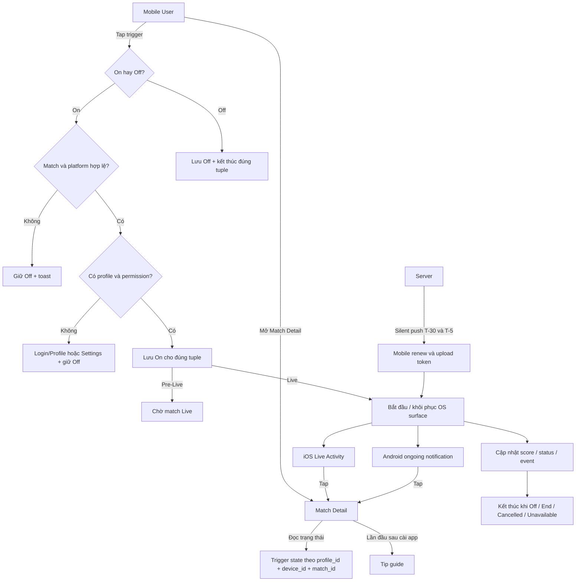

# Live Activity — Match Detail Trigger — Template handoff

- **Dự án / Nền tảng:** FPT Play / Mobile iOS và Android
- **Mục tiêu / Phạm vi:** Đặc tả trigger On/Off Live Activity tại Match Detail, permission, lifecycle theo profile–device–match, token renewal và các OS surface liên quan.
- **Phiên bản / Ngày cập nhật / Người phụ trách:** v1.0 / 2026-10-13 / Dylan

> Khung dùng để soạn tài liệu handoff cho Dev và Stakeholder. Nhân bản dòng bảng hoặc khối nội dung khi cần; mục không áp dụng ghi N/A.

**Quy ước sử dụng**

- Mục 1 là nội dung cố định; người dùng tự điền link. Skill phải giữ nguyên toàn bộ mục này, bao gồm các link đã điền.
- Skill chỉ tạo/cập nhật nội dung trong phạm vi được giao ở mục 2–5. Mỗi mục có thể gắn nhiều skill; tên skill đã được chốt bên dưới, link sẽ bổ sung khi xây dựng skill.
- Flow / Structure / Behavior / State / Interaction rules là khung kiểm tra nội dung. Chỉ mô tả các ý áp dụng; ý không áp dụng có thể bỏ hoặc ghi N/A.
- Trạng thái chung mô tả một lần ở mục 4. Mục 5 dẫn chiếu tình huống tương ứng và chỉ bổ sung ngoại lệ của thành phần.
- Thông tin chưa chốt ghi **Cần xác nhận: [Nội dung]** ngay trong Mô tả hoặc ghi chú của mục liên quan; không tự suy diễn thành yêu cầu đã thống nhất.

**Skills áp dụng toàn tài liệu**

| Skill | Vai trò | Link |
| --- | --- | --- |
| `ba-source-analysis` | Đọc nguồn, xác định phạm vi, phần kế thừa và thông tin cần xác nhận. | |
| `ba-spec-review` | Rà soát thiếu sót, mâu thuẫn, trùng lặp và tính nhất quán giữa các mục. | |
| `ba-template-assembly` | Đưa nội dung vào đúng bố cục template, bảo toàn mục 1 và chỉ cập nhật phần được giao. | |

> Các tên skill là danh mục đã thống nhất để xây dựng; chưa phải skill đã triển khai.

## 1. Disclaimer & Tài liệu tham chiếu

<!-- Nội dung cố định: giữ nguyên khi tái sử dụng hoặc chạy skill. Người dùng tự điền các link bên dưới. -->

Để đảm bảo tính đồng nhất và tránh trùng lặp, tài liệu này kế thừa các mô tả tính năng từ các nguồn liên quan sau:

- **Thiết kế:**
- **Jira task:**
- **Tài liệu liên quan:**
- **Data Licensing:**

**Lưu ý:** Hình ảnh minh họa trong tài liệu này tập trung thể hiện luồng nghiệp vụ (user flow) và tương tác (interaction). Để cập nhật giao diện (UI) mới nhất, vui lòng tham khảo trực tiếp tại link thiết kế. Quyền sử dụng dữ liệu và nội dung được tham chiếu tại Data Licensing.

## 2. Model overview

**Skills:** `ba-model-overview` — Link: [Bổ sung sau]

- **Vai trò các thành phần:**
  - `Match Detail`: điểm duy nhất trong phạm vi này để user bật hoặc tắt Live Activity cho một trận.
  - `Trigger state`: trạng thái độc lập theo `profile_id + device_id + match_id`; tuple chưa có dữ liệu trả về Off.
  - `Tip guide`: hướng dẫn trigger ở lần đầu mở Match Detail sau khi cài app.
  - `iOS Live Activity`: hiển thị trên Lock Screen và Dynamic Island khi thiết bị hỗ trợ và Live Activities đang được bật.
  - `Android ongoing notification`: hiển thị score/status bằng notification cố định khi notification permission hợp lệ.
  - `Token renewal`: server gửi hai đợt silent push để mobile lấy token mới và upload lại trước giờ phát.
- **Luồng chính:** User mở Match Detail → hệ thống hiển thị state của đúng tuple → user bật trigger → hệ thống kiểm tra profile, trạng thái trận và platform permission → lưu On → bắt đầu khi trận Live → cập nhật trong trận → kết thúc đúng tuple khi user Off hoặc trận kết thúc.
- **Phạm vi:**
  - In scope: Match Detail trigger, tip guide, toast, permission handling, tuple state, lifecycle, token renewal, iOS Live Activity, Android ongoing notification và deeplink.
  - Out of scope: Notifications Sport, dùng Đặt lịch/theo dõi đội/theo dõi mùa giải để bật Live Activity, priority/switch giữa nhiều match, Android Dynamic Island/OEM surface, Website và TV.
- **Điểm chưa chốt:** **Cần xác nhận: phiên bản FPT Play app đầu tiên phát hành feature.**

## 3. Layout Overview

**Skills:** `ba-layout-overview` — Link: [Bổ sung sau]

| Screen | Section | Feature / Thành phần | Vị trí / Thứ tự | Mô tả tổng quan |
| --- | --- | --- | --- | --- |
| Match Detail | Match Action Area | Live Activity trigger | Bên trái icon Đặt lịch | Hiển thị Off, On, On-pending, loading hoặc disabled theo tuple và trạng thái trận. |
| Match Detail | Match Action Area | Đặt lịch | Bên phải trigger Live Activity | Feature hiện hành; không bật/tắt và không thay đổi state Live Activity. |
| Match Detail | Coach Mark Layer | Tip guide | Neo tại trigger Live Activity | Hiển thị một lần theo installation flag; user tap vùng dismiss để đóng. |
| Match Detail | Feedback Layer | Toast | Theo toast component của Mobile Design System | Phản hồi sau thao tác On, Off, permission denied hoặc request lỗi. |
| Match Detail | Login/Profile Flow | Login hoặc chọn profile | Dùng flow Mobile hiện hành | Mở khi user chưa có `profile_id` và tap On; quay lại đúng match với trigger Off. |
| Match Detail | Permission Recovery | Hướng dẫn Settings | Sau khi user tap On nhưng permission/authorization đang tắt | Giữ trigger Off và hướng dẫn user mở Settings; không tự On khi quay lại app. |
| iOS System Surface | Dynamic Island — minimal/compact | Score/status ngắn | Do iOS bố trí | Chỉ hiển thị thông tin vừa diện tích; tap mở Match Detail, hold mở expanded view khi OS hỗ trợ. |
| iOS System Surface | Dynamic Island — expanded | Score, clock, event | Do iOS bố trí | Hiển thị thông tin trận đang active của đúng tuple. |
| iOS System Surface | Lock Screen Live Activity | Score, clock, event/final state | Do iOS bố trí | Cập nhật trong trận; tap mở Match Detail. |
| Android System Surface | Ongoing notification | Match title, score, status | Notification shade/Lock Screen tùy OS | Cập nhật trong trận; tap mở Match Detail. |

## 4. Layout Overview — Các trạng thái chung

**Skills:** `ba-common-states` — Link: [Bổ sung sau]; `ba-user-flow` — Link: [Bổ sung sau]

| Tình huống | Link tham chiếu | Mô tả |
| --- | --- | --- |
| Loading trigger state | | **Flow:** User mở Match Detail → hệ thống tải trigger state của tuple hiện tại. **Structure:** Giữ vị trí trigger bên trái Đặt lịch; hiển thị loading state tại trigger. **Behavior:** Không mặc định render On khi chưa có kết quả; chặn tap lặp trong lúc tải. **State:** Loading. **Interaction rules:** Given state chưa tải xong, when user tap vị trí trigger, then hệ thống không gửi toggle request mới. |
| Default Off | | **Flow:** Hệ thống không tìm thấy record của tuple hoặc record có state Off. **Structure:** Trigger hiển thị icon outline/trạng thái Off. **Behavior:** Cho phép tap khi match là Pre-Live hoặc Live. **State:** Off. **Interaction rules:** Given tuple chưa từng bật, when Match Detail tải xong, then trigger phải hiển thị Off. |
| Mất mạng khi bật/tắt | | **Flow:** User tap trigger khi thiết bị mất mạng hoặc request timeout. **Structure:** Trigger quay về state đã được server xác nhận gần nhất; hiển thị toast lỗi. **Behavior:** Không đổi state vĩnh viễn bằng optimistic update; cho phép user thử lại khi có mạng. **State:** Request error / previous confirmed state. **Interaction rules:** Given request không thành công, when loading kết thúc, then trigger phải giữ state trước thao tác và không tạo lifecycle mới. |
| Request đang xử lý | | **Flow:** User tap On hoặc Off → request được gửi. **Structure:** Trigger hiển thị loading và tạm thời không nhận tap mới. **Behavior:** Chỉ chuyển sang state mới sau khi request được xác nhận. **State:** Submitting. **Interaction rules:** Given request đầu tiên chưa hoàn tất, when user tap lại, then hệ thống không gửi request thứ hai. |
| Toggle thành công | | **Flow:** Server xác nhận On hoặc Off. **Structure:** Trigger hiển thị state mới; toast hiển thị theo action. **Behavior:** On dùng `Đã bật Hoạt động trực tiếp.`; Off dùng `Đã tắt Hoạt động trực tiếp.` **State:** On / Off. **Interaction rules:** Mỗi action do user thực hiện chỉ hiển thị một toast kết quả. |
| Toggle lỗi | | **Flow:** Request trả lỗi nghiệp vụ hoặc hệ thống. **Structure:** Trigger giữ state đã xác nhận trước đó; toast hiển thị `Không thể cập nhật Hoạt động trực tiếp. Vui lòng thử lại.` **Behavior:** Không start/end activity dựa trên state chưa được xác nhận. **State:** Error / previous confirmed state. **Interaction rules:** Không hiển thị toast thành công cùng lúc với toast lỗi. |
| Yêu cầu đăng nhập/chọn profile | | **Flow:** Guest hoặc user chưa có profile tap On → mở login/chọn profile → hoàn tất → quay lại cùng Match Detail. **Structure:** Dùng login/profile surface hiện hành; Match Detail sau khi quay lại hiển thị trigger Off. **Behavior:** Hiển thị `Vui lòng đăng nhập hoặc chọn hồ sơ để bật Hoạt động trực tiếp.`; không tự gửi lại On request. **State:** Login required / profile required / Off. **Interaction rules:** User phải tap On lại sau khi đã có `profile_id`. |
| Phiên hết hạn | | **Flow:** Session hết hạn trước hoặc trong toggle request. **Structure:** Mở flow xác thực hiện hành; giữ Match Detail context. **Behavior:** Không cập nhật tuple khi chưa xác thực; sau login quay lại cùng match với state đọc lại từ server. **State:** Session expired / re-authentication required. **Interaction rules:** Không dùng cached `profile_id` của phiên đã hết hạn để tạo hoặc cập nhật tuple. |
| iOS Live Activities bị tắt | Apple `ActivityAuthorizationInfo` | **Flow:** User tap On → app đọc `areActivitiesEnabled = false`. **Structure:** Trigger giữ Off; hiển thị toast hướng dẫn Settings. **Behavior:** Không hiển thị runtime permission popup do app tự tạo; copy: `Hãy bật Hoạt động trực tiếp trong Cài đặt để sử dụng tính năng.` **State:** Authorization disabled / Off. **Interaction rules:** Khi user quay lại từ Settings, app đọc lại authorization nhưng không tự chuyển trigger On. |
| Android notification permission bị từ chối | Android notification permission | **Flow:** User tap On khi permission state là denied. **Structure:** Trigger giữ Off; hiển thị toast hướng dẫn Settings. **Behavior:** Không mở permission prompt mới từ mỗi lần tap trigger; copy: `Hãy bật quyền thông báo trong Cài đặt để sử dụng tính năng.` **State:** Permission denied / Off. **Interaction rules:** Không lưu On-suppressed khi permission đang denied. |
| Thiết bị/OS không hỗ trợ | | **Flow:** User tap On trên device hoặc OS ngoài phạm vi hỗ trợ. **Structure:** Trigger giữ Off; hiển thị toast `Thiết bị này chưa hỗ trợ Hoạt động trực tiếp.` **Behavior:** Không tạo activity record active. **State:** Unsupported / Off. **Interaction rules:** iOS áp dụng từ 16.1+; Android ongoing notification áp dụng từ API 26+. |
| Pre-Live | | **Flow:** User mở match chưa Live. **Structure:** Trigger enabled; On hiển thị trạng thái chờ. **Behavior:** On chỉ lưu intent; OS surface chưa bắt đầu cho tới khi match chuyển Live và điều kiện kỹ thuật hợp lệ. **State:** Off hoặc On-pending. **Interaction rules:** Given match Pre-Live và permission hợp lệ, when user tap On, then tuple chuyển On-pending và hiển thị toast On. |
| Live | | **Flow:** User mở match đang Live hoặc match chuyển Pre-Live → Live. **Structure:** Trigger enabled; On hiển thị active hoặc connecting. **Behavior:** Với tuple On, hệ thống bắt đầu hoặc reconcile đúng OS surface và tiếp tục update. **State:** Off / On-starting / On-active / On-suppressed. **Interaction rules:** Không start activity cho tuple Off. |
| End | | **Flow:** Match chuyển End hoặc user mở match đã End. **Structure:** Trigger disabled. **Behavior:** Gửi final content, end activity, giữ final state tối đa 15 phút rồi dismiss. **State:** Disabled / ended. **Interaction rules:** Tap trigger không gửi On/Off request mới. |
| Cancelled | | **Flow:** Match chuyển Cancelled. **Structure:** Trigger disabled và hiển thị Off. **Behavior:** End/dismiss OS surface ngay với reason `cancelled`. **State:** Disabled / Off / ended. **Interaction rules:** Không giữ On intent cho match Cancelled. |
| Postponed | | **Flow:** Match chuyển Postponed hoặc đổi giờ phát. **Structure:** Trigger vẫn enabled; nếu đã On thì tiếp tục hiển thị On-pending. **Behavior:** Không duy trì OS surface; hủy lịch renew cũ và tạo lại T-30/T-5 theo giờ mới. **State:** Off hoặc On-pending/postponed. **Interaction rules:** Không tự đổi On thành Off chỉ vì Postponed. |
| Unavailable | | **Flow:** Match không còn khả dụng. **Structure:** Trigger disabled và hiển thị Off. **Behavior:** End/dismiss OS surface ngay; chỉ enable lại khi match trở về Pre-Live hoặc Live hợp lệ. **State:** Disabled / Off / unavailable. **Interaction rules:** Không start/update trong thời gian unavailable. |
| Token tạm unavailable | | **Flow:** User đã bật On và authorization hợp lệ nhưng chưa có token dùng được. **Structure:** Trigger hiển thị On-pending/đang kết nối. **Behavior:** Giữ user intent On; chạy recovery. Hết recovery window thì state lifecycle là `suppressed/token_unavailable` và retry khi app foreground/resume. **State:** On-pending / suppressed. **Interaction rules:** Không tự trả trigger về Off và không chạy retry nền vô hạn. |
| OS surface update lỗi | | **Flow:** Score/status/event update không gửi được. **Structure:** OS surface giữ dữ liệu tốt gần nhất. **Behavior:** Hệ thống retry theo technical policy; bỏ qua event trùng hoặc cũ. **State:** Stale / retrying. **Interaction rules:** Không reset score về 0 và không dùng update của match khác. |

## 5. Chi tiết từng section

**Skills:** `ba-component-spec` — Link: [Bổ sung sau]; `ba-user-flow` — Link: [Bổ sung sau]

### Match Detail / Live Activity trigger

Mục đích: cho user chủ động bật hoặc tắt Live Activity cho đúng match đang xem.

| Screen | Section | Feature / Thành phần | Mô tả chi tiết |
| --- | --- | --- | --- |
| Match Detail | Match Action Area | Vị trí trigger | **Flow:** Match Detail render action area → trigger Live Activity hiển thị trước icon Đặt lịch. **Structure:** Trigger và Đặt lịch có hit area riêng; không chồng lấn. **Behavior:** Trigger không thay đổi state Đặt lịch và Đặt lịch không thay đổi state trigger. **State:** Off, On, On-pending, loading, disabled. **Interaction rules:** Given action area đã render, then trigger phải nằm bên trái Đặt lịch; tap một control không được kích hoạt control còn lại. |
| Match Detail | Match Action Area | Icon và state | **Flow:** Hệ thống nhận confirmed state → render icon tương ứng. **Structure:** Icon riêng dạng scoreboard/pulse; Off dùng outline, On/On-pending dùng filled và state indicator, disabled giảm opacity. **Behavior:** Không dùng bell hoặc calendar; không chỉ dùng màu để phân biệt state. **State:** Off, On, On-pending, loading, disabled. **Interaction rules:** Accessibility label lần lượt là `Hoạt động trực tiếp, đang tắt/đang bật/đang kết nối/không khả dụng`. |
| Match Detail | Match Action Area | Đọc state | **Flow:** Mở hoặc quay lại Match Detail → tải state theo tuple hiện tại. **Structure:** Chỉ một trigger cho match đang xem. **Behavior:** Không có record thì render Off; đổi profile phải tải lại state của profile mới. **State:** Loading → confirmed state. **Interaction rules:** Given cùng match/device nhưng đổi `profile_id`, then UI không được giữ state của profile trước. |
| Match Detail | Match Action Area | Bật trigger | **Flow:** User tap Off → check match status, profile, platform support và permission → gửi On request → render kết quả. **Structure:** Loading nằm tại trigger; toast nằm ở feedback layer. **Behavior:** Pre-Live chuyển On-pending; Live chuyển On-starting/On-active nếu token hợp lệ; lỗi giữ Off. **State:** Off → loading → On-pending/On-active hoặc Off/error. **Interaction rules:** Given match Pre-Live/Live, có profile và permission hợp lệ, when user tap On, then chỉ tuple hiện tại được lưu On và hiển thị đúng một toast thành công. |
| Match Detail | Match Action Area | Tắt trigger | **Flow:** User tap On → gửi Off request → clear pending intent hoặc end active surface → render Off. **Structure:** Loading nằm tại trigger; toast nằm ở feedback layer. **Behavior:** Pre-Live clear intent; Live end đúng tuple ngay; không ảnh hưởng tuple khác. **State:** On/On-pending → loading → Off. **Interaction rules:** Given tuple đang On, when user tap Off, then activity của đúng `profile_id + device_id + match_id` phải dừng và không nhận update tiếp. |
| Match Detail | Match Action Area | Chống thao tác trùng | **Flow:** User tap nhiều lần trong lúc request đầu đang xử lý. **Structure:** Trigger tạm disabled/loading. **Behavior:** Chỉ request đầu được gửi; duplicate event phải idempotent. **State:** Submitting. **Interaction rules:** Không tạo hai active activity cho cùng tuple. |

**Tham chiếu:** Mục 4 — Loading trigger state, Default Off, Request đang xử lý, Toggle thành công, Toggle lỗi, Pre-Live, Live, End.

**Ngoại lệ so với trạng thái chung:** N/A.

**Cần xác nhận:** N/A.

### Match Detail / Tip guide

Mục đích: giúp user nhận biết trigger Live Activity trong lần đầu sử dụng.

| Screen | Section | Feature / Thành phần | Mô tả chi tiết |
| --- | --- | --- | --- |
| Match Detail | Coach Mark Layer | Điều kiện hiển thị | **Flow:** User mở Match Detail → hệ thống đọc local flag `live_activity_tip_seen_v1`. **Structure:** Guide neo vào trigger Live Activity. **Behavior:** Flag chưa có thì hiển thị guide; flag đã có thì không hiển thị. **State:** First view / seen. **Interaction rules:** Đổi profile trên cùng installation không làm guide hiện lại; reinstall/reset app data làm guide hiện lại. |
| Match Detail | Coach Mark Layer | Nội dung guide | **Flow:** Guide hiển thị cùng Match Detail. **Structure:** Coach mark chỉ rõ trigger, không che nội dung chính lâu hơn cần thiết. **Behavior:** Copy: `Bật Hoạt động trực tiếp để theo dõi tỷ số ngay trên Màn hình khóa.` **State:** Visible. **Interaction rules:** Guide không tự chuyển trigger On. |
| Match Detail | Coach Mark Layer | Dismiss guide | **Flow:** User tap vùng dismiss/overlay → guide đóng → lưu seen flag. **Structure:** Toàn bộ vùng dismiss được thiết kế cho thao tác đóng theo reference. **Behavior:** Trigger giữ nguyên state trước khi dismiss. **State:** Visible → dismissed. **Interaction rules:** Given trigger Off, when user dismiss guide, then trigger vẫn Off và không gửi toggle request. |
| Match Detail | Coach Mark Layer | Rời màn chưa dismiss | **Flow:** User back/close Match Detail khi guide còn mở. **Structure:** Guide đóng cùng screen. **Behavior:** Không lưu seen flag; lần mở Match Detail tiếp theo hiển thị lại. **State:** Not seen. **Interaction rules:** Chỉ lưu seen flag sau thao tác dismiss thành công. |

**Tham chiếu:** Mục 4 — Default Off; source screenshot Match Detail.

**Ngoại lệ so với trạng thái chung:** Nếu lưu flag lỗi, hệ thống vẫn đóng guide và giữ trạng thái `đã xem` trong memory của session hiện tại. Khi app khởi động lại mà flag chưa được lưu, guide hiển thị lại.

**Cần xác nhận:** N/A.

### Match Detail / Toast và user-facing copy

Mục đích: cho user biết rõ kết quả của từng thao tác trigger.

| Screen | Section | Feature / Thành phần | Mô tả chi tiết |
| --- | --- | --- | --- |
| Match Detail | Feedback Layer | On thành công | **Flow:** On request được xác nhận → trigger hiển thị On/On-pending → toast xuất hiện. **Structure:** Dùng toast component hiện hành. **Behavior:** Copy `Đã bật Hoạt động trực tiếp.` **State:** Success. **Interaction rules:** Một On action hiển thị tối đa một toast success. |
| Match Detail | Feedback Layer | Off thành công | **Flow:** Off request được xác nhận → trigger hiển thị Off → toast xuất hiện. **Structure:** Dùng toast component hiện hành. **Behavior:** Copy `Đã tắt Hoạt động trực tiếp.` **State:** Success. **Interaction rules:** Chỉ hiển thị sau khi Off được xác nhận. |
| Match Detail | Feedback Layer | Request lỗi | **Flow:** Toggle request fail → trigger giữ confirmed state trước đó → toast xuất hiện. **Structure:** Dùng toast component hiện hành. **Behavior:** Copy `Không thể cập nhật Hoạt động trực tiếp. Vui lòng thử lại.` **State:** Error. **Interaction rules:** Toast không được báo On/Off thành công cho cùng request lỗi. |
| Match Detail | Feedback Layer | iOS authorization disabled | **Flow:** User tap On → `areActivitiesEnabled = false`. **Structure:** Trigger giữ Off; hiển thị toast hướng dẫn Settings, không tự mở Settings. **Behavior:** Copy `Hãy bật Hoạt động trực tiếp trong Cài đặt để sử dụng tính năng.` **State:** Permission guidance. **Interaction rules:** Khi user quay lại app, hệ thống đọc lại authorization nhưng không tự bật trigger. |
| Match Detail | Feedback Layer | Android permission denied | **Flow:** User tap On → notification permission state là denied. **Structure:** Trigger giữ Off; toast hướng dẫn Settings. **Behavior:** Copy `Hãy bật quyền thông báo trong Cài đặt để sử dụng tính năng.` **State:** Permission guidance. **Interaction rules:** Không mở lại runtime permission prompt từ mỗi lần tap. |
| Match Detail | Feedback Layer | Token recovery | **Flow:** Recovery window hết trong lúc user vẫn ở Match Detail và token chưa hợp lệ. **Structure:** Trigger giữ On/đang kết nối; hiển thị một toast recovery cho lần lỗi hiện tại. **Behavior:** Copy `Đã bật Hoạt động trực tiếp. Tính năng sẽ tự kết nối lại khi ứng dụng hoạt động.` **State:** On-suppressed / token unavailable. **Interaction rules:** Không đổi trigger Off; không hiển thị lại toast cho cùng một recovery failure nếu state chưa thay đổi. |

**Tham chiếu:** Mục 4 — Toggle thành công, Toggle lỗi, iOS Live Activities bị tắt, Android notification permission bị từ chối, Token tạm unavailable.

**Ngoại lệ so với trạng thái chung:** Background token-renew failure không tự hiển thị toast khi user không ở trong app.

**Cần xác nhận:** N/A.

### Match Detail / Profile và permission gate

Mục đích: chỉ lưu On khi user có identity hợp lệ và platform cho phép hiển thị surface.

| Screen | Section | Feature / Thành phần | Mô tả chi tiết |
| --- | --- | --- | --- |
| Match Detail | Login/Profile Flow | Thiếu `profile_id` | **Flow:** User tap On khi chưa login/chưa chọn profile → mở flow tương ứng → quay lại cùng match. **Structure:** Kế thừa login/profile UI hiện hành. **Behavior:** Trigger vẫn Off; user phải tap On lại. **State:** Login/profile required → Off. **Interaction rules:** Không tạo tuple với `profile_id` rỗng và không auto-On sau login. |
| Match Detail | iOS Authorization Gate | Check Live Activities | **Flow:** User tap On → app đọc `ActivityAuthorizationInfo().areActivitiesEnabled`. **Structure:** Không hiển thị app-owned permission popup. **Behavior:** `true` thì tiếp tục On flow; `false` thì giữ Off và hướng dẫn Settings. **State:** Enabled / disabled. **Interaction rules:** `frequentPushesEnabled` không được dùng thay cho `areActivitiesEnabled` để quyết định On. |
| Match Detail | iOS Authorization Gate | Đồng bộ thay đổi Settings | **Flow:** App resume hoặc Match Detail load → đọc lại authorization/quan sát `activityEnablementUpdates`. **Structure:** Trigger phản ánh product state và authorization hiện tại. **Behavior:** Nếu authorization bị tắt trong khi tuple On, không start update mới và chuyển lifecycle sang suppressed theo technical handling; không tự đổi user intent nếu chưa có Product event Off. **State:** On-suppressed hoặc Off theo confirmed trigger state. **Interaction rules:** Authorization bật lại không tự gửi On action. |
| Match Detail | Android Permission Gate | Check notification permission | **Flow:** Android đã chạy permission flow ở lần đầu vào app; khi user tap On, trigger chỉ đọc permission state hiện tại. **Structure:** Không nhúng permission prompt lặp trong trigger flow. **Behavior:** Granted tiếp tục On; denied giữ Off và hướng dẫn Settings. **State:** Granted / denied. **Interaction rules:** Không lưu On-suppressed khi permission denied. |

**Tham chiếu:** Apple ActivityKit authorization; Android notification runtime permission; Mục 4 — Yêu cầu đăng nhập/chọn profile, iOS Live Activities bị tắt, Android notification permission bị từ chối.

**Ngoại lệ so với trạng thái chung:** N/A.

**Cần xác nhận:** N/A.

### Hệ thống / Tuple state và lifecycle

Mục đích: bắt đầu, cập nhật và kết thúc đúng Live Activity của từng profile, device và match.

| Screen | Section | Feature / Thành phần | Mô tả chi tiết |
| --- | --- | --- | --- |
| Hệ thống | Trigger State | Tuple identity | **Flow:** Mọi read/write/start/update/end đều nhận `profile_id`, `device_id`, `match_id`. **Structure:** Một confirmed trigger state cho mỗi tuple. **Behavior:** Cùng match khác profile hoặc device là các state độc lập. **State:** Off / On-pending / On-active / On-suppressed / disabled. **Interaction rules:** Không dùng `user_id` hoặc `match_id` riêng lẻ làm khóa duy nhất. |
| Hệ thống | Lifecycle | Start | **Flow:** Tuple On-pending + match chuyển Live → kiểm tra token/platform → start đúng activity. **Structure:** Activity record liên kết đúng tuple. **Behavior:** Duplicate start cùng `event_id` trả kết quả idempotent; không tạo activity thứ hai. **State:** Pending → starting → active hoặc suppressed. **Interaction rules:** Tuple Off không được start. |
| Hệ thống | Lifecycle | Update | **Flow:** Match feed có score/status/event mới → resolve các tuple On-active của `match_id` → gửi update. **Structure:** Mỗi active surface nhận content của đúng match. **Behavior:** Bỏ qua event trùng/cũ; lỗi giữ content tốt gần nhất. **State:** Active → updating → active/stale. **Interaction rules:** Không update tuple Off, ended hoặc thuộc match khác. |
| Hệ thống | Lifecycle | End do user Off | **Flow:** Off request được xác nhận → end đúng activity tuple → dừng update. **Structure:** Không ảnh hưởng activity khác. **Behavior:** Dismiss ngay; stale update đến sau Off phải bị bỏ qua. **State:** Active/pending → ending → Off. **Interaction rules:** Off/version mới hơn phải thắng start/update cũ đang xử lý. |
| Hệ thống | Lifecycle | End do Match End | **Flow:** Match chuyển End → gửi final content → end activity. **Structure:** Surface final hiển thị final score và tối đa 3 stat chính khi có dữ liệu. **Behavior:** Giữ final state tối đa 15 phút rồi dismiss; trigger disabled. **State:** Active → ended/disabled. **Interaction rules:** Missing final statistics fallback về final score + FT; không bịa stat. |
| Hệ thống | Lifecycle | Cancelled/Unavailable | **Flow:** Match chuyển Cancelled hoặc Unavailable → end đúng các active tuple. **Structure:** Trigger disabled/Off; surface bị dismiss ngay. **Behavior:** Không giữ pending intent. **State:** Ended / disabled / Off. **Interaction rules:** Chỉ enable lại Unavailable khi match trở về Pre-Live/Live hợp lệ. |
| Hệ thống | Lifecycle | Postponed | **Flow:** Match chuyển Postponed hoặc đổi giờ → dừng surface nếu đang hiển thị → giữ On intent → schedule lại renew. **Structure:** Trigger On-pending hoặc Off theo state trước đó. **Behavior:** Không end user intent On; không tiếp tục score surface khi chưa Live. **State:** On-pending/postponed. **Interaction rules:** Renew schedule phải dùng giờ phát mới. |

**Tham chiếu:** Mục 4 — Pre-Live, Live, End, Cancelled, Postponed, Unavailable; source key `profile_id + device_id + match_id`.

**Ngoại lệ so với trạng thái chung:** Lifecycle operations phải idempotent theo tuple và `event_id`; raw token không xuất hiện trong analytics/logs.

**Cần xác nhận:** N/A.

### Hệ thống / Token renewal trước giờ phát

Mục đích: tăng khả năng có token hợp lệ trước khi match Live mà không thay đổi user intent.

| Screen | Section | Feature / Thành phần | Mô tả chi tiết |
| --- | --- | --- | --- |
| Hệ thống | Renew Scheduler | Silent push đợt 1 | **Flow:** Đến T-30 phút so với giờ phát hiện hành → server gửi silent push renew cho tuple On/eligible. **Structure:** Payload có correlation/event ID và thông tin tối thiểu; không chứa raw token. **Behavior:** Mobile lấy/quan sát token mới và upload cùng tuple; server chờ tối đa 120 giây. **State:** Renewing attempt 1. **Interaction rules:** Token mới phải mới hơn token hiện tại theo version/time; duplicate upload là idempotent. |
| Hệ thống | Renew Scheduler | Silent push đợt 2 | **Flow:** Đến T-5 phút → nếu chưa có token mới hợp lệ thì gửi attempt 2. **Structure:** Dùng event ID riêng cho attempt 2. **Behavior:** Nếu attempt 1 hoặc foreground đã renew thành công thì attempt 2 no-op/cancel; nếu gửi thì chờ tối đa 120 giây. **State:** Renewing attempt 2. **Interaction rules:** Không ghi đè token mới bằng token cũ. |
| Hệ thống | Renew Scheduler | Cả hai đợt thất bại | **Flow:** Hết T-5 + 120 giây vẫn không có token hợp lệ. **Structure:** Tuple giữ On; lifecycle ghi `suppressed/token_unavailable`. **Behavior:** Không start bằng token invalid; retry khi app foreground/resume; log/metric failure. **State:** On-suppressed. **Interaction rules:** Không tự đổi trigger Off và không tạo vòng retry nền vô hạn. |
| Hệ thống | Renew Scheduler | Match đổi giờ | **Flow:** Nhận giờ phát mới → hủy T-30/T-5 cũ → tạo schedule mới. **Structure:** Chỉ một active renew schedule theo giờ hiện hành cho mỗi tuple/match policy. **Behavior:** Job cũ đến muộn phải no-op theo schedule version/event ID. **State:** Rescheduled. **Interaction rules:** Không gửi renew theo giờ phát đã bị thay thế. |
| Mobile App | Token Reconciliation | Foreground/app resume | **Flow:** App foreground/resume → kiểm tra token hiện tại → nếu thay đổi thì upload. **Structure:** Không cần user thao tác trigger. **Behavior:** Khi token mới hợp lệ, tuple vẫn On và match vẫn Live/eligible, lifecycle chuyển từ suppressed sang starting rồi active. **State:** Suppressed → starting → active. **Interaction rules:** Recovery không được bật lại tuple đã Off. |

**Tham chiếu:** Mục 4 — Token tạm unavailable; Product defaults T-30, T-5 và timeout 120 giây.

**Ngoại lệ so với trạng thái chung:** Silent push là best-effort; không được dùng receipt của silent push làm bằng chứng token đã renew.

**Cần xác nhận:** N/A.

### iOS / Dynamic Island và Lock Screen Live Activity

Mục đích: hiển thị score/status/event của đúng match ngoài app trên thiết bị iOS hỗ trợ.

| Screen | Section | Feature / Thành phần | Mô tả chi tiết |
| --- | --- | --- | --- |
| Dynamic Island | Minimal/Compact | Score/status ngắn | **Flow:** Activity active → iOS render compact content → update khi score/status đổi. **Structure:** Minimal chỉ hiển thị score ở vùng app được cấp; Compact hiển thị logo nhỏ khi có logo và score. **Behavior:** Thiếu logo thì ẩn; text dài truncate; score dùng tabular/monospace digits nếu component hỗ trợ. **State:** Active / updating / stale. **Interaction rules:** Không hiển thị profile/device/token; không dùng vùng OS dành cho app khác. |
| Dynamic Island | Expanded | Match context và event | **Flow:** User hold Dynamic Island → OS mở expanded view. **Structure:** Hai đội, score, clock/period và tối đa một latest event. **Behavior:** Event mới hiển thị khoảng 6 giây rồi trở về default; nhiều event cùng lúc chọn event mới nhất theo priority đã định nghĩa trong source spec. **State:** Default / event / final. **Interaction rules:** Hold chỉ expand; tap mới deeplink. |
| Lock Screen | Live Activity | Match context | **Flow:** Activity active → Lock Screen render score/status → nhận update trong trận. **Structure:** Brand nhỏ, match title, score, clock/period, latest event khi có. **Behavior:** Missing/unknown field được ẩn hoặc dùng fallback đã định nghĩa; không tự đoán dữ liệu. **State:** Active / event / stale / final. **Interaction rules:** Tap mở đúng Match Detail bằng `match_id`. |
| iOS System Surface | Final state | Match End | **Flow:** Match End → nhận final content → activity end. **Structure:** Final score + FT; hiển thị tối đa 3 stat chính nếu đủ dữ liệu. **Behavior:** Giữ tối đa 15 phút rồi dismiss. **State:** Final / ended. **Interaction rules:** User Off, Cancelled và Unavailable dismiss ngay, không chờ 15 phút. |

**Tham chiếu:** Existing Live Activity surface rules trong `Live-Activity-Change-Draft.md`; Mục 4 — OS surface update lỗi, End.

**Ngoại lệ so với trạng thái chung:** Presentation cuối cùng do iOS quyết định; Dynamic Island chỉ có trên thiết bị hỗ trợ.

**Cần xác nhận:** N/A.

### Android / Ongoing notification

Mục đích: hiển thị score/status của đúng match ngoài app trên Android.

| Screen | Section | Feature / Thành phần | Mô tả chi tiết |
| --- | --- | --- | --- |
| Android System Surface | Ongoing notification | Match summary | **Flow:** Tuple On-active + match Live → tạo/update ongoing notification. **Structure:** Brand/header nhỏ, match title, score và status. **Behavior:** Update theo match feed; unknown field được ẩn; không giả lập Dynamic Island. **State:** Active / updating / stale / ended. **Interaction rules:** Chỉ chạy trên API 26+ và khi notification permission hợp lệ theo version Android. |
| Android System Surface | Ongoing notification | Tap action | **Flow:** User tap notification → app mở/resume → route tới Match Detail của payload `match_id`. **Structure:** Dùng deeplink/navigation hiện hành. **Behavior:** Cold start vẫn mở đúng match; tap lặp không stack duplicate Match Detail. **State:** Routing / opened / fallback. **Interaction rules:** Invalid hoặc unavailable `match_id` fallback Sport Zone match card. |
| Android System Surface | Ongoing notification | End | **Flow:** User Off, Match End, Cancelled hoặc Unavailable → notification kết thúc theo lifecycle rule. **Structure:** Match End hiển thị final score/status tối đa 15 phút rồi dismiss; User Off, Cancelled và Unavailable dismiss ngay. **Behavior:** Không nhận update sau khi tuple Off/ended. **State:** Final / ended / dismissed. **Interaction rules:** Không giữ notification stale sau terminal event. |

**Tham chiếu:** Mục 4 — Android notification permission bị từ chối, Live, End, Cancelled, Unavailable.

**Ngoại lệ so với trạng thái chung:** Lock Screen visibility do Android/OEM/user settings quyết định.

**Cần xác nhận:** N/A.

### OS surfaces / Deeplink về Match Detail

Mục đích: đưa user từ Live Activity hoặc notification về đúng match.

| Screen | Section | Feature / Thành phần | Mô tả chi tiết |
| --- | --- | --- | --- |
| iOS/Android System Surface | Tap target | Valid `match_id` | **Flow:** User tap surface → app đọc `match_id` → mở Match Detail. **Structure:** Route giữ đúng match context. **Behavior:** Hỗ trợ cả app đang chạy và cold start. **State:** Routing → Match Detail. **Interaction rules:** Không mở match khác và không tạo nhiều màn Match Detail do tap lặp. |
| iOS/Android System Surface | Tap target | Invalid/unavailable `match_id` | **Flow:** User tap → route validation fail. **Structure:** Mở Sport Zone match card/list fallback. **Behavior:** Hiển thị `Không mở được trận đấu. Đã chuyển đến Sport Zone.` hoặc `Không tìm thấy trận đấu này.` theo failure type. **State:** Fallback. **Interaction rules:** Không crash, không mở dữ liệu của match gần nhất thay thế. |

**Tham chiếu:** Mục 4 — OS surface update lỗi; source routing rules.

**Ngoại lệ so với trạng thái chung:** Hold Dynamic Island mở expanded view, không deeplink ngay.

**Cần xác nhận:** N/A.

### Hệ thống / Analytics, bảo mật và kiểm thử hồi quy

Mục đích: đo độ tin cậy và phát hiện update sai tuple mà không ghi lộ dữ liệu nhạy cảm.

| Screen | Section | Feature / Thành phần | Mô tả chi tiết |
| --- | --- | --- | --- |
| Hệ thống | Analytics | Trigger funnel | **Flow:** Ghi event khi trigger impression, tap, success, fail và permission result. **Structure:** Properties gồm platform, match status, trigger state và error code; identifiers dùng dạng privacy-safe. **Behavior:** Cho phép đo On conversion và permission denial rate. **State:** N/A. **Interaction rules:** Không gửi raw activity token. |
| Hệ thống | Observability | Token và lifecycle | **Flow:** Ghi renew scheduled/sent/uploaded/failed và start/update/end requested/succeeded/failed. **Structure:** Có correlation/event ID để trace một lifecycle. **Behavior:** Cho phép phát hiện duplicate, stale update và cả hai renew attempt thất bại. **State:** N/A. **Interaction rules:** Log không chứa raw token hoặc dữ liệu Lock Screen riêng tư. |
| Hệ thống | Security | Tuple ownership | **Flow:** Mọi request đọc/ghi tuple → xác thực profile–device ownership. **Structure:** Không expose token/profile/device trên OS surface. **Behavior:** Từ chối cross-profile/device access. **State:** Authorized / rejected. **Interaction rules:** Cùng `match_id` nhưng khác profile/device phải được xử lý độc lập. |
| QA | Regression Matrix | Core isolation | **Flow:** Chạy test cùng match với nhiều profile/device, duplicate actions và stale events. **Structure:** Test data có ít nhất 2 profile × 2 device × 2 match. **Behavior:** Chỉ tuple mục tiêu đổi state/lifecycle. **State:** Off / On-pending / active / ended / suppressed. **Interaction rules:** Bất kỳ update/end nhầm tuple nào là lỗi release-blocking. |

**Tham chiếu:** Source QA Acceptance Matrix và traceability trong `Live-Activity-Change-Draft.md`.

**Ngoại lệ so với trạng thái chung:** Metrics không được làm thay đổi product state hoặc chặn user flow nếu telemetry fail.

**Cần xác nhận:** N/A.
