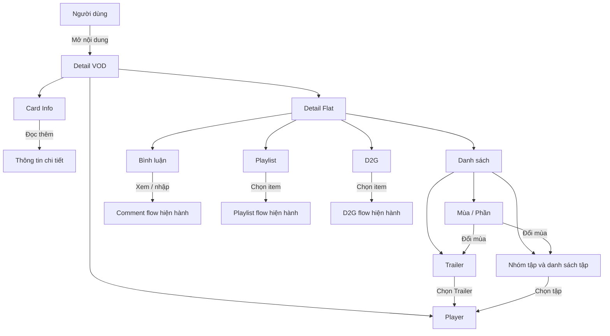

# Detail VOD Mobile & Tablet — BA Feature Spec

- **Dự án / Nền tảng:** FPT Play / Mobile và Tablet
- **Mục tiêu / Phạm vi:** Handoff gói thay đổi Detail VOD v1.1: chuyển các nội dung chính từ floating sang Detail Flat, cập nhật Card Info, Mùa/Phần, Trailer, danh sách tập, Bình luận, Playlist và D2G.
- **Phiên bản / Ngày cập nhật / Người phụ trách:** v1.1-draft / 2026-10-19 / Đặng Thái Dương (BA)

> Khung dùng để soạn tài liệu handoff cho Dev và Stakeholder. Nhân bản dòng bảng hoặc khối nội dung khi cần; mục không áp dụng ghi N/A.

**Quy ước sử dụng**

- Mục 1 là nội dung cố định; người dùng tự điền link. Skill phải giữ nguyên toàn bộ mục này, bao gồm các link đã điền.
- Skill chỉ tạo/cập nhật nội dung trong phạm vi được giao ở mục 2–5. Mỗi mục có thể gắn nhiều skill; tên skill đã được chốt bên dưới, link sẽ bổ sung khi xây dựng skill.
- Flow / Structure / Behavior / State / Interaction rules là khung kiểm tra nội dung. Chỉ mô tả các ý áp dụng; ý không áp dụng có thể bỏ hoặc ghi N/A.
- Trạng thái chung mô tả một lần ở mục 4. Mục 5 dẫn chiếu tình huống tương ứng và chỉ bổ sung ngoại lệ của thành phần.
- Thông tin chưa chốt ghi **Cần xác nhận: [Nội dung]** ngay trong Mô tả hoặc ghi chú của mục liên quan; không tự suy diễn thành yêu cầu đã thống nhất.

**Skills áp dụng toàn tài liệu**

| Skill | Vai trò | Link |
| --- | --- | --- |
| `ba-source-analysis` | Đọc nguồn, xác định phạm vi, phần kế thừa và thông tin cần xác nhận. | |
| `ba-spec-review` | Rà soát thiếu sót, mâu thuẫn, trùng lặp và tính nhất quán giữa các mục. | |
| `ba-template-assembly` | Đưa nội dung vào đúng bố cục template, bảo toàn mục 1 và chỉ cập nhật phần được giao. | |

> Các tên skill là danh mục đã thống nhất để xây dựng; chưa phải skill đã triển khai.

## 1. Disclaimer & Tài liệu tham chiếu

<!-- Nội dung cố định: giữ nguyên khi tái sử dụng hoặc chạy skill. Người dùng tự điền các link bên dưới. -->

Để đảm bảo tính đồng nhất và tránh trùng lặp, tài liệu này kế thừa các mô tả tính năng từ các nguồn liên quan sau:

- **Thiết kế:**
- **Jira task:**
- **Tài liệu liên quan:**
- **Data Licensing:**

**Lưu ý:** Hình ảnh minh họa trong tài liệu này tập trung thể hiện luồng nghiệp vụ (user flow) và tương tác (interaction). Để cập nhật giao diện (UI) mới nhất, vui lòng tham khảo trực tiếp tại link thiết kế. Quyền sử dụng dữ liệu và nội dung được tham chiếu tại Data Licensing.

## 2. Model overview

**Skills:** `ba-model-overview` — Link: [Bổ sung sau]

- **Vai trò các thành phần:**
  - `Detail VOD`: màn hình tổng, hiển thị Player, Card Info và các block nội dung liên quan.
  - `Card Info`: hiển thị thông tin tóm tắt và entry point **Đọc thêm** thay cho tab Thông tin.
  - `Detail Flat`: vùng cuộn chứa Danh sách, Bình luận, Playlist, D2G và các block hiện hành khác.
  - `Danh sách`: quản lý Mùa/Phần, Trailer, nhóm tập và card tập.
  - `Player`: phát Trailer hoặc tập được chọn; logic phát kế thừa tài liệu Player hiện hành.
  - `Bình luận`, `Playlist`, `D2G`: chuyển entry point từ floating sang block/list tại Detail Flat; nghiệp vụ lõi kế thừa tài liệu hiện hành nếu có.
- **Luồng chính:** User mở Detail VOD → xem thông tin tóm tắt → cuộn Detail Flat → chọn Mùa/Phần, Trailer hoặc tập → Player phát nội dung tương ứng; user có thể truy cập Bình luận, Playlist và D2G từ các block mới.
- **Phạm vi thay đổi:**
  - Thay tab Thông tin bằng nút **Đọc thêm** tại Card Info.
  - Chuyển Danh sách tập, Bình luận, Playlist và D2G khỏi floating sang Detail Flat.
  - Dùng Dropdown để chọn Mùa/Phần.
  - Hiển thị Trailer theo Season hiện tại.
  - Chia danh sách tập thành nhóm tối đa 15 tập; bỏ filter Cũ nhất/Mới nhất.
- **Nguyên tắc kế thừa:** Các requirement không được mô tả là thay đổi tiếp tục dùng baseline `detailvod.pdf`. Tài liệu này chưa ghi đè baseline cho tới khi được phê duyệt.

## 3. Layout Overview

**Skills:** `ba-layout-overview` — Link: [Bổ sung sau]

| Screen | Section | Feature / Thành phần | Vị trí / Thứ tự | Mô tả tổng quan |
| --- | --- | --- | --- | --- |
| Detail VOD | Player Area | Player | Bám cạnh trên của trang | Hiển thị nội dung đang phát theo tỷ lệ 16:9; nhận nội dung khi user chọn Trailer hoặc tập. |
| Detail VOD | Primary Info | Title và metadata | Bên dưới Player | Kế thừa baseline; hiển thị title và metadata của nội dung hiện tại. |
| Detail VOD | Card Info | Thông tin tóm tắt | Sau title/metadata theo Figma | Hiển thị mô tả/thông tin tóm tắt và nút **Đọc thêm**. |
| Detail VOD | Card Info | Nút Đọc thêm | Trong Card Info | Thay entry point tab Thông tin; mở nội dung chi tiết của VOD hiện tại. |
| Detail Flat | Danh sách | Dropdown Mùa/Phần | Header khu vực Danh sách | Hiển thị khi nội dung có nhiều Season; đổi Season sẽ reload Trailer và danh sách tập. |
| Detail Flat | Danh sách | Trailer | Trước các nhóm tập | Hiển thị Trailer thuộc Season hiện tại; không có dữ liệu thì ẩn. |
| Detail Flat | Danh sách | Chip nhóm tập | Trên danh sách card tập | Chia tập theo nhóm tối đa 15 item; nhóm chứa tập đang phát được active mặc định. |
| Detail Flat | Danh sách | Card tập | Bên dưới chip nhóm tập | Hiển thị tập theo Season/nhóm đang chọn, mặc định từ cũ đến mới. |
| Detail Flat | Bình luận | Khung Bình luận | **Cần xác nhận:** thứ tự theo Figma | Thay entry point floating Bình luận; logic comment kế thừa flow hiện hành. |
| Detail Flat | Playlist | Block Playlist | **Cần xác nhận:** thứ tự theo Figma | Thay entry point floating Playlist; chỉ hiển thị khi có dữ liệu. |
| Detail Flat | D2G | Danh sách D2G | **Cần xác nhận:** thứ tự theo Figma | Thay entry point floating D2G; chỉ hiển thị khi có dữ liệu. |
| Detail VOD | Floating toolbar | Danh sách/Bình luận/Playlist/D2G | Bị loại bỏ theo từng thay đổi được duyệt | Không tiếp tục hiển thị entry point floating khi block thay thế tương ứng đã được phê duyệt. |

## 4. Layout Overview — Các trạng thái chung

**Skills:** `ba-common-states` — Link: [Bổ sung sau]; `ba-user-flow` — Link: [Bổ sung sau]

| Tình huống | Link tham chiếu | Mô tả |
| --- | --- | --- |
| Loading Detail | `detailvod.pdf` — UI Requirement / Các trường hợp chung | **Flow:** User mở Detail VOD → hệ thống tải dữ liệu Detail và dữ liệu các block liên quan. **Structure:** Giữ Player/vùng chính theo thiết kế; block đang tải hiển thị skeleton hoặc placeholder hiện hành. **Behavior:** Dữ liệu block nào sẵn sàng trước có thể hiển thị trước nếu không phụ thuộc block khác. **State:** Loading / Partial loaded. **Interaction rules:** Không cho tương tác với control chưa tải đủ dữ liệu; không mặc định chọn item chưa được xác nhận. |
| Mất mạng khi mở Detail | `detailvod.pdf` — Xử lý khi mất mạng | **Flow:** User mở Detail khi không có mạng → hệ thống hiển thị popup → user chọn Thử lại hoặc Đóng. **Structure:** Popup gồm title `Không có kết nối mạng`, description và hai action theo baseline. **Behavior:** Thử lại gọi lại API Detail; Đóng tắt popup và thoát Detail về trang trước, không xác định được thì về Homepage. **State:** Offline / Retry / Closed. **Interaction rules:** Không hiển thị dữ liệu mới khi chưa kết nối; lịch sử điều hướng chỉ dùng page trước gần nhất, không dùng Detail khác. |
| Lỗi API Detail | `detailvod.pdf` — Xử lý khi API detail lỗi | **Flow:** API Detail lỗi khác 410/mất mạng → hiển thị popup → user Thử lại hoặc Đóng. **Structure:** Title `Lỗi kết nối dịch vụ`; description `Hãy kiểm tra lại kết nối và thử tải lại trang này`. **Behavior:** Thử lại gọi API Detail; Đóng thoát Detail theo rule baseline. **State:** Error / Retry / Closed. **Interaction rules:** Không render Detail như thành công khi API chính lỗi. |
| Nội dung không tồn tại / deeplink lỗi | `detailvod.pdf` — Xử lý khi deeplink lỗi/không tồn tại | **Flow:** User đi deeplink → nội dung không tồn tại → hệ thống hiển thị thông báo → user đóng popup. **Structure:** Title `Không tìm thấy nội dung`; description theo baseline; một action Đóng/Đồng ý. **Behavior:** Cold start quay về Homepage; app đang mở quay về page trước gần nhất, không xác định được thì về Homepage. **State:** Content not found / Closed. **Interaction rules:** Không tự mở một nội dung khác thay thế. |
| Loading block con | `detailvod.pdf`; Figma cần bổ sung | **Flow:** Detail chính đã hiển thị → block Danh sách/Bình luận/Playlist/D2G tiếp tục tải dữ liệu. **Structure:** Skeleton/placeholder nằm trong đúng vùng block; không che Player và block khác. **Behavior:** Block tải độc lập nếu API độc lập. **State:** Block loading. **Interaction rules:** Không cho tap item khi block chưa có dữ liệu; loading một block không được khóa toàn bộ Detail. |
| Block không có dữ liệu | `detailvod.pdf` — rule ẩn block | **Flow:** API trả danh sách rỗng hoặc feature không áp dụng → hệ thống không render block tương ứng. **Structure:** Không giữ khoảng trống của block bị ẩn. **Behavior:** Các block phía sau được dồn lên theo layout. **State:** Empty / Hidden. **Interaction rules:** Không hiển thị CTA giả nếu nguồn không quy định empty state; Trailer, Playlist và D2G không có dữ liệu thì ẩn. |
| Block con lỗi | Baseline + cần xác nhận theo Figma | **Flow:** Detail chính thành công nhưng một block con lỗi → hệ thống giữ màn Detail và xử lý lỗi tại block/popup theo rule riêng. **Structure:** Block lỗi hiển thị error/retry nếu component hiện hành hỗ trợ; không thay thế toàn màn hình. **Behavior:** Không xóa dữ liệu tốt của các block khác. **State:** Partial error / Retry. **Interaction rules:** **Cần xác nhận:** block Danh sách, Bình luận, Playlist và D2G dùng inline retry hay ẩn block khi API lỗi. |
| Yêu cầu đăng nhập | `detailvod.pdf` — Login Required | **Flow:** User thao tác với nội dung yêu cầu login → hệ thống hiển thị popup → user Đóng hoặc Đăng nhập. **Structure:** Popup title/description và hai nút theo baseline. **Behavior:** Đăng nhập thành công quay lại đúng Detail; thất bại hiển thị lỗi theo login flow hiện hành. **State:** Login required / Authenticating / Returned. **Interaction rules:** Đóng popup không thực hiện action ban đầu; sau đăng nhập chỉ tự tiếp tục action nếu flow hiện hành đã quy định. |
| Phiên hết hạn | `detailvod.pdf` — Login required/expire token | **Flow:** User chọn item hoặc nhập Bình luận khi token hết hạn → hệ thống mở login flow → quay lại Detail. **Structure:** Dùng popup/màn login hiện hành. **Behavior:** Không gửi action cần auth bằng token hết hạn. **State:** Session expired / Re-authentication required. **Interaction rules:** Sau khi quay lại phải đọc lại state liên quan trước khi cho user tiếp tục. |
| Ảnh lỗi / thiếu ảnh | `detailvod.pdf` — Trường hợp lỗi từng component | **Flow:** Thumbnail/poster/avatar tải lỗi → hệ thống hiển thị placeholder. **Structure:** Placeholder giữ đúng tỷ lệ/kích thước component. **Behavior:** Nội dung text khác vẫn hiển thị nếu có. **State:** Missing image / Placeholder. **Interaction rules:** Placeholder không làm thay đổi tap target của card. |
| Đổi nội dung đang phát | `detailvod.pdf` — Trailer/Card item | **Flow:** User chọn Trailer hoặc tập → hệ thống chuyển nội dung trên Player → cập nhật item đang phát. **Structure:** Player giữ vị trí; card tương ứng hiển thị playing state. **Behavior:** Chỉ một item trong context hiện tại được đánh dấu đang phát. **State:** Switching / Playing / Playback error. **Interaction rules:** Tap Download không được đồng thời chuyển tập; lỗi phát kế thừa Player flow hiện hành. |

## 5. Chi tiết từng section

**Skills:** `ba-component-spec` — Link: [Bổ sung sau]; `ba-user-flow` — Link: [Bổ sung sau]

### Detail VOD / Detail Flat

Mục đích: đưa các nội dung quan trọng ra vùng cuộn chính của Detail VOD, giảm phụ thuộc vào floating toolbar và Bottom Sheet Danh sách.

| Screen | Section | Feature / Thành phần | Mô tả chi tiết |
| --- | --- | --- | --- |
| Detail VOD | Detail Flat | Vùng nội dung cuộn | **Flow:** User mở Detail VOD → xem Player và thông tin chính → cuộn xuống các block Detail Flat. **Structure:** Detail Flat chứa Card Info/Danh sách/Bình luận/Playlist/D2G và các block hiện hành khác theo Figma. **Behavior:** Chỉ render block áp dụng và có dữ liệu; block ẩn không giữ khoảng trống. **State:** Loading, loaded, partial loaded, partial error, offline. **Interaction rules:** Cuộn dọc là tương tác chính; lỗi độc lập của một block không đóng toàn bộ Detail. |
| Detail VOD | Detail Flat | Thứ tự block | **Flow:** Hệ thống render các block theo cấu hình/thiết kế đã chốt. **Structure:** Player và primary info ở trên; các block liên quan nằm trong Detail Flat. **Behavior:** Thứ tự phải đồng nhất giữa Mobile và Tablet trừ responsive rule trong Figma. **State:** Full layout / Conditional layout. **Interaction rules:** **Cần xác nhận:** thứ tự chính xác giữa Danh sách, Bình luận, Playlist, D2G, Short Video, Diễn viên và Liên quan. |
| Detail VOD | Floating toolbar | Loại bỏ entry point cũ | **Flow:** User mở Detail sau khi gói thay đổi được áp dụng → truy cập chức năng từ block mới thay vì floating. **Structure:** Ẩn icon Danh sách/Bình luận/Playlist/D2G tương ứng với change đã được duyệt. **Behavior:** Không duy trì hai entry point có cùng chức năng nếu Product không yêu cầu. **State:** Retained hoặc removed theo approval. **Interaction rules:** Change bị reject thì entry point baseline tương ứng tiếp tục có hiệu lực; không loại bỏ đồng loạt khi chưa duyệt từng thay đổi. |

**Tham chiếu:** Mục 3 — Layout Overview; Mục 4 — Loading Detail, Loading block con, Block không có dữ liệu, Block con lỗi; `detailvod.pdf` v1.2 changelog.

**Ngoại lệ so với trạng thái chung:** N/A.

**Cần xác nhận:** Thứ tự block cuối cùng và breakpoint/layout Tablet theo Figma.

### Detail VOD / Card Info và Đọc thêm

Mục đích: thay tab Thông tin bằng entry point **Đọc thêm** ngay tại Card Info.

| Screen | Section | Feature / Thành phần | Mô tả chi tiết |
| --- | --- | --- | --- |
| Detail VOD | Card Info | Thông tin tóm tắt | **Flow:** Detail tải thành công → hệ thống hiển thị thông tin tóm tắt của VOD. **Structure:** Card chứa nội dung tóm tắt và nút **Đọc thêm** khi có thông tin chi tiết. **Behavior:** Field thiếu xử lý theo baseline; không hiển thị nút nếu không có nội dung cần mở rộng. **State:** Loading, loaded, missing field, no-detail. **Interaction rules:** Card không tự mở nội dung chi tiết khi user chỉ cuộn hoặc tap ngoài vùng action. |
| Detail VOD | Card Info | Nút Đọc thêm | **Flow:** User chọn **Đọc thêm** → hệ thống mở nội dung chi tiết → user đóng/quay lại Detail. **Structure:** Action nằm trong Card Info; surface chi tiết hiển thị title `Chi tiết`, mô tả, thể loại và các field baseline hỗ trợ. **Behavior:** Entry point này thay tab Thông tin; mở đúng dữ liệu của VOD hiện tại. **State:** Default, pressed, detail opened, hidden. **Interaction rules:** Không đồng thời duy trì tab Thông tin sau khi change được duyệt. Đóng surface phải trả user về đúng Detail hiện tại. **Cần xác nhận:** mở inline, Pullup hay Bottom Sheet. |

**Tham chiếu:** `detailvod.pdf` — mục Thông tin; changelog v1.2; Mục 4 — Loading Detail, Ảnh lỗi/thiếu ảnh.

**Ngoại lệ so với trạng thái chung:** Nếu nội dung chi tiết dùng dữ liệu đã có từ Detail API thì không hiển thị loading lần hai.

**Cần xác nhận:** Loại surface của **Đọc thêm** và rule hiển thị nút khi chỉ có một phần dữ liệu.

### Detail Flat / Dropdown Mùa/Phần

Mục đích: cho user đổi Mùa/Phần ngay tại khu vực Danh sách.

| Screen | Section | Feature / Thành phần | Mô tả chi tiết |
| --- | --- | --- | --- |
| Detail Flat | Danh sách | Season đang chọn | **Flow:** Hệ thống tải Season → xác định Season chứa nội dung đang phát → hiển thị Season hiện tại. **Structure:** Header/Dropdown nằm đầu khu vực Danh sách. **Behavior:** Một Season thì ẩn control; lỗi API Season thì ẩn Dropdown nhưng giữ các dữ liệu khác đang dùng được. **State:** Loading, selected, hidden, error. **Interaction rules:** Tên dài thì truncate; Season mặc định phải tương ứng với tập/nội dung đang phát. |
| Detail Flat | Danh sách | Mở Dropdown | **Flow:** User tap Season hiện tại → Dropdown mở → user xem danh sách Season. **Structure:** Dropdown không tràn ngoài vùng thiết kế; Season hiện tại hiển thị ở vị trí đầu theo baseline. **Behavior:** Trên 8 item thì cho phép cuộn; không lưu scroll khi đóng/mở lại. **State:** Closed, open, scrolling. **Interaction rules:** Tap ngoài đóng Dropdown; tap lại item hiện tại chỉ đóng Dropdown, không reload. |
| Detail Flat | Danh sách | Chọn Season khác | **Flow:** User chọn Season khác → Dropdown đóng → hệ thống tải Trailer và danh sách tập tương ứng → hiển thị dữ liệu mới. **Structure:** Giữ nguyên khu vực Danh sách; nội dung con chuyển sang loading khi reload. **Behavior:** Thành công thì reset Trailer/nhóm tập/list về Season mới và cuộn danh sách về đầu. **State:** Selecting, loading, selected, error. **Interaction rules:** Không hiển thị lẫn dữ liệu của hai Season. **Cần xác nhận:** nếu reload lỗi thì rollback Season cũ hay giữ Season mới với error state. |

**Tham chiếu:** `detailvod.pdf` — Danh sách/Header Season; Mục 4 — Loading block con, Block con lỗi.

**Ngoại lệ so với trạng thái chung:** Lỗi Season không đóng Detail VOD.

**Cần xác nhận:** Behavior khi tải Season mới thất bại.

### Detail Flat / Trailer

Mục đích: hiển thị Trailer của Season hiện tại tại Detail Flat và cho user phát Trailer trên Player.

| Screen | Section | Feature / Thành phần | Mô tả chi tiết |
| --- | --- | --- | --- |
| Detail Flat | Danh sách | Khu vực Trailer | **Flow:** Season được xác định → hệ thống tải Trailer → hiển thị Trailer trước nhóm tập. **Structure:** Danh sách card Trailer theo component/Figma áp dụng. **Behavior:** Không có Trailer thì ẩn khu vực; đổi Season thì reload Trailer của Season mới. **State:** Loading, loaded, empty/hidden, error. **Interaction rules:** Không giữ item Trailer của Season trước sau khi Season mới được xác nhận. |
| Detail Flat | Danh sách | Card Trailer | **Flow:** User xem card → tap card → Player chuyển sang Trailer tương ứng. **Structure:** Card gồm thumbnail 16:9, title và thời lượng khi có. **Behavior:** Thumbnail lỗi dùng placeholder; title thiếu thì ẩn; thời lượng thiếu thì ẩn hoặc dùng fallback baseline. **State:** Default, pressed, playing, missing thumbnail, missing title. **Interaction rules:** Toàn card là tap target; item đang phát hiển thị playing state và không hiển thị duration label nếu baseline quy định. |

**Tham chiếu:** `detailvod.pdf` — Block Trailer & Videos; Danh sách/Chip Trailer; Mục 4 — Ảnh lỗi/thiếu ảnh, Đổi nội dung đang phát.

**Ngoại lệ so với trạng thái chung:** Trailer không áp dụng seekbar/download của card tập trừ khi source hiện hành quy định.

**Cần xác nhận:** Có tiếp tục dùng chip `Trailer` hay chuyển thành title/block riêng theo Figma mới.

### Detail Flat / Nhóm tập

Mục đích: chia danh sách tập dài thành các nhóm liên tiếp để user tìm tập nhanh hơn.

| Screen | Section | Feature / Thành phần | Mô tả chi tiết |
| --- | --- | --- | --- |
| Detail Flat | Danh sách | Quy tắc tạo nhóm | **Flow:** Hệ thống nhận danh sách tập của Season → sắp xếp từ cũ đến mới → chia nhóm tối đa 15 tập. **Structure:** Mỗi nhóm có một chip/range label. **Behavior:** Tên nhóm là số đầu-cuối, ví dụ `1-15`, `16-30`, `46-50`; nhóm một tập hiển thị một số, ví dụ `31`. **State:** Single group, multiple groups, empty. **Interaction rules:** Tổng số tập ≤15 thì không hiển thị chip nhóm; phim lẻ không hiển thị danh sách tập. |
| Detail Flat | Danh sách | Chip nhóm tập | **Flow:** Hệ thống active nhóm chứa tập đang phát → user chọn nhóm khác → danh sách hiển thị tập của nhóm đó. **Structure:** Các chip nằm trên danh sách card tập và cho phép scroll/swipe ngang khi vượt vùng hiển thị. **Behavior:** Chỉ một chip active; đổi Season thì tính lại và reset nhóm. **State:** Default, active, pressed, disabled/loading. **Interaction rules:** Tap chip không phát tập; chỉ đổi tập hợp card đang hiển thị. |
| Detail Flat | Danh sách | Cập nhật khi có tập mới | **Flow:** Nguồn dữ liệu có thêm tập → hệ thống tính lại nhóm cuối hoặc tạo nhóm mới. **Structure:** Giữ quy tắc tối đa 15 item/nhóm. **Behavior:** Không thay đổi thứ tự các tập cũ; range label phản ánh dữ liệu mới. **State:** Updated. **Interaction rules:** Nếu user đang ở nhóm không bị ảnh hưởng thì giữ nhóm hiện tại; **Cần xác nhận:** nếu đang ở nhóm cuối bị đổi range, có giữ active không. |

**Tham chiếu:** `detailvod.pdf` — Chip Nhóm tập.

**Ngoại lệ so với trạng thái chung:** Ví dụ chuẩn: 50 tập → `1-15`, `16-30`, `31-45`, `46-50`; 31 tập → `1-15`, `16-30`, `31`.

**Cần xác nhận:** Rule giữ active group khi danh sách có tập mới trong lúc màn hình đang mở.

### Detail Flat / Danh sách tập

Mục đích: hiển thị danh sách tập trực tiếp trên Detail Flat thay vì trong floating Bottom Sheet.

| Screen | Section | Feature / Thành phần | Mô tả chi tiết |
| --- | --- | --- | --- |
| Detail Flat | Danh sách | Danh sách card tập | **Flow:** Season/nhóm được chọn → hệ thống hiển thị các tập tương ứng → user cuộn và chọn tập. **Structure:** Card tập nằm trong khu vực Danh sách; không có filter Cũ nhất/Mới nhất. **Behavior:** Sắp xếp mặc định từ cũ đến mới; nhóm chứa tập đang phát được active khi vào màn. **State:** Loading, loaded, empty, error. **Interaction rules:** **Cần xác nhận:** tự cuộn tới card đang phát hay chỉ active đúng nhóm. Không duy trì Bottom Sheet Danh sách sau khi change được duyệt. |
| Detail Flat | Danh sách | Card tập | **Flow:** User tap card → Player chuyển sang tập → card mới nhận playing state. **Structure:** Thumbnail 16:9, số/tên tập, mô tả, thời lượng, seekbar, nhãn gói và Download khi áp dụng. **Behavior:** Title/mô tả truncate theo baseline; tập cuối có thể hiển thị `Tập {N} - Tập cuối`; thumbnail lỗi dùng placeholder. **State:** Default, pressed, playing, watched/in-progress, locked/package, download states. **Interaction rules:** Tap card chuyển tập; tap Download chỉ chạy Download flow; chỉ một card có playing state. |
| Detail Flat | Danh sách | Tập đang phát | **Flow:** Player bắt đầu phát tập → hệ thống cập nhật card tương ứng. **Structure:** Icon đang phát nằm trên thumbnail theo thiết kế. **Behavior:** Không hiển thị duration label của item đang phát theo baseline. **State:** Playing. **Interaction rules:** Khi đổi tập, phải bỏ playing state khỏi item trước. |
| Detail Flat | Danh sách | Seekbar tập đã xem | **Flow:** Hệ thống đọc lịch sử xem → render progress trên card. **Structure:** Seekbar nằm trên/bên dưới thumbnail theo component hiện hành. **Behavior:** Tập chưa xem không hiển thị seekbar. **State:** Unwatched, in-progress, watched. **Interaction rules:** Progress chỉ phản ánh lịch sử xem của đúng tập/user context hiện hành. |
| Detail Flat | Danh sách | Download | **Flow:** User tap icon Download → hệ thống chạy Download Flow hiện hành. **Structure:** Icon/state Download nằm trên card của nội dung hỗ trợ offline. **Behavior:** Hỗ trợ các state Chưa tải, Đang tải, Trong hàng đợi, Tạm dừng, Thất bại, Thành công. **State:** Download states. **Interaction rules:** Tap Download không bubble sang tap card; nội dung không hỗ trợ offline thì ẩn action. |
| Detail Flat | Danh sách | Thứ tự mặc định | **Flow:** Hệ thống nhận dữ liệu → sắp xếp từ cũ đến mới → tạo nhóm và render card. **Structure:** Không hiển thị filter sort. **Behavior:** Bỏ control Cũ nhất/Mới nhất và state filter đã lưu trước đây. **State:** Default order / filter removed. **Interaction rules:** **Cần xác nhận:** dùng episode number hay canonical order từ API khi số tập thiếu, trùng hoặc không liên tục. |

**Tham chiếu:** `detailvod.pdf` — Card item, Bộ filter, Download; Mục 4 — Đổi nội dung đang phát, Ảnh lỗi/thiếu ảnh.

**Ngoại lệ so với trạng thái chung:** Phim lẻ không hiển thị danh sách tập.

**Cần xác nhận:** Auto-scroll tới tập đang phát và source-of-truth cho thứ tự khi episode number bất thường.

### Detail Flat / Bình luận

Mục đích: chuyển entry point Bình luận từ floating button sang khung Bình luận tại Detail Flat.

| Screen | Section | Feature / Thành phần | Mô tả chi tiết |
| --- | --- | --- | --- |
| Detail Flat | Bình luận | Điều kiện hiển thị | **Flow:** Detail tải → hệ thống kiểm tra nội dung có cho phép bình luận → hiển thị hoặc ẩn khung. **Structure:** Khung Bình luận nằm trong Detail Flat theo Figma. **Behavior:** Nội dung bị chặn bình luận thì ẩn toàn bộ khung và entry point. **State:** Loading, loaded, empty, blocked/hidden, error. **Interaction rules:** Không tiếp tục hiển thị floating Bình luận sau khi change được duyệt. |
| Detail Flat | Bình luận | Xem Bình luận | **Flow:** User tap khung/CTA → hệ thống mở nội dung bình luận theo flow hiện hành. **Structure:** **Cần xác nhận:** inline, Pullup hay Bottom Sheet. **Behavior:** Kế thừa `C-2 - Comment - Mobile & Tablet`. **State:** Opened, loading, empty, error. **Interaction rules:** Không thay đổi business rule comment chỉ vì entry point được chuyển vị trí. |
| Detail Flat | Bình luận | Nhập Bình luận | **Flow:** User chọn vùng nhập → hệ thống check login/token → cho nhập hoặc mở login flow → user submit. **Structure:** Dùng input/comment composer hiện hành. **Behavior:** Chưa login hoặc token hết hạn dùng flow Login Required hiện hành. **State:** Ready, login required, submitting, success, error. **Interaction rules:** Không submit khi chưa xác thực; đăng nhập thành công quay lại đúng Detail. |

**Tham chiếu:** `detailvod.pdf` — Bình luận; `C-2 - Comment - Mobile & Tablet`; Mục 4 — Yêu cầu đăng nhập, Phiên hết hạn, Block con lỗi.

**Ngoại lệ so với trạng thái chung:** Nội dung chặn bình luận phải ẩn entry point, không dùng empty state.

**Cần xác nhận:** Surface hiển thị nội dung bình luận đầy đủ sau khi user chọn khung.

### Detail Flat / Playlist

Mục đích: chuyển Playlist từ floating button sang block Danh sách tại Detail Flat.

| Screen | Section | Feature / Thành phần | Mô tả chi tiết |
| --- | --- | --- | --- |
| Detail Flat | Playlist | Block Playlist | **Flow:** Detail tải → hệ thống tải/kiểm tra Playlist → hiển thị block nếu có dữ liệu. **Structure:** Block nằm trong Detail Flat; title và list style theo Figma/source Playlist. **Behavior:** Không có dữ liệu thì ẩn; lỗi độc lập không đóng Detail. **State:** Loading, loaded, empty/hidden, error, offline. **Interaction rules:** Không tiếp tục hiển thị floating Playlist sau khi change được duyệt. **Cần xác nhận:** title, block style và số item hiển thị. |
| Detail Flat | Playlist | Item Playlist | **Flow:** User tap item → hệ thống thực hiện Playlist flow hiện hành. **Structure:** **Cần xác nhận:** field hiển thị, thumbnail, metadata và action phụ. **Behavior:** Không tự định nghĩa destination khi chưa có source-of-truth. **State:** Default, pressed, selected, error. **Interaction rules:** **Cần xác nhận:** phát trên Player, chuyển Detail hay mở danh sách con. |
| Detail Flat | Playlist | Mất mạng | **Flow:** User thao tác Playlist khi mất mạng → hệ thống hiển thị popup mất mạng → user Đóng. **Structure:** Popup theo baseline Playlist. **Behavior:** Đóng popup và giữ màn Detail hiện tại. **State:** Offline / Closed. **Interaction rules:** Không thoát Detail khi user đóng popup Playlist. **Cần xác nhận:** có thêm CTA Thử lại tại block hay không. |

**Tham chiếu:** `detailvod.pdf` — Xử lý khi mất mạng (playlist); changelog v1.2.

**Ngoại lệ so với trạng thái chung:** Đóng popup mất mạng Playlist giữ nguyên Detail, khác với lỗi/mất mạng của API Detail chính.

**Cần xác nhận:** Source Playlist hiện hành, cấu trúc item, destination và retry behavior.

### Detail Flat / D2G

Mục đích: chuyển D2G từ floating button sang danh sách tại Detail Flat.

| Screen | Section | Feature / Thành phần | Mô tả chi tiết |
| --- | --- | --- | --- |
| Detail Flat | D2G | Danh sách D2G | **Flow:** Detail tải → hệ thống kiểm tra dữ liệu D2G → hiển thị danh sách khi có dữ liệu. **Structure:** Danh sách nằm trong Detail Flat theo Figma/source D2G. **Behavior:** Không có dữ liệu thì ẩn; lỗi độc lập không ảnh hưởng các block khác. **State:** Loading, loaded, empty/hidden, error. **Interaction rules:** Không tiếp tục hiển thị floating D2G sau khi change được duyệt. |
| Detail Flat | D2G | Item D2G | **Flow:** User tap item → hệ thống thực hiện D2G flow hiện hành. **Structure:** **Cần xác nhận:** label, thumbnail, metadata, CTA và block style. **Behavior:** Không tự suy diễn loại nội dung hoặc destination. **State:** Default, pressed, selected, error, login/entitlement required nếu source quy định. **Interaction rules:** **Cần xác nhận:** destination, login/entitlement condition và tác động tới Player/Detail. |

**Tham chiếu:** `detailvod.pdf` — changelog v1.2; tài liệu D2G hiện hành cần bổ sung.

**Ngoại lệ so với trạng thái chung:** N/A khi chưa có source D2G chi tiết.

**Cần xác nhận:** Định nghĩa D2G, dữ liệu hiển thị, block style, destination và điều kiện login/entitlement.

### Detail VOD / Tracking thay đổi entry point

Mục đích: duy trì khả năng đo lường sau khi tab/floating cũ được thay bằng các entry point mới.

| Screen | Section | Feature / Thành phần | Mô tả chi tiết |
| --- | --- | --- | --- |
| Detail VOD | Card Info | Tracking Đọc thêm | **Flow:** User tap **Đọc thêm** → hệ thống ghi nhận interaction → mở thông tin chi tiết. **Structure:** Tracking gắn với action mới tại Card Info. **Behavior:** Thay tracking click tab Thông tin trong Log 37 nếu Product/Analytics xác nhận. **State:** Clicked / opened / failed nếu có. **Interaction rules:** **Cần xác nhận:** event name và properties; không ghi đồng thời event tab Thông tin cũ. |
| Detail Flat | Danh sách | Tracking Season/Trailer/Tập | **Flow:** User mở Dropdown/chọn Season/chọn Trailer/chọn tập → hệ thống ghi nhận event tương ứng. **Structure:** Event gắn với component tại Detail Flat. **Behavior:** Giữ continuity báo cáo nếu có mapping event cũ-mới. **State:** Impression / click / selection. **Interaction rules:** **Cần xác nhận:** event schema, season/group/item identifiers và mapping với Log 918. |
| Detail Flat | Bình luận/Playlist/D2G | Tracking entry point mới | **Flow:** Block hiển thị hoặc user tap entry point/item → hệ thống ghi nhận event. **Structure:** Tracking gắn với block/list mới, không gắn floating cũ. **Behavior:** Không tự tạo event name trong BA spec. **State:** Impression / click / opened. **Interaction rules:** Analytics/Dev xác nhận event và property trước release. |

**Tham chiếu:** `detailvod.pdf` — Tracking log 37 và 918.

**Ngoại lệ so với trạng thái chung:** Telemetry lỗi không được chặn user flow.

**Cần xác nhận:** Mapping đầy đủ từ Log 37/918 sang các entry point mới.
